# Unprose

**Talk designs through with your AI agent on a shared board, not in walls of text.**

[繁體中文](README.zh-TW.md) · Works with Claude Code, Codex and any MCP agent · Apache-2.0

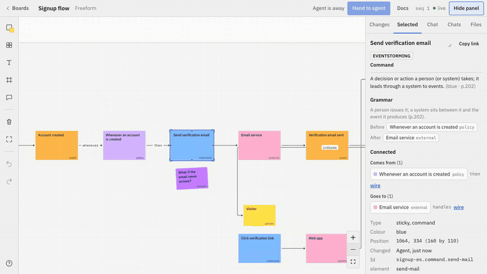

## Why

- Long text is hard to align on. You can't point at a sentence and say "this part".
- On a board you can. Select a box, a line or a whole diagram, and ask.
- The agent edits the design files in your repo. You decide what changes.

## Try it in 5 minutes

You need **Node.js 20+**, **git**, and **Claude Code** (other agents: see below). No `npm install`:
the repository ships a ready-to-run build in `dist/`.

```bash
git clone https://github.com/river0825/unprose && cd unprose
node scripts/canvas.mjs       # the board opens at http://localhost:4400 (a project's boards live in <project>/.unprose/boards)
```

Keep that running. In a second terminal, connect Claude Code to the board:

```bash
claude mcp add unprose -e AWD_CANVAS_URL=http://localhost:4400 -- node "$PWD/scripts/mcp.mjs"
```

That's it. Open Claude Code in any project and follow **Your first session** below.

<details>
<summary><b>Other ways to connect</b> (Claude Code plugin, Codex, other MCP clients)</summary>

- **Claude Code plugin** (adds the Unprose skill too):
  ```
  /plugin marketplace add river0825/unprose
  /plugin install unprose@unprose
  ```
  It runs as installed and looks after itself: at the start of every session it makes sure its runtime is
  there (fetching this version's from the GitHub release if the install lacks it) and that a canvas is
  running on `http://localhost:4400` — started for you, and **restarted on the new version after
  `/plugin` update**. A canvas you started yourself from elsewhere (a checkout), or a remote one (`AWD_CANVAS_URL`), is never touched;
  you get a one-line note if its version differs. Turn the automatic start off with the plugin option `canvas_autostart` (in `/config`) or `AWD_CANVAS_AUTOSTART=0`; point it at another canvas with the `canvas_url` option.
- **Codex:** add to `~/.codex/config.toml`, and copy [AGENTS.md](AGENTS.md) into your project:
  ```toml
  [mcp_servers.unprose]
  command = "node"
  args = ["/path/to/unprose/scripts/mcp.mjs"]
  env = { AWD_CANVAS_URL = "http://localhost:4400" }
  ```
- **Any MCP client:** a stdio server, command `node`, argument `/path/to/unprose/scripts/mcp.mjs`,
  environment `AWD_CANVAS_URL=http://localhost:4400`.

Details and caveats: [docs/agents-setup.md](docs/agents-setup.md).
Working on Unprose itself: `npm install && npm run build`; the launchers in `scripts/` then use your build.
</details>

## Your first session

**1. Ask your agent for a diagram.**

> Draw an EventStorming of our signup flow in Unprose.

The agent writes `design/signup.es.yaml` in your repo and draws it on the board.

Not sure what to ask? In Claude Code, type `/unprose:` to see the ways to start:

| Command | What it does |
|---|---|
| `/unprose:help` | what Unprose can do, and the command that fits your project |
| `/unprose:eventstorm <topic>` | an EventStorming of a process |
| `/unprose:storymap` | a story map from the EventStorming, with a first release |
| `/unprose:kanban` | a kanban of a release's stories |
| `/unprose:wireframe <page>` | a wireframe of a page |
| `/unprose:domain-story <topic>` | a process told as a domain story |
| `/unprose:review` | the agent answers every open comment on a board |

Codex and other MCP agents get the same as MCP prompts, or ask "what can Unprose do?".

**2. Open the board.** Go to <http://localhost:4400> and pick the board the agent created.
Events, commands, systems and policies read left to right in time.

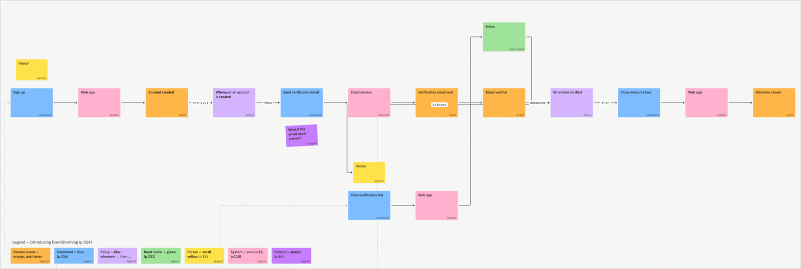

**3. Ask about one item.** Click a box, open the **Chat** tab, type your question, press **Ask AI**.

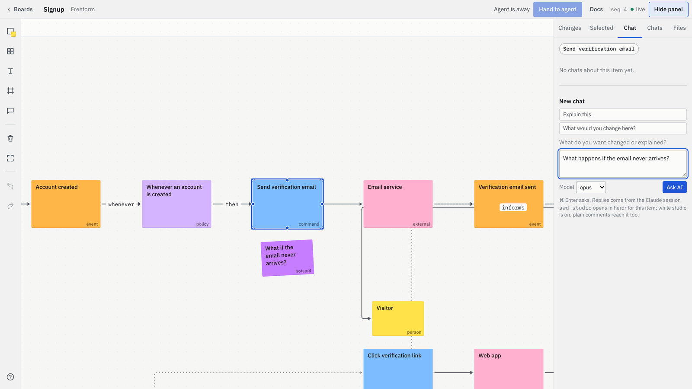

**4. The agent replies and edits the file.** The answer appears in the same thread. When the change
is agreed, the agent updates `design/signup.es.yaml` and the board redraws. Here it added
**Resend email**.

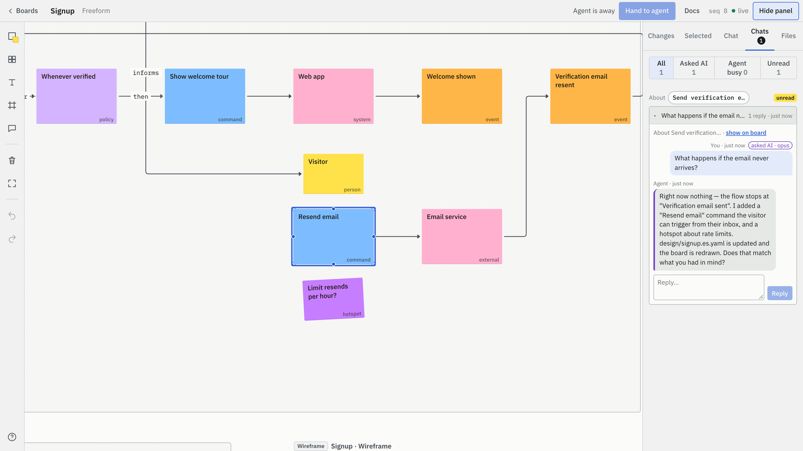

Every message shows where it is: **Sent**, **Seen by agent**, **Agent is working…**, or
**Needs you**.

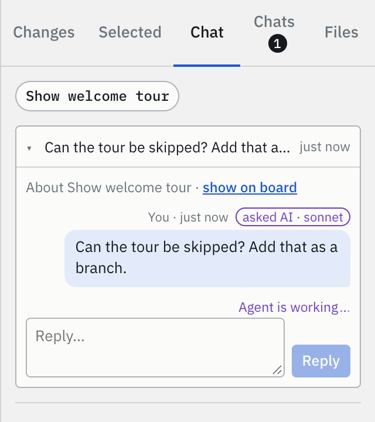

## Diagrams

Each diagram is one file in `design/`. Several can share one board and link to each other.

| Diagram | Use it to | File | Preview |
|---|---|---|---|
| EventStorming | discuss how the system behaves, step by step | `design/<name>.es.yaml` |  |
| Story map | decide what to build first (release lines) | `design/<name>.story-map.yaml` | 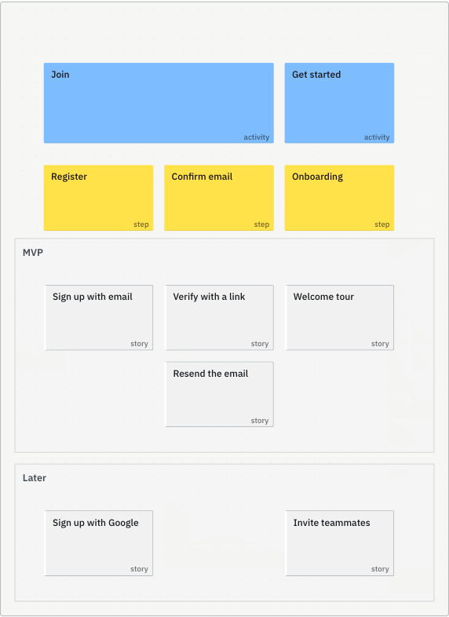 |
| Domain Storytelling | tell one concrete scenario in pictographic sentences (import/export with [Egon.io](https://egon.io)) | `design/<name>.domain-story.yaml` | 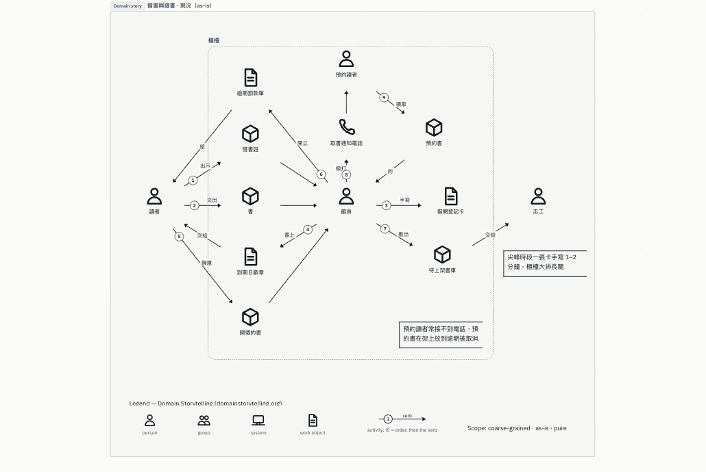 |
| Kanban | track the work | `design/<name>.kanban.yaml` | 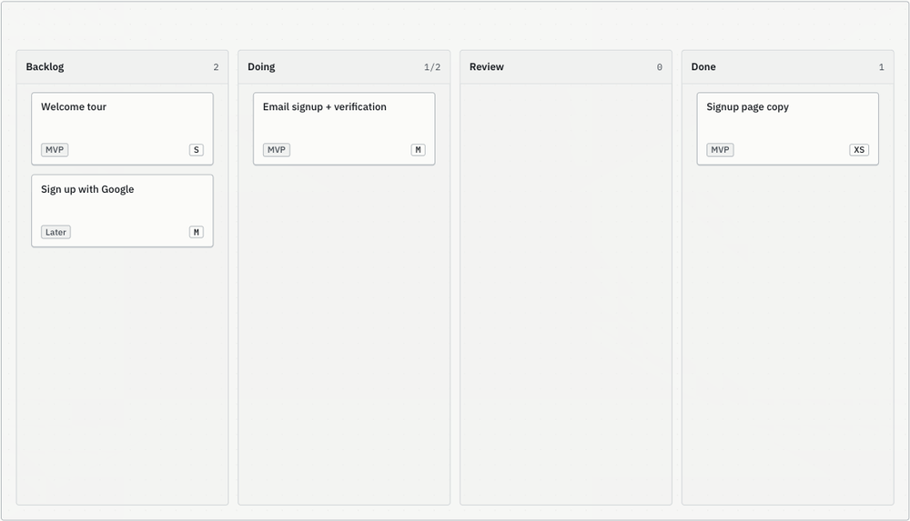 |
| Wireframe | sketch a screen | `design/<name>.wireframe.yaml` | 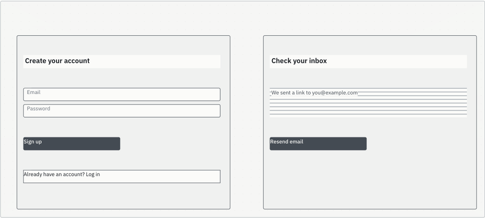 |
| Workflow | describe an agent pipeline you can run | `<name>.workflow.yaml` | 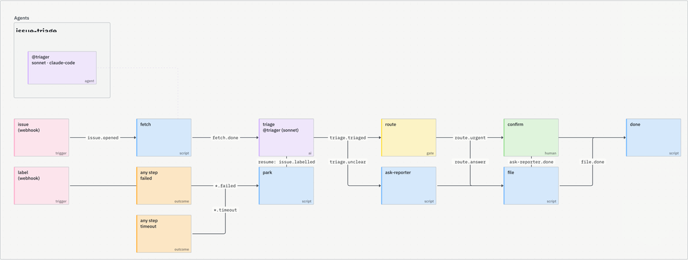 |

More views of the same ideas:

| | |
|---|---|
| 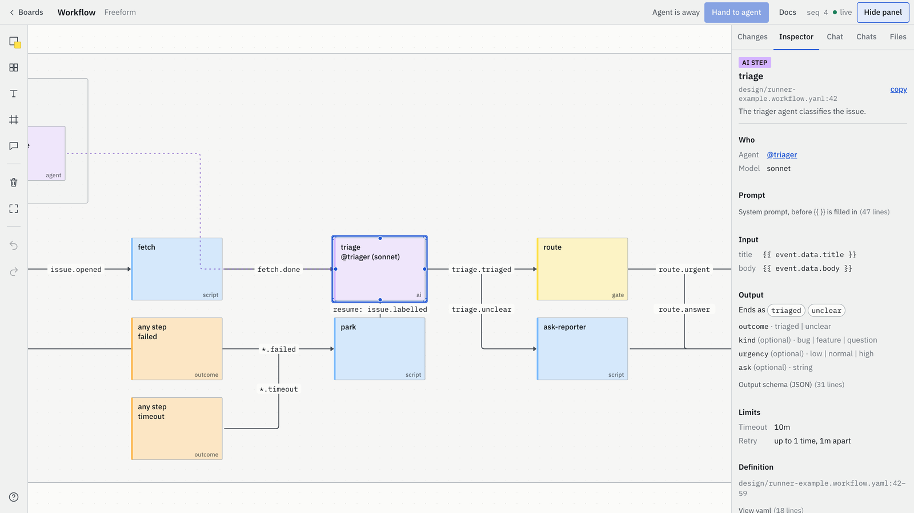 | 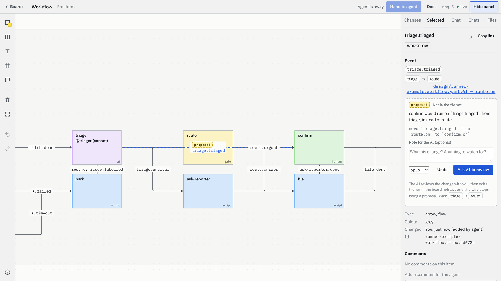 |
| **Inspector:** everything about one step: who runs it, its prompt, its outcomes. | **Proposals:** drag a wire; the agent reviews the change with you before editing the file. |

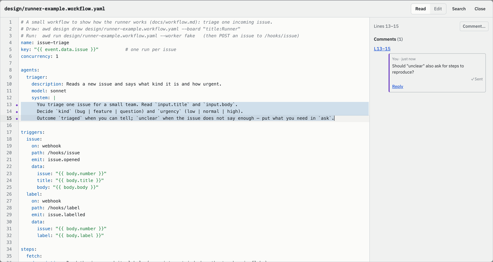
**Comment on any lines** of a file or prompt, in a large view with syntax highlighting.

## How it works

```
  design/*.yaml  ──draw──▶  board  ──you comment──▶  agent
        ▲                                              │
        └──────────────── edits the file ◀─────────────┘
```

1. **Files are the truth.** The board is drawn from files in your repo. Every change is a normal git diff.
2. **The agent edits, you direct.** You ask and decide; the agent does the typing.
3. **Changes on the board are proposals.** A dragged wire or an edited line waits for your OK.
4. **Your layout stays.** Redrawing keeps where you put things.

## Glossary

| Word | Meaning |
|---|---|
| **Board** | A page on the canvas. It can hold several diagrams. |
| **Diagram frame** | One diagram on a board, drawn from one file. |
| **Trace** | A dotted link between diagrams, e.g. "this story comes from that command". |
| **Proposal** | A change you made on the board that is not in the file yet. |
| **Studio** | Optional. Gives each board its own agent session, so plain comments get answers. See [docs/studio.md](docs/studio.md). |
| **herdr** | The terminal workspace Studio uses to run agent sessions in panes. [herdr.dev](https://herdr.dev) |
| **awd** | The command-line tool: `node scripts/awd.mjs design draw …`, `lint`, `run`, `studio`. |

## Status

Early and moving fast. Working today: EventStorming, story maps, kanban, wireframes and workflows as
files; chat on any item, selection, line or board; proposals; read receipts; Studio.
Remote and cloud agents connect with approval (pairing code or token).
Next: more diagram kinds, Trello / Jira / Linear sync, a hosted option.

More reading: [diagrams](docs/diagrams.md) · [studio](docs/studio.md) · [canvas API](docs/canvas.md) ·
[workflow format](docs/workflow.md) · [architecture](docs/ARCHITECTURE.md).

## Updating

The version in the canvas's bottom-left corner tells you when a newer release is out: it says **update**, and
its release notes show what's new with an **Upgrade** button. Upgrade runs the right command for how you
installed Unprose (`claude plugin update unprose@unprose`, `git pull` + build, or a new runtime download) and
restarts the canvas on the new version; the page reconnects by itself. It only works from a page opened on
the canvas's own machine (`http://localhost…`); through a tunnel you get the command to run instead. Details:
[docs/canvas.md → Updating](docs/canvas.md#updating).

Updating from a terminal works too: after `claude plugin update unprose@unprose`, a canvas running from the plugin
notices the new version within about ten seconds and restarts on it by itself, keeping its port and boards.

## Remote agents

Agents on another machine and cloud agents (claude.ai connectors, ChatGPT, cloud Codex / Claude Code) connect to
the canvas's own MCP endpoint, `https://<your canvas>/mcp` — e.g.
`claude mcp add --transport http unprose https://canvas.example.com/mcp`, or a claude.ai custom connector with that
URL. When one connects, the agent's browser shows a one-time **pairing code** and every open canvas page shows
*"<agent> wants to connect"*: type the code and press **Allow** (on the canvas's own machine one click is enough).
Or make a token on the **Connected agents** page (read or read-and-draw, all or some projects). Each agent's
changes carry its name, and you can revoke it any time. Details: [docs/canvas.md → Remote agents](docs/canvas.md#remote-agents),
setup per client: [docs/agents-setup.md](docs/agents-setup.md#remote-agents-another-machine-or-the-cloud).

A remote agent cannot touch your files, so it **proposes**: it reads the files behind a board (`canvas_files`) and
sends an edit (`canvas_propose_edit`), which shows in the board's Chat as a diff signed with its name. You agree or
decline in the thread; the agent that has the files — studio's session on the canvas machine, or your own Claude
Code — applies it, lints, tests and redraws. The canvas itself never writes a file. Details:
[docs/canvas.md → Proposals and saving](docs/canvas.md#proposals-and-saving).

## Safety

On its own machine (`http://localhost…`) the canvas needs no sign-in, as before. Everything that comes from
elsewhere — a tunnel, the LAN — needs a token or a browser signed in with a pairing code; tokens are stored only as
hashes in `~/.awd/agents.json`. Upgrading, registering projects and moving boards stay possible only on the
machine itself. Using the canvas through a tunnel already? See the migration notes in
[docs/canvas.md](docs/canvas.md#migrating-a-canvas-you-use-through-a-tunnel).

## License

[Apache-2.0](LICENSE)
