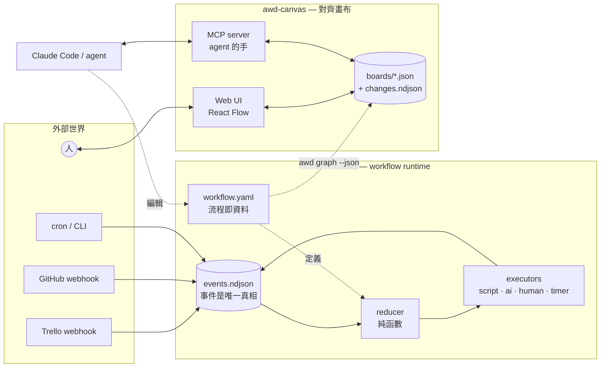
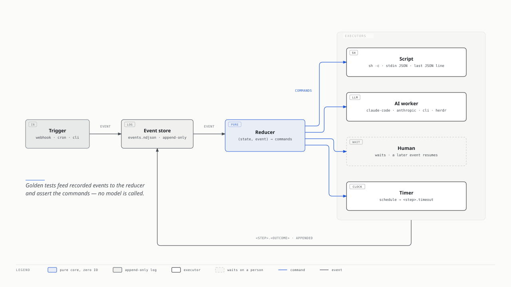
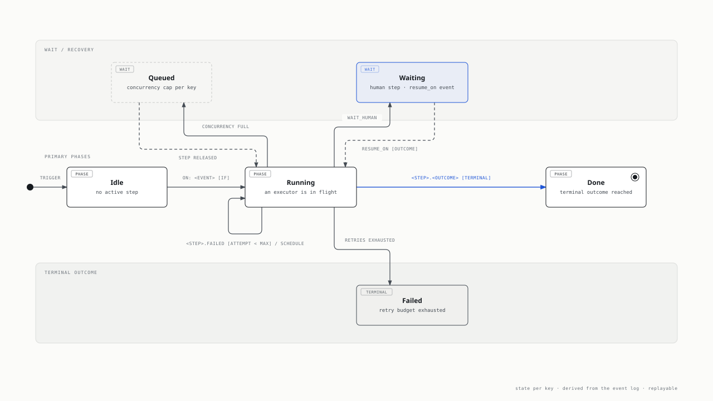
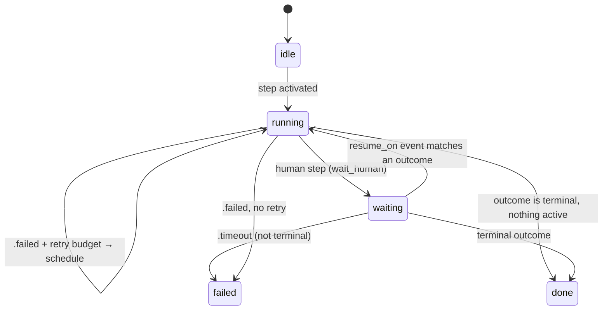
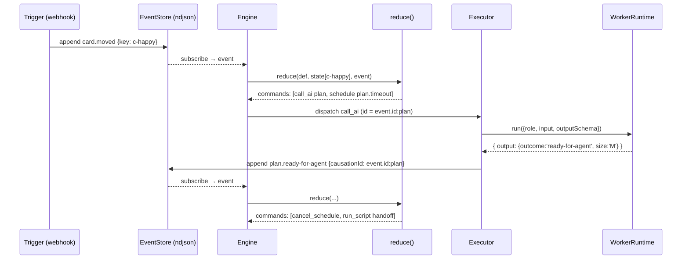
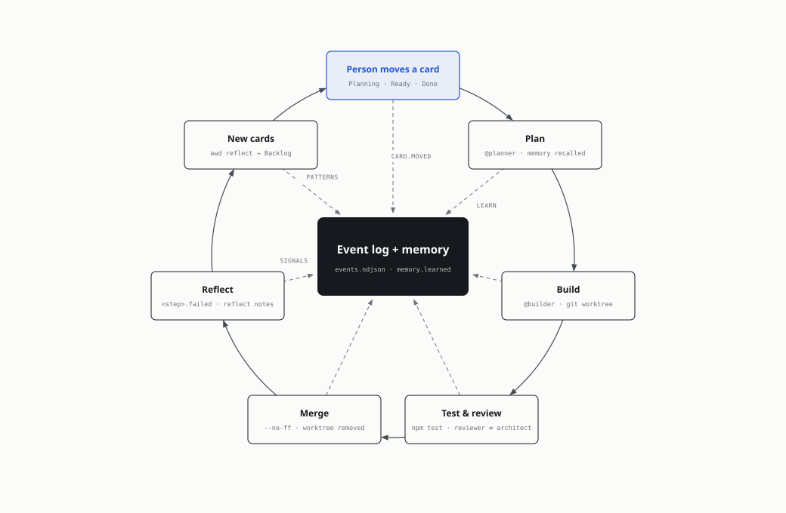
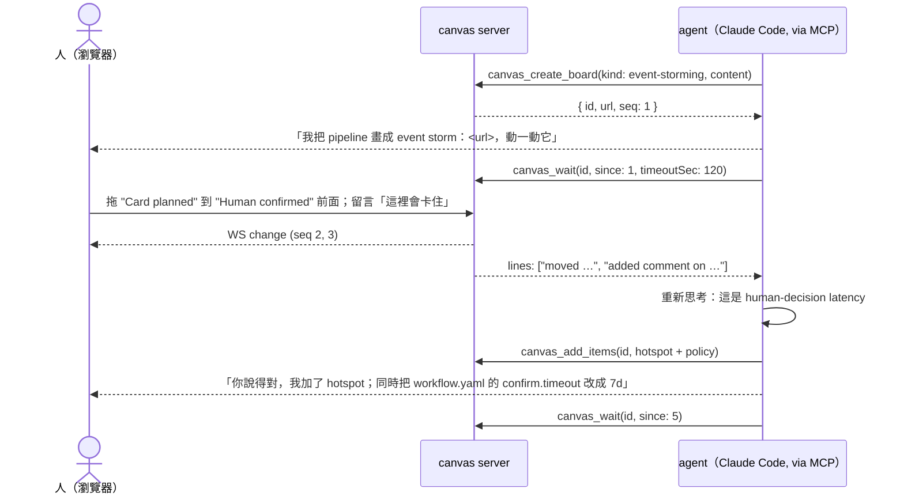
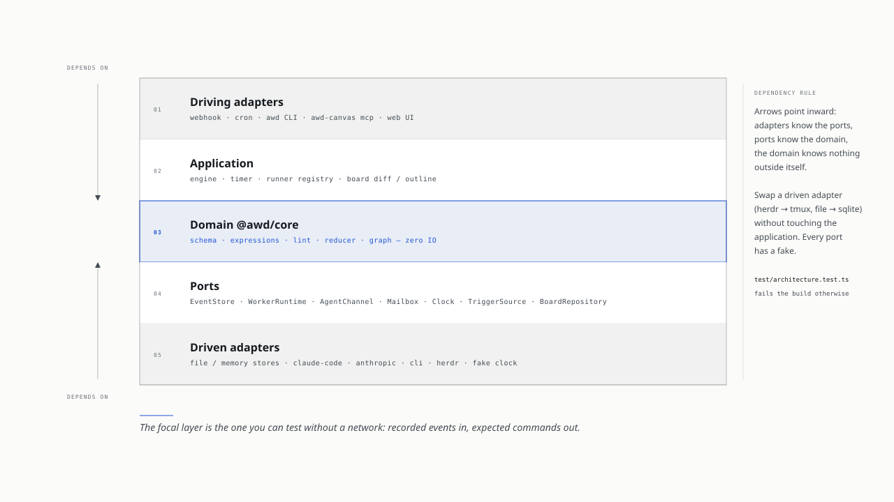
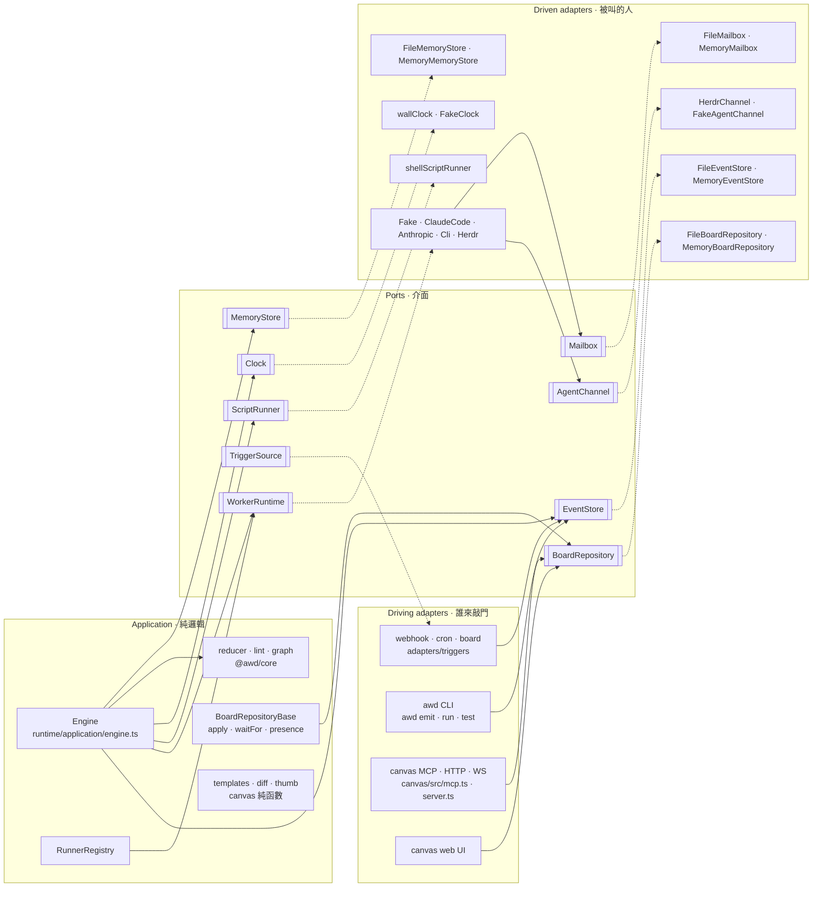

# 架構說明 — 從散文 skill 到「流程即資料」

這份文件是給人讀的學習手冊，不是 API reference（那在 [`workflow.md`](workflow) 與 [`canvas.md`](canvas)）。
它回答三個問題：**為什麼這樣切、每一層的責任是什麼、哪裡是刻意的取捨。**
每一節結尾有一段「原本以為 / 實際上」，那是設計時真正卡住的地方。

---

## 0 · 為什麼

起點是一條真的在跑的 Trello → GitHub 開發流程，寫成一個 Claude Code skill（card-pipeline coordinator）：
一個 37 KB 的 `SKILL.md`、一個 100 KB 的 `reference.md`、約 7,000 行 Python。
它一開始很好用，然後每出一次事就多一條規則。三篇事後檢討把病灶說得很清楚：

| 失敗形態（day-03） | 根本原因 | 這個 repo 的對應解法 |
| --- | --- | --- |
| 第二份副本 | 同一條規則寫在 dispatch、gate、QA、guardrail 五個地方 | 規則只存在一次：`workflow.yaml` 裡的一個 step / gate 表達式 |
| 死引用 | 檔案刪了，散文還叫 agent 去讀它 | `awd lint` 檢查每個 `on:` 指向的事件真的存在 |
| 文件對世界說錯話 | 散文寫死 exit code、版本、路徑 | script step 的 contract 是 JSON stdout，不是散文描述 |
| 只寫不擋 | 「不得移除 lifecycle label」寫在文件裡，CLI 照做 | gate 是 reducer 裡的表達式；不合法的轉移根本不會產生 command |
| 名稱碰撞 | `$T` 同時是 token 和 script path | 表達式只能看 `event / vars / key / env / now`，沒有 shell 變數 |
| 修 A 壞 B | 沒有 test oracle，只能靠下一輪 AI review | `tests/*.golden.yaml`：錄下事件，斷言 command，不呼叫模型 |

day-01 的結論是：「我把流程當成文字文件，而不是一個 domain。」
所以這裡的第一個決定是——**把流程當 domain 建模，再讓文件、圖、lint 都變成它的投影。**

> **原本以為**：把 SKILL.md 拆成小檔案就會好維護。
> **實際上**：拆檔案只是把副本搬到不同資料夾。要解決的是「同一個事實只有一個擁有者」，那是資料模型的問題，不是檔案結構的問題。

---

## 1 · 兩個產品，一個想法

[系統全景圖（深色、可匯出）](diagrams/system-architecture.html) 把所有元件放在一張圖上；下面每一節各自只畫自己那一塊。



| | `awd` | `awd-canvas` |
| --- | --- | --- |
| 解決什麼 | 流程怎麼**執行**，而且可驗證 | 流程（與其他想法）怎麼**被討論** |
| 真相來源 | `workflow.yaml` + `events.ndjson` | `boards/<id>.changes.ndjson` |
| 給 agent 的介面 | `ai` step 的 `input` / `output` schema | MCP tools（`canvas_*`） |
| 給人的介面 | webhook、`awd emit`、`human` step | 拖曳、註解、留言 |

兩邊共用同一個信念：**log 是真相，快照是投影，圖是投影，文件也是投影。** 投影壞了可以重算；真相壞了才是事故。

---

## 2 · Part 1 — workflow runtime



### 2.1 詞彙表：EventStorming 文法縮到最小

PLAN.md 想用 EventStorming 的文法（Actor → Command → Aggregate → Event → Policy → Command）長出 `pipeline.yaml`。
這裡把它縮成五個字，每個字都直接對應到程式碼裡的一個型別：

| 字 | EventStorming 裡叫什麼 | 程式裡是什麼 | 在哪 |
| --- | --- | --- | --- |
| **Event** | 橘色便利貼 | `Event { id, type, key, data, ts, causationId?, meta? }` | `packages/core/src/events.ts` |
| **Trigger** | Actor / External system | `TriggerDef`：把外部 payload 正規化成 event | `packages/core/src/schema.ts` |
| **Step** | Command + Policy 合體 | `StepDef`，四種：`script` `ai` `gate` `human` | 同上 |
| **Outcome** | 「然後發生了什麼」 | step 結束時發出的 `<step>.<outcome>` event | 命名慣例 |
| **Key** | Aggregate id | `key: "{{ event.data.card }}"`；一張卡一條 stream | `WorkflowDefinition.key` |
| **Command** | 系統要去做的事 | `run_script` `call_ai` `wait_human` `emit` `schedule` `cancel_schedule` | `events.ts` |

Policy（"whenever X then Y"）沒有獨立的節點——它就是 step 上的 `on:` + `if:`。
Aggregate 也沒有獨立的節點——它是 `key`，一個 template。
這是刻意的：day-01 說「一句『完成後移到 Review』隱藏了很多沒寫出來的問題」；
把 policy 和 aggregate 藏進 `on:` 與 `key:`，每個 step 都被迫回答「你聽哪個事件、在哪個 aggregate 上」。

> **原本以為**：要忠實還原 EventStorming 的七種便利貼才算 DDD。
> **實際上**：便利貼是給工作坊用的；程式需要的是「哪些字會出現在型別裡」。五個字夠用，多的每一個都會變成第二份副本。

### 2.2 `workflow.yaml` 逐段解說

拿 `examples/card-pipeline/workflow.yaml` 當範例（19 個 step、4 個 agent，對應原本 37 KB 的散文）。

**檔頭：aggregate 與併發**

```yaml
name: card-pipeline
key: "{{ default(event.data.card, 'system') }}"   # 一張卡一條 run；cron tick 共用 'system'
concurrency: 1                                     # 同一張卡同時只有一個 worker
```

`concurrency: 1` 就是散文裡「一張卡同時只能有一個 worker」那條規則——但它不是一句話，是 reducer 裡一個計數器（`slotsInUse`），超過的 activation 排進 `state.pending`，step 結束時 FIFO 釋放。

**Trigger：外部 payload 進來的地方**

```yaml
triggers:
  trello:
    on: webhook
    path: /hooks/trello
    emit: card.moved
    if: "body.action.type == 'updateCard' && body.action.data.listAfter"
    data:
      card: "{{ body.action.data.card.shortLink }}"
      to:   "{{ body.action.data.listAfter.name }}"
  reconcile:
    on: cron
    every: 30m
    emit: tick
```

Trigger 是唯一看得到 `body / query / headers` 的地方。過了這道門，整個系統只認得 `event.data`。
這就是 Clean Architecture 說的「介面層 adapter」：Trello 的 JSON 長什麼樣，只有這 8 行知道。

`reconcile` 是 level-triggered 的安全網（PLAN.md Day 23：「為什麼 reconcile 還要留著」）。webhook 會漏，cron 不會。

**四種 step**

```yaml
  qualify:                                   # script：決定性的判斷交給程式
    on: confirm.approved
    run: python3 scripts/qualify.py --card {{ key }}
    outcomes: [pick, skip]
    terminal: [skip]

  plan:                                      # ai：只有需要判斷的地方才叫模型
    on: card.moved
    if: "event.data.to == 'Agent Planning'"
    ai:
      agent: planner                         # agents.planner（prompt 在 roles/planner.md）；舊寫法 role: 仍可用
      model: opus
      input: { card: "{{ key }}", name: "{{ event.data.name }}" }
      output:                                # JSON schema；outcome 必填
        type: object
        required: [outcome, summary, size]
        properties:
          outcome: { enum: [ready-for-agent, needs-human] }
          size: { enum: [XS, S, M, L, XL] }

  size-gate:                                 # gate：純決策，在 reducer 裡評估，零 IO
    on: qualify.pick
    gate:
      outcomes:
        guarded: "vars.qualify.riskClass == 'hard-to-reverse' && vars.qualify.size in ['XS','S','M','L']"
        build:   "vars.qualify.size in ['XS','S','M','L']"
      default: split

  confirm:                                   # human：暫停，等同一個 key 上的下一個事件
    on: handoff.done
    timeout: 7d
    human:
      resume_on: card.moved
      outcomes:
        approved: "event.data.to == 'Ready'"
        shelved:  "event.data.to == 'Backlog'"
```

四種 step 的分工，正好是 PLAN.md Day 14 要畫的那條線——「決定性骨架與 LLM 判斷的分界線」：

| Kind | 誰決定 | 有 IO 嗎 | 可以不叫模型測嗎 |
| --- | --- | --- | --- |
| `gate` | reducer（表達式） | 無 | 可以，reducer 直接跑 |
| `script` | 你的程式 | 有（subprocess） | 可以，script 本來就是決定性的 |
| `human` | 人 | 無（等事件） | 可以，用 `awd emit` 假裝人 |
| `ai` | 模型 | 有（WorkerRuntime） | 可以，`--worker fake` 回傳 fixture |

**Outcome 的命名就是圖的邊**

`qualify` 有 `[pick, skip]` 兩個 outcome → 圖上兩條邊；`size-gate` 有 `guarded / build / split` → 三條邊。
`awd graph` 不需要另外的 layout 資訊，因為**事件命名本身就是圖**。

> **原本以為**：要像 n8n 一樣有 nodes 和 edges 兩個陣列。
> **實際上**：edges 是冗餘的。`on: qualify.pick` 已經說了「從 qualify 的 pick 邊連過來」。少一個陣列，就少一種「圖和 yaml 不一致」的 bug。

### 2.3 Reducer 為什麼是純函數



```ts
// packages/core/src/reducer.ts
reduce(def, state, event) → { state, commands }
```

它不看時鐘（時間來自 `event.ts`）、不產生亂數（command id 由 `commandId(event.id, step)` 推導）、不做 IO。
每次呼叫都先 `JSON.parse(JSON.stringify(prev))`，所以呼叫者可以保留舊 state 做比對。



一次 `reduce` 做四件事（原始碼裡的 1–4 註解）：

1. 這個事件是不是我某個 step 的 outcome？是 → 記到 `history`、存 `vars[step] = event.data`、釋放 slot。
2. 有沒有 `human` step 在等這個事件型別？有 → 依序評估 `outcomes` 的條件，第一個符合的變成 `emit <step>.<outcome>`。
3. 哪些 step 的 `on:` 聽這個事件（且 `if:` 為真）？→ `activate`：`gate` 直接 emit；其他產生 `run_script / call_ai / wait_human` command，並依 `timeout` 追加 `schedule`。
4. slot 有空了？→ 從 `pending` 釋放。

為什麼堅持純函數？因為 PLAN.md Day 15/24 要的東西——golden test、replay test——只有純函數做得到。
「錄下的事件餵 reducer，斷言 commands」這句話，要求 reducer 在任何機器、任何時間、任何模型都給同一個答案。

> **原本以為**：純函數是學術潔癖，實際專案會為了方便在 reducer 裡讀個檔。
> **實際上**：只要 reducer 讀過一次檔，`tests/10-reducer-only.golden.yaml` 就寫不出來。純不純是二元的，沒有「大致上純」。

### 2.4 Command / Event 循環



三個細節決定了「process 隨時可以死掉」：

- **`causationId`**：每個 executor 產生的事件都帶著它回應的 command id。Engine 啟動時 replay 整個 log，重算每個事件產生的 commands，**已經有回應的 command 不再執行**（`engine.ts` 的 `answered` set）。
- **Timer 也是事件**：`timeout: 7d` 不是 `setTimeout`，是一個 `timer.set` 事件寫進 log；重啟後 `Timer.load()` 從 log 重建 pending timers。
- **Store 是 append-only NDJSON**：`fs.appendFileSync` 對小行是 atomic 的；多個程序（engine、`awd emit`、webhook）可以同時寫。

這正是原本 coordinator 用 `/loop` 每 30 分鐘「從 Trello + git + PR 重建狀態」想達到的效果——但這裡的狀態不是從三個外部系統猜回來的，是從自己的 log 重算的。

### 2.5 Executors：command 的另一端

| Command | Executor | Contract |
| --- | --- | --- |
| `run_script` | `runtime/src/adapters/process/script.ts`（`ScriptRunner` port） | `sh -c cmd`；env `AWD_EVENT / AWD_KEY / AWD_STEP / AWD_ATTEMPT`；stdin 是 `{event, vars, key, step, attempt}`；**stdout 最後一行能 parse 成 JSON 的就是 `{outcome, data}`**（旁邊可帶 `reflect: [...]`，見 §2.9）；沒有 JSON → `done`；exit ≠ 0 → `<step>.failed` 帶 stderr 尾巴 |
| `call_ai` | `runtime/src/application/executors/ai.ts` | 先 `recall` 記憶進 system prompt，再交給 `WorkerRuntime`；輸出用 ajv 對 `output` schema 驗證（`remember` / `learn` / `reflect` 永遠允許）；`output.outcome` 決定事件型別，`learn` / `reflect` 各自變成事件 |
| `wait_human` | 沒有 executor | reducer 自己在下一個事件比對；`awd emit` 是「人」的 CLI |
| `schedule` / `cancel_schedule` | `runtime/src/timer.ts` | 寫 `timer.set` / `timer.cancel` 事件；每秒檢查一次到期 |

Script contract 值得多看一眼：它就是 day-03「第三種：文件對世界說錯話」的解法。
散文寫「archive command 失敗時仍會回傳成功」，程式的實際行為不同，沒人發現。
這裡 script 的行為**只能**用 stdout JSON 和 exit code 表達，散文沒有地方可以說錯。

### 2.6 WorkerRuntime port 與五個 adapter

```ts
// packages/runtime/src/workers/types.ts
interface WorkerRuntime {
  readonly name: string
  run(req: { role?, model?, system?, input, outputSchema, timeout?, key, step }): Promise<{ output, usage?, raw? }>
}
```

PLAN.md Day 18 的原則：「只在有第二個實作時開 port」。這個 port 有五個實作（`runtime/src/adapters/workers/`），engine 用 `RunnerRegistry` 依 agent 的 `runner:` 路由：

| Adapter | 檔案 | 什麼時候用 | 怎麼拿到結構化輸出 |
| --- | --- | --- | --- |
| `fake` | `workers/fake.ts` | 測試、`--dry-run`、launchd 上的 demo | 讀 `fixtures/ai/<role>/<key>.json` 或 `<role>.json`；陣列 → round-robin |
| `claude-code` | `workers/claudeCode.ts` | 這台機器的預設；用既有登入，不需要 API key | `claude -p --output-format json --json-schema <schema>`；讀 envelope 的 `structured_output`，退而求其次 parse `result` |
| `anthropic` | `workers/anthropic.ts` | 部署到沒有 Claude Code 的地方 | `@anthropic-ai/sdk` 的 `output_config.format = json_schema`，`thinking: adaptive`，streaming + `finalMessage()` |
| `cli` | `workers/cli.ts` | 任何有 headless 模式的 CLI agent（preset `codex` / `opencode`，或自訂 command） | prompt 走 stdin，stdout 最後一個 JSON（或 JSONL 事件流裡的最後一段文字）是答案 |
| `herdr` | `workers/herdr.ts` | 不支援 A2A 的互動式 agent：住在 herdr pane 裡 | 信箱檔 `<store>/mail/<cmd>.{in,out}.json`；一行 prompt；答案檔是合約（[agents.md §6](agents.md)） |

五個 adapter 對 reducer 完全透明——reducer 產生的 `call_ai` command 長得一模一樣，只多一個 `runner` 欄位讓 registry 選人。`claude-code` 另外吃 agent 的 `claudeCode: { permissionMode, cwd, addDirs }`，dogfooding 的 builder 就是靠 `cwd: "{{ vars.worktree.path }}"` 在自己的 worktree 裡跑。這就是「模型可換」在程式碼裡的樣子：不是 config 裡一個字串，是一個 interface 和五個 class。

Model alias（`opus` / `sonnet`）在 yaml 裡是抽象的；`claude-code` 直接把 alias 傳給 CLI，`anthropic` 用 `MODEL_ALIASES` 表查成 `claude-opus-5`。原本 SKILL.md 的「Model tiers」那一節（為什麼要 alias 而不是 dated id）變成了 12 行的 lookup table。

> **原本以為**：先做 Anthropic API adapter 才是「正規」的。
> **實際上**：`fake` 才是最重要的 adapter——沒有它，整條 pipeline 無法在不花錢、不等待的情況下跑完。`claude-code` 第二重要，因為它用的是你已經有的登入。API adapter 排第三。

### 2.7 Golden test：讓「可執行的預期行為」取代 review 當 oracle

day-03 的核心句子：「沒有可執行的預期行為，review 就無法證明重構前後的行為相同。」

`examples/card-pipeline/tests/` 有 10 個 `*.golden.yaml`，兩種模式：

```yaml
# 01-happy-path.golden.yaml — mode: run
# 只給外部事件（三次 card.moved），engine 跑假 script 與假模型，斷言 outcome 序列
mode: run
key: c-happy
events:
  - { type: card.moved, data: { card: c-happy, name: Upload contacts CSV, to: Agent Planning } }
  - { type: card.moved, data: { card: c-happy, from: Agent Planned, to: Ready } }
  - { type: card.moved, data: { card: c-happy, from: Human Review, to: Human Review Passed } }
expect:
  status: done
  outcomes: [plan.ready-for-agent, handoff.done, confirm.approved, qualify.pick,
             size-gate.build, build.done, review.clean, park.done, human-review.passed, merge.done]
  vars:
    qualify: { size: M, riskClass: reversible }
```

```yaml
# 10-reducer-only.golden.yaml — mode: replay
# 給「每一個」事件（含 step outcome），只跑 reducer，釘死每個事件產生的 commands
```

| 檔案 | 它保護的不變量（來自 day-02 的事故） |
| --- | --- |
| `02-xl-split` | XL 永遠不建，由人拆 |
| `03-build-retry` | build 失敗重試一次，第二次失敗才 `failed` |
| `04-human-shelves` | 人把卡移回 Backlog，run 結束，不留 waiting |
| `05-review-loop` / `06-review-escalates` | review→fix 迴圈有上限：3 輪後 `escalate`，不會無限燒 token |
| `07-risk-guard` / `08-risk-missing` | hard-to-reverse 的卡要先有 rollback plan（原 §3a） |
| `09-hands-off` | `ST:HumanOwned` / `ST:Blocked` 永遠 skip |

「每次事故真正該留下的，是一個可以被驗證的不變量」（day-02 結語）。以後每次事故的新習慣：**加一個 golden 檔，不是加一段散文。**

> **原本以為**：AI review 多幾輪就能保證重構安全。
> **實際上**：review 是在「判斷合不合理」；golden test 是在「證明沒變」。兩件事不同，前者不能取代後者。`awd test` 跑完不到一秒，十二輪 review 花了兩週。

### 2.8 記憶：先是事件，再是投影

agent 的答案可以多帶 `remember: {…}`（這個 run）與 `learn: [{ note, tags }]`（這個專案）。前者進 `RunState.memory.short`——是 state，所以 replay 會重現、golden 會檢查；後者由 ai executor 變成 **`memory.learned` 事件** append 進 log，`MemoryStore` port（`runtime/src/ports/memory.ts`；adapters `FileMemoryStore` = `<store-dir>/memory/<agent>.ndjson`、`MemoryMemoryStore`）只是它的投影，engine 啟動時用 `syncMemory` 從 log 重建。下一次同一個 agent 被叫到，`recall({ key, limit })` 把筆記放進 system prompt 最上面；outcome 事件的 `meta.recalled` 記下這次給了哪幾條。沒有 embedding：先看見 agent 會學到什麼，再決定值不值得一個向量庫。全文：[agents.md §7](agents.md)。

### 2.9 反省：signal → pattern → decision

同一招再用一次。**signal** 是事件：每個 `<step>.failed` / `<step>.timeout` 本來就在 log 裡，agent 答案與 script JSON 裡的 `reflect: [{ note, kind, tags }]` 變成 `reflection.noted`。**pattern** 是投影：`awd reflect` 每次從 log 重算（`runtime/src/application/reflection.ts`，純函數 `signalsOf` / `patternsOf`），失敗依 step + 原因類別分組。**decision** 是一張 kanban 卡：`--to-board` 對每個過門檻的 pattern 建一張、帶 Suggested guard，以 `data.pattern` 認自己所以冪等（`adapters/canvas/cards.ts` 是唯一會寫 canvas 的 driven adapter）。reducer 另外認得 `on: "*.failed"`：任何其他 step 失敗都觸發，範例的 `reflect-failure` step 就靠它自動開卡。全文：[reflection.md](reflection.md)。



### 2.10 `on: board`：Kanban 是 driving adapter

第三種 trigger。`adapters/triggers/canvasTrigger.ts` 實作 `TriggerSource`：對 canvas 的 `GET /api/boards/:id/wait` long-poll，再讀 `GET /cards?since`（沒有時退回 `/changes` + ops 的 `before`），每個換欄變一個事件（模板範圍 `{ card, from, to, author, seq, env, now }`）。游標不是另一種事件——每個發出的事件帶 `meta.boardSeq`，重啟取最大值繼續，所以不會重播。預設只算 `author: user` 的拖動：流程自己用 `scripts/board_move.sh`（`POST /cards/:id/move`，author `agent`）推卡片時不會再回頭變成事件。這就是「Trello 換成 Kanban，yaml 一行不用改」在程式碼裡的樣子：一個 adapter，engine 不知道事件從哪來。

### 2.11 對照表：散文裡的規則去了哪裡

| `SKILL.md` 原文（節錄） | 現在在哪 | 形式 |
| --- | --- | --- |
| "Never move an Agent-Planned card to Ready — that's the human's gate" | `confirm` step | `human` step：只有 `card.moved` 到 Ready 才 `approved` |
| "`qualify.py` runs the RFA + CardSize + hands-off gate and emits the verb" | `qualify` step | `script`，outcomes `[pick, skip]` |
| "Size decides ROUTING… XL → split · unsized → bounce" | `size-gate` | `gate` 表達式 + `default: split` |
| "a shrug takes the guarded path, never the cheap one" | `size-gate.guarded` → `guard-check` | gate 條件 `riskClass == 'hard-to-reverse'` 排在 `build` 之前 |
| "One card, one worker at a time — `claim` before dispatching" | `concurrency: 1` | reducer 的 slot 計數，不再需要 claim/release 腳本 |
| "Feedback wins… or it re-fires forever" | `review` → `fix` → `rounds-gate` | 有上限的迴圈，`vars.fix.rounds < 3` |
| "Merge only on the human's move" | `human-review.passed` → `merge` | `merge` 只聽這一個事件 |
| "The loop is the wait — fire-and-exit" | `timeout: 7d` / `timer.set` | 等待是 log 裡的 timer 事件，不是 sleep 也不是 `/loop` |
| "`/loop` is the ONLY scheduler" | `reconcile` trigger `every: 30m` | cron 是 trigger，不是 agent 的自我約束 |
| "Every tick records its own cost" | `WorkerResult.usage` → `event.meta` | 每個 `call_ai` 的 usage 跟著 outcome 事件進 log |
| 「散文 §13b token discipline 整段」 | `roles/*.md` | system prompt 只講角色，不講流程 |

還沒搬過去、誠實列出：WIP cap 的時間感知（工作時段 3、夜間 1）、daily reflection card、`log_ticks.py` 的 coordinator 自身成本。它們是 §6 未完成清單的一部分。

---

## 3 · Part 2 — canvas


### 3.1 Board model：跟 workflow 同一種形狀

```ts
// packages/canvas/src/model.ts（無相依，是 server / MCP / templates / web 四方共用的 contract）
Board  { id, title, kind, seq, items: Record<id, Item>, meta? }
Item   { id, type, x, y, w, h, text?, color?, role?, parent?, from?, to?, target?, data?, createdBy, updatedBy }
Op     add {item} | update {id, patch} | remove {id}
Change { seq, ts, author: 'agent' | 'user', ops, before, note? }
```

刻意的選擇：

- **`color` 是語意 token**（`orange` / `lilac` / `pale-yellow`…），不是 hex。UI 在 light/dark 各自對應；agent 不用知道十六進位。
- **`role` 是 domain 角色**（`event` / `command` / `policy` / `story` / `button`…）。`type` 說「它是一張便利貼」，`role` 說「它在 EventStorming 裡是什麼」。diff 摘要靠 `role` 才能說出「added **policy** "…"」而不是「added sticky」。
- **座標永遠是絕對座標**，`parent` 只表示容器關係。React Flow 需要相對座標，那是 `web/src/flow/boardToFlow.ts` 的事，不進資料模型。

### 3.2 Change log 為什麼也是 event store

`packages/canvas/src/store.ts` 的第一行註解：「Mirrors the workflow runtime's event store: the log is the truth, the snapshot is a rebuildable projection.」

- `boards/<id>.json` 是快照，寫入時先寫 `.tmp` 再 rename。
- `boards/<id>.changes.ndjson` 是 append-only log；快照不見了就從 log `rebuild()`。
- 每個 `Change` 帶 `before`（被動到的 item 改動前的樣子），所以 diff 不需要回頭讀整個 log。
- `seq` 單調遞增；agent 記住上次看到的 `seq`，之後只問「從 seq N 之後誰動了什麼」。

這讓「agent 看得到改動」不是輪詢整張板子比對，而是 `GET /api/boards/:id/changes?since=N&author=user`。

### 3.3 Templates 為什麼是純函數

```ts
// packages/canvas/src/templates/index.ts
render(kind, content, { at?, scope?, now? }) → Item[]
```

Agent 永遠不算像素。它給的是結構：

```json
{ "level": "process",
  "events":   [{ "text": "Card moved to Ready", "lane": "Planning", "pivotal": true }],
  "commands": [{ "text": "Qualify card", "event": "Card qualified", "actor": "coordinator" }],
  "policies": [{ "text": "whenever qualified then build", "when": "Card qualified", "then": "Build card" }],
  "hotspots": [{ "text": "誰驗證 open questions 已回答？", "near": "Card moved to Ready" }] }
```

Template 負責時間軸從左到右、橘色事件在主軸、藍色 command 在上、紫色 policy 在下、紅色 hotspot 斜貼在旁邊。
Item id 由 `<scope>.<role>.<slug>-<hash>` 決定——**同樣的內容再 render 一次得到同樣的 id**，所以 agent 重畫是 `update` 而不是複製一份。這和 reducer 的 `commandId` 是同一個想法：id 從內容推導，replay 才穩定。

七種 kind：`event-storming`（big-picture / process / software 三個 level）、`user-story-map`、`user-journey`（情緒曲線）、`wireframe`（12 欄格線）、`workflow`（吃 `awd graph --json` 的輸出，含 Agents frame）、`kanban`（§3.6）、`freeform`。

`workflow` 這個 kind 是兩個產品的接縫：`awd graph --json` 的 `{nodes, edges}` 直接變成一張板子。以後改 yaml → 重畫；在板子上留言 → agent 改 yaml。

### 3.4 diff / outline：給 agent 讀的兩種投影

`packages/canvas/src/diff.ts`：

- `outline(board)` — 整張板子的文字版，按 lane / frame 分組，附箭頭與留言。60 幾個 item 約 3 KB，放得進 context。
- `summarize(board, changes)` — 把 ops 翻成人話：
  - `moved "Card qualified" from lane Planning → Build`（`parent` 變了，或用幾何判斷跨了 lane）
  - `moved "Build claimed" by (+320, 0), now before "PR opened"`
  - `added comment on event "Build claimed": "這裡會卡住"`
  - `renamed "Plan card" → "Plan + review spec"`

為什麼不直接丟 JSON 給模型？因為 `{ "kind": "update", "id": "es.event.card-qualified-3f1a", "patch": { "x": 1240 } }` 對模型來說是雜訊；「移到 Build lane」才是訊號。這是 PLAN.md 說的 context assembly——組給模型的上下文，是一種投影，要設計。

### 3.5 MCP 工具與對齊迴圈

`packages/canvas/src/mcp.ts` 用 `@modelcontextprotocol/sdk` 開 stdio server，八個工具全部打在跑著的 HTTP server 上（`AWD_CANVAS_URL`），所以 UI 和 agent 共用同一個 store。repo 根目錄的 `.mcp.json` 讓 Claude Code 在這個 repo 裡自動拿到它們。



| 工具 | 做什麼 | 對應 HTTP |
| --- | --- | --- |
| `canvas_create_board` | 用 template 畫一張新板 | `POST /api/boards` |
| `canvas_add_items` | 在既有板上 render + apply | `POST /template` + `POST /ops` |
| `canvas_read_board` | `outline` 或 JSON | `GET /outline` / `GET /api/boards/:id` |
| `canvas_diff` | 從 seq N 之後的人話摘要 | `GET /diff?since=N` |
| `canvas_wait` | long-poll 到有人動為止 | `GET /wait?since=N&timeout=` |
| `canvas_apply` | 精準的 raw ops（改名、回覆留言） | `POST /ops` |
| `canvas_list_boards` / `canvas_open` | 列表 / 印 URL 並開瀏覽器 | `GET /api/boards` |

「對齊」在這裡的意思很具體：**兩邊看到的是同一個 seq**。人看到的是畫面，agent 看到的是 diff lines，但底下是同一個 change log。

### 3.6 Kanban：第七種 board，也是事件來源

`kanban` kind 只是 template 多一種形狀（直欄 `lane`、`card` 子項）；讓它能取代 Trello 的是兩個很小的約定：卡片的欄位 = `parent`（沒設就用幾何判斷），換欄就是一筆普通的 change。`diff.ts` 的 `cardMoves(board, changes)` 把它讀成 `{ cardId, title, from, to, seq, author }`，server 開 `GET /cards?since=N` 給 poller，`POST /cards` / `POST /cards/:id/move` 給流程寫回。runtime 那一側是 §2.10 的 trigger。web UI 顯示每欄 `已用/WIP`（超過標 `over`，用字不用色），卡片拖進另一欄時 re-parent 並排進堆疊。

### 3.7 執行過程的 overlay：投影，不是資料

workflow board 上看到的 running / waiting / done / failed 徽章與 Runs / Events 抽屜（`web/src/run/RunOverlay.tsx`）**不寫任何東西進 board**：它訂閱 runtime 的 `GET /api/stream`（SSE：`snapshot`，然後每個事件一個 `event` + `state` frame；連不上就每 2 秒輪詢 `/api/status`），把 run 狀態疊在對應的 step 卡（`data.nodeId`）與 agent 卡（`data.agent`）上。board 只記 `meta.workflow.statusUrl`（`awd graph --canvas` 寫的）。同一個原則第三次出現：真相在 event log，畫面是投影——所以 board 可以被人隨便搬、留言，overlay 永遠對。

### 3.8 Agents frame：誰在做什麼，一眼看完

`toGraph()` 現在也輸出 `agents`；workflow template 在圖上方畫一個 Agents frame（每個 agent 一張紫色 `card`，`owns` 虛線指到它的 step，`delegates` 虛線指到它能委派的 agent）。id 是 `wf.agent.<id>`，重跑原地更新。overlay 用 `data.agent` 在卡上標 working / idle 與正在做的 key。

> **原本以為**：要做即時協作就得上 CRDT / Yjs。
> **實際上**：只有兩個作者（agent、user），而且 agent 的編輯是「一批一批」的。單調 `seq` + `before` 快照 + WS 廣播就夠，衝突用 last-write-wins。CRDT 留給真的有第三個作者的那一天。

---

## 4 · 六角架構對照



原本那張「Personal Agent Harness」樹狀圖，其實是六角架構畫成直的。這個 repo 從第三天起把它落成**目錄**：每個 package 都分成 `ports/`（介面）、`application/`（用 port 的純邏輯）、`adapters/`（真的碰外面世界的實作），加上一個 composition root（`src/index.ts`）負責把 adapter 接到 port。相依方向只有一個：**adapters → application → ports**，而且有測試在守（`test/architecture.test.ts`，每個 package 一份——任何一個 `import` 從核心指向 adapter，測試就紅）。



### Ports 與 Adapters 清單

| Port（介面） | 在哪 | 邊 | Adapters（至少兩個，fake 算一個） | 誰用它 |
| --- | --- | --- | --- | --- |
| `EventStore` | `runtime/src/ports/eventStore.ts` | driven | `FileEventStore`（NDJSON）· `MemoryEventStore` | Engine · Timer · triggers · CLI |
| `WorkerRuntime` | `runtime/src/ports/workerRuntime.ts` | driven | `FakeWorker` · `ClaudeCodeWorker` · `AnthropicWorker` · `CliWorker` · `HerdrWorker`，由 `RunnerRegistry` 依 agent 的 `runner:` 路由 | ai executor |
| `ScriptRunner` | `runtime/src/ports/scriptRunner.ts` | driven | `shellScriptRunner`（`sh -c`；把 stdout JSON 旁的 `reflect` 一併帶回）· 測試裡任何函數 | Engine（`run:` step） |
| `Clock` | `runtime/src/ports/clock.ts` | driven | `wallClock` · `FakeClock`（`advance(ms)` 才走） | Engine · Timer |
| `AgentChannel` | `runtime/src/ports/agentChannel.ts` | driven | `HerdrChannel`（shell out 到 `herdr`）· `FakeAgentChannel` | `HerdrWorker`（透過 `channelExec` 橋接） |
| `Mailbox` | `runtime/src/ports/mailbox.ts` | driven | `FileMailbox` · `MemoryMailbox` | herdr 協定的信箱（下一輪把 `HerdrWorker` 改成吃這個 port） |
| `TriggerSource` | `runtime/src/ports/triggerSource.ts` | driving | `webhookSource`（含 `/api/stream` SSE）· `cronSource` · `canvasSource`（`on: board`；`awd emit` 是第四個：人） | composition root 統一 start / stop |
| `MemoryStore` | `runtime/src/ports/memory.ts` | driven | `FileMemoryStore`（`<store>/memory/<agent>.ndjson`，從 `memory.learned` 事件重建）· `MemoryMemoryStore` | ai executor（recall）· Engine（`syncMemory`）· `awd memory` |
| （出站 HTTP，無 port）`canvasCards` | `runtime/src/adapters/canvas/cards.ts` | driven | 對 canvas 的 `POST /cards` / `PUT` 做冪等 upsert；只有 `awd reflect --to-board` 用 | 反省 decision 層 |
| `BoardRepository` | `canvas/src/ports/boardRepository.ts` | driven | `FileBoardRepository`（`<id>.json` + `<id>.changes.ndjson`）· `MemoryBoardRepository` | HTTP server · WS · MCP（經 HTTP）· CLI |
| `AccessStore` | `canvas/src/ports/accessStore.ts` | driven | `FileAccessStore`（`~/.awd/agents.json`，0600，只存 sha-256）· `MemoryAccessStore` | `AccessService`（`access.ts`：token、OAuth、配對碼）· HTTP server · `/mcp`；規則在純函數的 `accessPolicy.ts`（docs/canvas.md → Remote agents） |

Composition root：`runtime/src/index.ts` 的 `createRuntime({ workflow, store: 'file' | 'memory', worker, port })` 是唯一同時認識所有 adapter 的地方；CLI 的 `awd run --store memory`、golden test、`awd-canvas serve --store memory`（或 `AWD_CANVAS_STORE=memory`）都只是換一個名字。舊的進入點（`runtime/src/engine.ts`、`eventStore.ts`、`workers/*.ts`、`canvas/src/store.ts`）全部保留為相容 shim，內容只有 re-export。

### 要換掉 X 時改哪裡

| 想換的東西 | 動哪個 port 的 adapter | 不用動的 |
| --- | --- | --- |
| 換 LLM（Gemini、本地模型、CrewAI 整個 crew） | 寫一個 `WorkerRuntime`，在 `adapters/workers/index.ts` 註冊名字，agent 加 `runner:` | reducer、engine、golden test、canvas |
| 換 agent 通道（tmux、zellij、web IDE） | 寫一個 `AgentChannel`，`channelExec(new TmuxChannel())` 餵給 `HerdrWorker` | 信箱協定、blocked → 人的規則 |
| 換儲存（sqlite、postgres、S3） | `EventStore`（runtime）和 / 或 `BoardRepository`（canvas）各一個 adapter；`createRuntime({ store })` / `createBoardRepository()` 認得它 | 每一行 application 程式；replay 與 golden test 照跑 |
| 換觸發來源（queue、GitHub App、Slack） | 一個 `TriggerSource`：把外面的形狀翻成 `store.append(event)` | engine 完全不知道事件從哪來 |
| 換看板（Trello → Linear / Jira） | **零程式碼**：`workflow.yaml` 裡的 `script` step 換指令、webhook trigger 換 `data:` 模板 | runtime 全部 |
| 換時間（測試想跳一天） | `FakeClock.advance(86_400_000)` | Timer 的 durable 語意 |
| 換長期記憶（檔案 → 向量庫） | 一個 `MemoryStore` adapter（`recall` 的排序換成相似度） | `memory.learned` 事件、prompt 區塊、`awd memory` |
| 換事件來源（Kanban → Linear / Slack） | 一個 `TriggerSource`，`canvasTrigger.ts` 是範本（long-poll + 游標在 `meta`） | reducer、golden、overlay |

PLAN.md 說那棵樹「沒有、必須自己補的三樣」：

1. **人這個 actor** → `human` step 是一等公民，不是 wait node；`awd emit` 是人的 CLI；herdr pane 裡的 `blocked` 也是人。
2. **狀態與事件** → `RunState` 與 `Event`；樹是能力地圖，這裡補上行為模型。
3. **記憶的讀取與修剪** → `learn` → `memory.learned` → `recall`（§2.8）；修剪是 `awd memory --forget`。反省的三層在 §2.9。

> **原本以為**：六角架構是「先畫好層，再往裡面填」。
> **實際上**：這裡是反過來長的——先有純 reducer 和 golden test，port 是在需要第二個 worker 時才開的。把目錄真的切成 `ports / application / adapters` 是第三天的事，而且切的時候發現兩個藏起來的相依：engine 用 `instanceof FileEventStore` 決定要不要輪詢檔案（現在是 port 上的 optional `refresh()`），templates 用 `node:crypto` 算 id（那是雜湊不是 IO，規則裡明寫例外）。層不是畫出來的，是測試逼出來的。

### Package 相依圖

```mermaid
flowchart LR
  core[@awd/core<br/>零相依：yaml · ajv]
  runtime[@awd/runtime] --> core
  cli[@awd/cli] --> runtime & core
  canvas[@awd/canvas<br/>ws · mcp sdk · zod · marked]
  web[@awd/canvas-web<br/>react · @xyflow/react] -.型別.-> canvas
  ex[examples/card-pipeline] --> cli
  canvas -. workflow template 吃 awd graph --json .-> core
```

`@awd/canvas` 刻意**不** import `@awd/core`：兩個產品的接縫是 JSON（`awd graph --json`），不是型別。這樣任何一邊重寫，另一邊不用跟著動。

---

## 5 · 自架（Self-hosting）

canvas 和 runtime 都是單一個 node 程序，放在一台常開的機器上就能用：

| 服務 | 指令 | 預設 port |
| --- | --- | --- |
| canvas（UI · API · MCP · 文件） | `node packages/canvas/dist/cli.js serve --port 4400 --studio-project .`（board 預設存在 `~/.awd/boards`；`--dir` / `AWD_BOARDS_DIR` 可改） | 4400 |
| workflow runtime | `node packages/cli/bin/awd.js run <workflow.yaml> --port 4311 --worker claude-code` | 4311 |

**常駐。** macOS 用 launchd（`~/Library/LaunchAgents/<label>.plist`，`KeepAlive` 為 true），Linux 用 systemd user service：

```ini
# ~/.config/systemd/user/unprose-canvas.service
[Service]
WorkingDirectory=%h/code/unprose
ExecStart=/usr/bin/env node packages/canvas/dist/cli.js serve --port 4400 --dir %h/.awd/boards --studio-project %h/code/unprose
Restart=always
[Install]
WantedBy=default.target
```

```xml
<!-- ~/Library/LaunchAgents/dev.unprose.canvas.plist（節錄） -->
<key>ProgramArguments</key>
<array><string>/usr/bin/env</string><string>node</string><string>packages/canvas/dist/cli.js</string>
       <string>serve</string><string>--port</string><string>4400</string><string>--dir</string><string>boards</string></array>
<key>WorkingDirectory</key><string>/path/to/unprose</string>
<key>KeepAlive</key><true/>
```

macOS 注意：repo 若放在 `~/Documents` 之類受保護的資料夾，launchd 起的 `node` 需要在「隱私權與安全性」給檔案存取權，否則程序會卡在讀檔。

**對外。** 前面放一個 reverse proxy（Caddy / nginx）或 tunnel（例如 Cloudflare named tunnel：`canvas.example.com → :4400`、`awd.example.com → :4311`，後者給 webhook）。**canvas 目前沒有驗證**：對外開之前一定要在前面加一層登入（Cloudflare Access、proxy 的 basic auth / OIDC），否則任何人都能改 board，也能從網頁啟動 studio。

> **原本以為**：先用 `cloudflared tunnel --url` 的 quick tunnel 就好。
> **實際上**：quick tunnel 的 URL 每次重啟都變，Trello webhook 要重新註冊。named tunnel 多花五分鐘設定，換來一個固定的 hostname，之後 webhook、MCP 的 `AWD_CANVAS_URL`、書籤都不用動。

---

## 6 · 未完成清單與下一步（誠實）

2026-09-22 晚的狀態。前一版清單裡的「反省投影」「板上留言→agent」「Web UI 沒有真人驗證」都已經做掉（§2.9、§3.5、Playwright 截圖驗過 light / dark / 900px）；剩下的是這些：

**沒做的：**

- canvas 沒有驗證／授權：對外的 canvas 誰都能改（見 §5，前面一定要加登入）。
- Kanban 被 `on: board` trigger 訂閱時 header 常駐「Agent is watching」——presence 沒分「runtime 在訂閱」與「agent 在等你」。
- Kanban 卡片 id 會被 slug 化（`dev.x` → `kb.card.dev-x`），run 的 key 與 branch 名跟著變長。
- `anthropic` worker 只編譯過、沒真跑（沒有 API key）；記憶與反省的 prompt 區塊只在 claude-code 上實跑過。
- 長期記憶沒有向量檢索：召回是「同 key 優先、再新到舊、取 N 條」。筆記超過幾十條時要再看。
- WIP cap 的時間感知（工作時段 3 / 夜間 1）與 `serial-mode` override：`concurrency` 仍是每個 key 的常數。
- Trello / GitHub 的真實 adapter：`examples/card-pipeline/scripts/` 仍是讀 `board.json` 的假腳本。
- Shadow mode（PLAN.md Day 22）：「只記錄不執行」的 executor 沒有。

---

## 附錄 · 檔案地圖

```
docs/
  MANUAL.md          操作手冊（繁中）
  ARCHITECTURE.md    這份
  agents.md          多 agent：CrewAI 對照、runner、herdr、記憶
  reflection.md      signal → pattern → decision
  workflow.md        awd 使用手冊（yaml 參考、board trigger、live view）
  canvas.md          awd-canvas 使用手冊（API、templates、kanban 事件來源）
  DESIGN.md          原始設計（英文，contract 級別）
  DESIGN-SYSTEM.md · UX-FLOW.md · diagrams/
packages/
  core/src/          schema · expr · lint · reducer · graph · events · memory · reflection   （零 IO）
  runtime/src/
    ports/           eventStore · workerRuntime · scriptRunner · clock · agentChannel · mailbox · triggerSource · memory
    application/     engine · timer · runnerRegistry · executors/ai · agents · memory · reflection · prompting
    adapters/        store/ · workers/{fake,claudeCode,anthropic,cli,herdr} · channels/ · mailbox/ · memory/
                     triggers/{webhook,cron,canvasTrigger} · canvas/cards · process/script · clock/ · fs/workflowLoader
    index.ts         composition root：createRuntime()
  cli/src/index.ts   awd lint | graph | run | agents | memory | reflect | emit | status | replay | test
  canvas/src/        model · ports/boardRepository · adapters/boards/ · templates/（含 kanban、workflow 的 Agents frame）
                     diff（cardMoves）· place · thumb · server · mcp · cli · demo · docs
                     accessPolicy（純）· access · accessRoutes（OAuth、配對碼）· remoteMcp（/mcp）· designTools · ports/accessStore · adapters/access/
  canvas/web/src/    React Flow UI；run/（RunOverlay）；flow/（nodes、kanban 版面）
examples/card-pipeline/
  workflow.yaml · agents: + agents/architect.md · roles/ · scripts/（含 board_move.sh、reflect_to_board.sh）
  fixtures/ai/ · tests/*.golden.yaml（15）· board.json
examples/herdr-smoke/  codex → opencode 兩個 herdr pane 的最小範例
```

