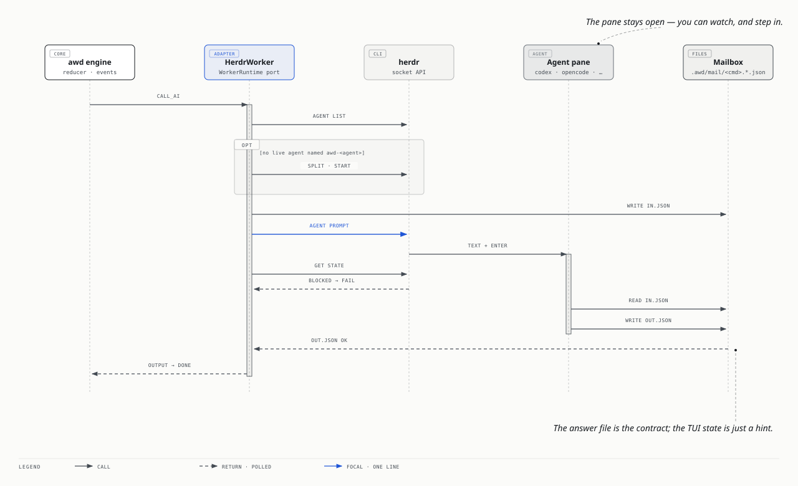

# 多個 AI agent 分工 — CrewAI 的概念，awd 的做法

一條流程裡不該只有一個「AI」。規劃需要想得深、review 需要便宜而快、架構問題需要另一個人、黑箱 QA 不該看 diff。CrewAI 把這件事叫 Agent / Task / Process / delegation；awd 已經有事件、step、reducer，所以只補一個 `agents:` 區塊，其餘全部沿用。這份文件說明對照、為什麼委派要走事件、五種 runner 怎麼跑一個 agent，以及不支援 A2A 的工具怎麼用 herdr pane 接進來。

## 1. 對照表：CrewAI → awd

| CrewAI | awd | 備註 |
|---|---|---|
| `Agent(role, goal, backstory, llm, tools)` | `agents.<id>: { description, system \| file, model, tools, effort, runner }` | 一個 persona 一個 id；prompt 可以放 yaml、`roles/<id>.md` 或 `agents/<id>.md`（frontmatter + 內文，與 Claude Code 的 `.claude/agents/*.md` 同形） |
| `Task(description, expected_output, agent)` | `ai` step：`on:` + `agent:` + `input:` + `output:`（JSON schema） | `expected_output` 不是散文，是 schema；答案先過 ajv 才變成事件 |
| `Process.sequential` | 事件鏈：`plan.done → handoff → confirm …` | 順序就是 `on:` 指向的事件，`awd graph` 畫得出來 |
| `Process.hierarchical`（manager 指派） | coordinator 是 `gate` / policy，不是另一個 LLM | `size-gate`、`rounds-gate`、`ready-gate` 決定誰上場；決定可以 golden test |
| `allow_delegation=True` | outcome 事件 + `delegates:` | reviewer 以 `needs-architect` 結束，architect 的 step 聽這個事件；`delegates` 是文件也是 lint |
| `tools=[...]` | `tools:` → runner 的 `--allowedTools` / server tools | claude-code 用 Claude Code 的工具語法；anthropic 認 `web_search`；cli / herdr 交給那個工具自己 |
| `memory=True` | 短期：`remember` → `state.memory.short`；長期：`learn` → `memory.learned` 事件 → `MemoryStore` 投影，下次 `recall` 進 prompt | §7；沒有向量檢索，召回是同 key 優先、再新到舊 |
| `crew.kickoff(inputs)` | trigger：webhook / cron / `awd emit` | 外部事件開始一個 run，key 決定 aggregate |
| 平行 task（`async_execution`） | 同一事件兩個 step + `concurrency: 2` | `review` 與 `qa` 同時聽 `build.done` |

**原本以為**：要有「crew」這個物件把 agents 綁在一起。**實際上**：綁在一起的是事件；agent 只是 step 上的一個欄位。多出來的概念只有 `agents:` 與 `delegates`。

## 2. `agents:` 長什麼樣

```yaml
concurrency: 2                       # 一張卡同時最多兩個 step 在跑（review ∥ qa）

agents:
  planner:
    description: Turns a card into a plan a build worker can execute without questions.
    file: roles/planner.md           # system prompt；也可 `system: |` 內嵌
    model: opus
    effort: high                     # low | medium | high | xhigh | max
    tools: [Read, Grep, Glob]
  reviewer:
    file: roles/reviewer.md
    model: sonnet
    tools: [Read, Grep, Glob, "Bash(gh pr *)", "Bash(gh api *)"]
    delegates: [architect]           # 可以把工作交給誰
  qa:
    system: |
      You test the *running* feature … never read the diff.
    model: sonnet
    runner: claude-code              # claude-code | anthropic | fake | cli | herdr
    memory: { recall: 10 }           # §7；預設短期 + 長期都開，false 全關
  builder:
    file: agents/builder.md
    claudeCode:                      # 只有 runner claude-code 認得（§5）
      permissionMode: acceptEdits    # default | plan | acceptEdits | bypassPermissions
      cwd: "{{ vars.worktree.path }}"    # 模板；`claude -p` 在這裡跑，prompt 會被加上「不要碰主 checkout」
      addDirs: []                    # --add-dir
```

```markdown
<!-- agents/architect.md — frontmatter 是設定，內文是 prompt -->
---
description: Answers design questions the reviewer cannot settle; only invoked by delegation.
model: opus
effort: xhigh
tools: [Read, Grep, Glob]
---
You are the architect for this codebase. …
```

合併規則：`agents:` 的 yaml 勝過 `agents/<id>.md` 的 frontmatter；prompt 依序取 `system` → `file` → `.md` 內文 → `roles/<id>.md`。舊的 `role: planner` 寫法不動，行為一如既往。

step 只要指名：

```yaml
review:
  on: [build.done, rounds-gate.again, human-review.bounced]
  ai:
    agent: reviewer
    input: { card: "{{ key }}", pr: "{{ vars.build.pr }}" }
    output:
      type: object
      required: [outcome]
      properties:
        outcome: { enum: [clean, findings, needs-architect] }   # ← 第三個就是委派
        findings: { type: array, items: { type: string } }
        question: { type: string }
```

`awd agents workflow.yaml` 列出每個 agent 的 runner、model、tools、負責的 step 與 delegates；`awd graph` 的 ai 節點寫成 `review\n@reviewer (sonnet)`；`awd status` 的 running step 帶 `@agent`。

## 3. 委派為什麼一定走事件

CrewAI 的 delegation 是 agent 在一次 LLM 呼叫裡呼叫另一個 agent 當工具——外面看不到、不能重播、也測不到。awd 的委派長這樣：

```
review ──needs-architect──▶ architect-review ──guidance──▶ fix ──done──▶ rounds-gate ──again──▶ review
```

```yaml
architect-review:
  on: review.needs-architect
  ai:
    agent: architect
    input: { question: "{{ vars.review.question }}" }
    output: { … outcome: { enum: [guidance] }, guidance: { type: string } }
fix:
  on: [review.findings, architect-review.guidance]
```

得到的三件事：

1. **可 replay**：`review.needs-architect` 是 event log 裡的一行，`awd replay` 重跑會得到同一個 `call_ai architect-review @architect` command。
2. **可 golden test**：`tests/11-delegation.golden.yaml` 用 fixtures 走完整個來回，不呼叫任何模型。
3. **圖上看得到**：委派是一條普通的邊；誰找過誰，一眼看完。

`delegates: [architect]` 本身不做事：lint 看到 ai→ai 的直接邊而 delegator 沒有宣告，就 warn；宣告了不存在的 agent，就 error。這是「把意圖寫成資料」的最小代價。

**原本以為**：委派要有「回到原 agent」的機制。**實際上**：不用。architect 的答案進了 `vars.architect-review`，fix 讀它，下一輪 review 自然看到修好的 PR。回頭找誰，是圖決定的，不是 agent 決定的。

## 4. 平行與會合

```yaml
qa:
  on: build.done                      # 與 review 同時
ready-gate:
  on: [review.clean, qa.pass]
  gate:
    outcomes:
      both: "len(default(vars.review.findings, ['pending'])) == 0 && vars.qa.passed == true"
    default: wait
  terminal: [wait]
park:
  on: ready-gate.both
```

`concurrency: 2` 讓同一張卡上兩個 step 佔兩個 slot。會合不是「等兩個 promise」，而是一個 gate 在每一個到達事件上重新評估 `vars`：第一個到 → `wait`，第二個到 → `both`。`qa.fail` 直接 `escalate`——兩個 agent 意見不合時，找人，不再讓機器互相說服。

**原本以為**：平行要在 runtime 裡加 fork/join。**實際上**：join 只是 gate 表達式；reducer 一行都沒改。

## 5. 五種 runner：同一個 agent，換誰去跑

| runner | 怎麼跑 | tools / effort | 需要 |
|---|---|---|---|
| `claude-code`（預設） | `claude -p --output-format json --json-schema … --model … --append-system-prompt … --allowedTools … --effort … [--permission-mode … --add-dir …]`，cwd = `claudeCode.cwd` | 都有；`claudeCode: { permissionMode, cwd, addDirs }` | 登入過的 `claude` CLI |
| `anthropic` | SDK `messages.stream` + `output_config.format: json_schema` + adaptive thinking | `effort` 直接對應；`tools` 含 `web_search` 時掛 server tool | `ANTHROPIC_API_KEY` 或 `ant auth login` |
| `fake` | `fixtures/ai/<agent>/<key>.json` → `<agent>.json` → `<step>.json` | — | 什麼都不用；`--worker fake` 蓋過所有 agent 的 runner |
| `cli` | 任何會印答案的 headless CLI：prompt 走 stdin，stdout 最後一個 JSON 是答案 | 由那個 CLI 自己管 | 那個 CLI |
| `herdr` | 一個活在 herdr pane 裡的互動 agent：一個 prompt + 信箱檔 | 由那個 agent 自己管 | herdr server |

`--worker` 是預設；每個 agent 可以用 `runner:` 自己選。engine 用 `RunnerRegistry` 依 command 上的 `runner` 派給對應的 WorkerRuntime，同一個 process 裡 claude-code、codex、opencode 可以各跑各的階段。

### `cli` runner 與 preset

```yaml
reviewer:
  runner: cli
  cli: { preset: codex }                              # = codex exec --json -s read-only -
qa:
  runner: cli
  cli: { command: "opencode run --format json{{ model ? ' -m ' + model : '' }}", stdin: false }
```

| preset | 展開成 | prompt 怎麼進去 | 答案怎麼出來 |
|---|---|---|---|
| `codex` | `codex exec --json -s read-only [-m model] -` | stdin | JSONL：`item.completed` 的 `agent_message.text` |
| `opencode` | `opencode run --format json [-m model]` | 最後一個引數 | JSONL：`type: text` 的 `part.text` |
| （自訂） | 你的 `command`（可用 `{{ model }}` `{{ agent }}` `{{ step }}` `{{ key }}`） | `stdin: true`（預設）或引數 | 最後一個 ```json fence 或 `{…}` |

system prompt 沒有自己的位置，直接放在使用者訊息前面；答案一樣過 ajv，不合 schema 就是 `<step>.failed`，`retry` 照常。

## 6. 不支援 A2A 的 agent：用 herdr pane 當 worker



codex、opencode、gemini、antigravity……很多互動式 agent 沒有 agent-to-agent 協定，但都能在 terminal 裡收 prompt、做事、回話。herdr 是管這些 pane 的 multiplexer，`herdr agent prompt <name> "<text>"` 會把一段話送進那個 pane；`herdr agent get` 回報它 `idle | working | blocked | done`。awd 把這變成一個 WorkerRuntime：

```yaml
qa:
  runner: herdr
  herdr: { kind: opencode, name: awd-qa, cwd: ., timeoutMs: 15m }
```

### 信箱協定：檔案才是合約

```
.awd/<workflow>/mail/<commandId>.in.json    ← awd 寫：{ step, key, system, input, outputSchema }
.awd/<workflow>/mail/<commandId>.out.json   ← agent 寫：符合 schema 的 JSON
```

一次呼叫做這幾件事：

1. **找 agent**：`herdr agent list` 有同名（預設 `awd-<agent>`）且 idle/done 的就重用；沒有就 `herdr pane split --direction right --cwd <cwd> --no-focus`（失敗則開新 tab）再 `herdr agent start <name> --kind <kind> --pane <id>`。所有 id 都從 JSON 回應讀，不猜。**剛 start 完不能馬上 prompt**：herdr 一「認出」agent 就回來，但 codex 這時還在畫 banner，輸入框還沒接字，送進去的 prompt 會消失。所以要等 `agent get` 回 `interactive_ready: true` 再多等 1.5 秒。
2. **寫信箱**：system prompt、input 與 schema 全部進 `.in.json`。
3. **一個 prompt，一行**：只有四句話——你是哪一步、去讀 `.in.json`、做事、把答案寫進 `.out.json` 然後回 `DONE`。刻意壓成一行，因為貼進 TUI 的換行可能被當成 Enter，把半句話先送出去。
4. **收答案**：每 0.5 秒看 `.out.json` 出現了沒、過不過 ajv——**一出現就收，不等 TUI 說 done**。同時每 2 秒問一次狀態：`blocked` 就交給人（下一節）；agent 已經 idle/done 卻 20 秒還沒有檔案，就把 `herdr agent read` 的 pane 尾巴抄進失敗原因，變成 `<step>.failed`。

實測（2026-09-22，這台機器）：codex 重用 pane 12 秒回 `{"outcome":"done","answer":"42"}`；opencode 在新 pane 起來後 20 秒內寫好 `{"outcome":"ok"}`，但它的 turn 又跑了五分鐘才 `done`——這就是為什麼不能等狀態、要看檔案。

### `blocked` 是人的事

agent 跳出核准框或問題（herdr 認得的 `blocked` 狀態）時，awd **不回答**：立刻 `<step>.failed`，`data.reason = agent_blocked`。人到 pane 裡處理；`retry` 會重新 prompt 同一個 agent。已經 `working` 的 agent 也不會被打斷（`agent_busy`）。awd 從不 `pane close` 自己沒開的 pane，從不按任何核准。

### 為什麼 pane 要留著

- 你看得到 agent 在做什麼——這是 herdr 的價值，不是要藏起來的東西。
- 出事時你可以直接在 pane 裡接手，不用重跑整個 run。
- 同一個 agent 跨多個 step 重用：context 留在它的 session 裡，信箱只傳這一步需要的東西。

**原本以為**：沒有 A2A 就只能等每個工具各自出協定；而且 agent 說 done 就是做完了。**實際上**：terminal 本身就是協定——一個 prompt、一個檔案，足夠讓 awd 當編排者；而「做完」的訊號是那個檔案，不是 TUI 的狀態燈。

## 7. 記憶：短期是 run，長期是專案

CrewAI 的 memory 是一個開關；awd 把它拆成兩個問句：「這個 agent 在**這張卡**上已經知道什麼？」和「它在**這個專案**裡學過什麼？」。兩個答案住在不同的地方，因為它們的生命週期不同。

### 短期：這個 run 的事，reducer 記

同一個 key（一張卡）上，每個 ai step 結束時 reducer 都會記一筆 trail（step、agent、outcome、`summary`）。agent 回答時可以多帶一個 `remember: {...}`——一個自由物件——reducer 把它併進 `state.memory.short[agent]`，下一次同一個 agent 被叫到，就會在 prompt 裡看到：

```
## Earlier in this run (short-term memory)
- review (@reviewer) → findings: 2 findings on the parser
- fix (@reviewer) → done
- you asked to remember: {"lastVerdict":"findings","threadsChecked":true}
```

它是 state 的一部分，所以 **replay 會重現、golden test 會檢查、`awd status --json` 看得到**；`remember` 和 `learn` 不會進 `vars`（那裡只放結果）。

### 長期：這個專案的事，先是事件，再是投影

agent 回答時另外可以帶 `learn: [{ note, tags }]`。runtime 把每一條變成一個 **`memory.learned` 事件**（`{ agent, key, step, note, tags }`）append 到 event log——所以它和其他事件一樣可 replay、可稽核，`awd replay` 看得到是哪一步學到的。

然後才是 `MemoryStore` port：一個從 `memory.learned` 事件長出來的投影（`<store-dir>/memory/<agent>.ndjson`，或記憶體版）。刪掉整個目錄也沒關係，engine 啟動時會從 log 重建。下次同一個 agent 被叫到，runtime 先 `recall`，把筆記放進 system prompt 最上面：

```
## What you learned before (long-term memory of this project)
- 2026-09-22 [c-mem1]: Cards tagged SP:NoOpenSpec carry no proposal.md — put the rollback section … (planning, rollback)
```

outcome 事件的 `meta.recalled` 會記下這次拿了哪幾條給模型看——golden test 就是這樣驗證「第二張卡真的看到了第一張卡的教訓」（`tests/13-memory.golden.yaml`）。

### 召回規則（刻意簡單）

```yaml
agents:
  planner:
    memory: { longTerm: true, recall: 20, shortTerm: true }   # 預設；`memory: false` 全關
```

每個 agent 只看自己的筆記。取 `recall` 條：**同一個 key 的先**、再按時間新到舊。沒有 embedding、沒有相似度——因為要先看見「agent 到底會學到什麼」，再決定值不值得一個向量庫。筆記超過 200 字會被截斷，trail 只保留最後 12 筆，整塊控制在約 1.5k token。

### 看與忘

```bash
npx awd memory examples/card-pipeline/workflow.yaml            # 每個 agent 學過什麼（id · 時間 · key · 筆記 · tags）
npx awd memory examples/card-pipeline/workflow.yaml planner --forget <id>
```

`--forget` 只動投影；`memory.learned` 事件留在 log 裡（log 是 append-only 的，這是原則）。要讓一條筆記永遠不再被召回又想保留稽核，就是這個指令。

**原本以為**：agent 記憶 = 接一個向量資料庫，把對話塞進去。**實際上**：先要回答「記什麼、誰記、記多久」。短期記憶是 state（reducer 已經有），長期記憶是事件（event store 已經有）；剩下的只是一個 recall 函數和一段 prompt。向量庫是等筆記多到 20 條不夠用時的下一步，不是第一步。

## 8. 把 CrewAI 本身接進來

如果已經有一個 crew，awd 仍然可以當它的 trigger 與狀態機：寫一個 WorkerRuntime 去 spawn 它。骨架（**未測試**，示意用）：

```ts
// packages/runtime/src/adapters/workers/crewai.ts
import { spawn } from 'node:child_process'
import type { WorkerRuntime, WorkerRequest, WorkerResult } from '../../ports/workerRuntime.js'
import { renderPrompt, extractJsonAnswer } from '../../application/prompting.js'

export class CrewAiWorker implements WorkerRuntime {
  readonly name = 'crewai'
  constructor(private script = 'crew.py') {}
  run(req: WorkerRequest): Promise<WorkerResult> {
    return new Promise((resolve, reject) => {
      // crew.py reads {agent, input, schema, prompt} on stdin, runs Crew(...).kickoff(inputs), prints crew.raw
      const child = spawn('python3', [this.script], { stdio: ['pipe', 'pipe', 'inherit'] })
      let out = ''
      child.stdout.on('data', (d) => (out += d))
      child.on('close', (code) => {
        const output = extractJsonAnswer(out)
        if (code !== 0 || !output) return reject(new Error(`crew exited ${code}: ${out.slice(-500)}`))
        resolve({ output, raw: out.slice(-2000) })
      })
      child.stdin.end(JSON.stringify({ agent: req.agent, input: req.input, schema: req.outputSchema, prompt: renderPrompt(req) }))
    })
  }
}
```

然後在 `adapters/workers/index.ts` 的 `workerFactory` 註冊 `'crewai'`（`WORKER_NAMES` 也加上）。crew 內部怎麼分工是它的事；對 awd 來說它就是一個 agent，輸入是 JSON、輸出要過 schema。反過來也成立：awd 的每個 step 都可以是 crew 的一個 task。

**原本以為**：多 agent 框架要選一個，整個搬過去。**實際上**：編排（誰在什麼事件後做什麼）和執行（一個 agent 怎麼跑）是兩件事。awd 只做前者，所以後者可以是 claude-code、codex、一個 pane、或整個 crew。

## 9. 檔案地圖

```
packages/core/src/schema.ts            AgentDef · ResolvedAgent · parseAgent · ai.agent
packages/core/src/reducer.ts           call_ai 帶 agent/model/tools/effort/runner/runnerConfig；active[step].agent
packages/core/src/lint.ts              checkAgents：unknown agent · agent+role · delegates · runner 設定 · 委派警告 · memory.recall
packages/core/src/memory.ts            remember / learn 的 schema 增補、trail 型別、vars 去除記憶欄位
packages/runtime/src/ports/memory.ts   MemoryStore port + rankForRecall（key 優先、再新到舊）
packages/runtime/src/adapters/memory/  FileMemoryStore（<store>/memory/<agent>.ndjson）· MemoryMemoryStore
packages/runtime/src/application/memory.ts  memory.learned 事件 ↔ 投影（syncMemory）· renderMemory（prompt 區塊）
packages/core/src/graph.ts             ai 節點 label `step\n@agent (model)`，config.agent / runner；`agents[]`（Agents frame 的來源）
packages/core/src/reflection.ts        `reflect` 欄位、`*.failed` / `*.timeout` 萬用字元（docs/reflection.md）
packages/runtime/src/application/agents.ts        agents/*.md frontmatter + yaml 合併（純）；adapters/fs/workflowLoader.ts 讀檔
packages/runtime/src/application/runnerRegistry.ts  每個 agent 自己的 runner；fake 蓋過全部
packages/runtime/src/adapters/workers/index.ts    workerFactory · WORKER_NAMES
packages/runtime/src/adapters/workers/cli.ts      CliWorker · CLI_PRESETS（codex / opencode）
packages/runtime/src/adapters/workers/herdr.ts    HerdrWorker（信箱 · 一個 prompt · blocked → 人）；channels/herdr.ts 是 AgentChannel adapter
packages/runtime/src/adapters/workers/claudeCode.ts  `claudeCode: { permissionMode, cwd, addDirs }`
packages/runtime/src/application/prompting.ts     renderPrompt · extractJsonAnswer（codex / opencode / claude-code 事件流）
examples/card-pipeline/                agents: planner · reviewer · qa；agents/architect.md；tests/11 · 12 · 13（memory）· 14 · 15（reflection）
```

## 10. 在 canvas 上看 agent

`awd graph workflow.yaml --canvas` 現在會在 workflow board 最上方畫一個 **Agents** frame：每個 agent 一張紫色卡（`@planner`、`opus · claude-code`），虛線指到它負責的 step，`delegates` 用虛線連到它能委派的 agent；`role:` 舊寫法的 step 也會長出一張標了 legacy 的卡，所以舊流程一樣能回答「誰在做這一步」。卡片的 `data.agent` 是 run overlay 的掛勾——某個 run 正在跑這個 agent 的 step 時卡片會亮起並顯示 key。改了 `agents:` 再跑一次同一個指令，卡片原地更新，你在旁邊留的 comment 不會掉。
