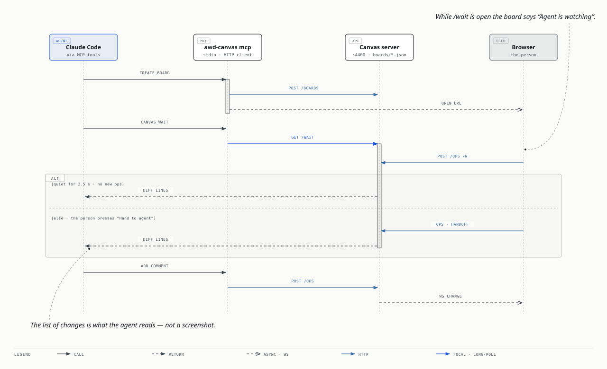

# awd-canvas — a shared canvas for an agent and a human

The agent draws its thinking as a diagram; you move things and leave comments; the agent sees exactly what changed and reacts. One store, two authors (`agent` | `user`), an append-only change log.

```
packages/canvas/
  src/model.ts            the contract: Board · Item · Op · Change (shared with the web UI)
  src/ports/boardRepository.ts   the port; src/adapters/boards/{file,memory}.ts implement it
                          (file = boards/<id>.json snapshot + boards/<id>.changes.ndjson log); src/store.ts is a shim
  src/templates/          pure render(kind, content) → Item[]   (the agent never computes pixels) — seven kinds
  src/diff.ts             summarize(changes) → lines the agent reads · filterChanges / diffSummary / pageLines · cardMoves(board, changes)
  src/outline.ts · read.ts   the outline (diagram frame → lane / column → items) · readBoard: filters, formats, pages, size cap
  src/snapshot.ts · raster.ts   server-side SVG of a frame / items / the board; PNG with resvg (npm package, else a pinned download)
  src/layoutCheck.ts · shown.ts · textMetrics.ts   layout findings · where the page draws things (kanban) · text metrics
  src/place.ts · thumb.ts · docs.ts   auto-place agent comments (beside the target; in the gutter of a UI-mock screen) · board thumbnails · the /docs site
  src/server.ts           HTTP + WebSocket API, serves web/dist and /docs
  src/mcp.ts              MCP stdio server (the agent's tools), thin over the HTTP API
  src/remoteMcp.ts · designTools.ts   the same tools at /mcp for remote agents (design files as text)
  src/access*.ts · accessRoutes.ts    remote agents: tokens, OAuth 2.1, pairing codes, scopes (Remote agents below)
  src/proposals.ts · patch.ts         agents' edit proposals: the files snapshot, unified diffs checked against it (Proposals and saving)
  src/routing.ts                      several agents on one board: responder, @mentions, loop guard, context, file holders
  src/annotations.ts · todos.ts       annotations (numbered cards, the person's drafts) and TODOs: the marks web, server and CLI share
  src/templates/annotations.ts        drawing a file's annotations beside any diagram: resolving `on`, numbering, the gutter
  src/ports/feedbackStore.ts · adapters/feedback   what agents tell the owner about Unprose (unprose_feedback)
  src/cli.ts              awd-canvas serve | mcp | render | demo | outline | diff | card add|move|moves
  web/                    the React UI (built separately); web/src/run/ is the live run overlay
```

## Run it

```bash
npm install
npm run build -w @awd/canvas          # → packages/canvas/dist
node packages/canvas/dist/cli.js serve --port 4400   # http://localhost:4400 · boards in ~/.awd/boards
node packages/canvas/dist/cli.js demo  # seven sample boards (one per kind) drawn from the card-pipeline example
```

**Boards live in the project they belong to** (see [Projects](#projects)): a board made from a session or a design file of a project is stored in `<project>/.unprose/boards/`. Boards of no project — the **personal** space — are stored in `--dir`, else `$AWD_BOARDS_DIR` (the older `AWD_CANVAS_DIR` also works), else `$XDG_DATA_HOME/awd/boards`, else `~/.awd/boards` — never inside a checkout or plugin install by default, because a plugin reinstall replaces its directory (the server warns if `--dir` points into a `plugins/cache` folder, and a board whose save fails shows "Changes are not being saved" in the page). `AWD_CANVAS_URL` tells the MCP server / CLI where the server is (default `http://localhost:4400`). If `packages/canvas/web/dist` exists it is served at `/` and `/b/:id`; otherwise a plain page lists the boards.

Claude Code in a checkout of this repo gets the tools through the dev-only project `.mcp.json` (`node scripts/mcp.mjs`); the plugin declares the same server in `.claude-plugin/plugin.json`. The MCP server needs the HTTP server running — it does not own a store of its own, so the browser and the agent always see the same board.

## The alignment loop



```
agent  canvas_create_board(kind:'event-storming', content) → { id, url, seq: 1 }
agent  "I drew the pipeline as an event storm at <url>. Move things or comment; I'm watching."
agent  canvas_wait(id, since: 1)                      ← blocks up to 30 min (default 5); the UI shows "agent is watching"
user   drags 'Build claimed' into the Planning lane, adds a comment "this is where it gets stuck"
       …and stops for 2.5 s (or presses "Hand to agent") — the wait resolves only once the person is done
agent  ← "[3 user] event "Build claimed" [es.event.build-claimed-…]: moved from Build → Planning
          [3 user] added comment on event "Build claimed" [es.event.build-claimed-…]: "this is where it gets stuck""
agent  reasons; replies with canvas_add_items(kind:'freeform', { items:[{ type:'comment', text:'…', target:<id> }] })
       and/or redraws a hotspot + policy, and/or changes workflow.yaml
```

Always keep the last `seq` you saw and pass it as `since`. `canvas_diff` returns only the user's changes by default so your own drawing never comes back as noise.

## MCP tools

The MCP server is called `unprose` (`node scripts/mcp.mjs`, which runs `awd mcp`; `awd-canvas mcp` serves the
canvas tools alone). Its instructions open with what Unprose is for, so an agent can explain it.

| Tool | Input | What it does |
|---|---|---|
| `unprose_help` | – | what Unprose can do — the diagrams, the tools, the comment loop, the ways to start — for the agent to pass on in the person's language; also the canvas URL and version |
| `canvas_list_boards` | – | id, kind, seq, item count, title, url per board |
| `canvas_create_board` | `title, kind, content, meta?` | render the template and create the board → id, url, seq |
| `canvas_read_board` | `id, format: outline\|json\|summary, frame?, types?, ids?, text?, fields?, limit?, cursor?, maxChars?` | `outline` (default): text grouped by diagram frame → lane / column / screen / group → items, with threads, proposals, each diagram's [annotations](#annotations) and wires, then the [TODOs](#todos); `summary`: counts per frame; `json`: items with ids and geometry, one per line. Filters, pages and a size cap (40 000 characters by default) — [Reading big boards](#reading-big-boards) |
| `canvas_apply` | `id, ops[], note?` | raw ops as the agent: `add {item}`, `update {id, patch}`, `remove {id}`; and the layout lock: `lock {id}` / `lock {frame: '<diagram key>'}` / `unlock …` set or clear `data.lock: 'layout'` (redraws and the kanban auto-layout never move a locked item; a locked frame keeps everything in it — docs/diagrams.md "What a redraw keeps"). An agent may unlock only what an agent locked |
| `canvas_add_items` | `id, kind?, content, at?, scope?, note?` | render a template onto an existing board; deterministic ids mean re-rendering the same content updates in place |
| `canvas_diff` | `id, since, from: person\|others\|all\|[names]` (older spelling `author: user\|others\|agent\|all`), `frame?, kinds?, summary?, last?, limit?, cursor?, maxChars?` | human-readable lines for every change after `since` (`person`, the default: the person's changes from any of their pages; `others`: the person and the other agents, never you; a list of names: only theirs); moves within a lane fold into one line; `summary: true` = counts by who × kind × frame + the last lines; capped and paged ([Reading big boards](#reading-big-boards)) |
| `canvas_wait` | `id, since, timeoutSec = 300 (≤ 1800), quietSec = 2.5, wake = meaningful, from = person\|others\|[names], listen = mine\|all, untilMention = false, frame?, kinds?, summary?, maxChars?` | `from: person` (default) wakes on the person's changes — from any of their pages, a browser signed in through the tunnel included — and on another agent asking you; `from: others` also on the other agents' changes (never yours). Block until the user has changed something **and stopped for `quietSec`** (or pressed "Hand to agent"); returns the diff lines and new seq. Only what is for you wakes you — the board's responder, @mentions of you, another agent asking you, proposals to files you hold (`listen: 'all'`: everything); the first wait on a board starts with its context note ([Several agents on one board](#several-agents-on-one-board)). `wake: meaningful` (default) wakes on comments, adds, removals, renames, connections, recolours and handoff; pure moves / resizes / reroutes and read receipts neither wake nor restart the quiet window and come back folded into one `moved N items: …` line. `any` wakes on every change (one line each); `handoff` waits for the button only. While pending the board shows "agent is watching". `frame`, `kinds` and `from: [names]` narrow what wakes you; `summary: true` and `maxChars` keep a burst short. `untilMention: true` wakes only when you are addressed personally (an @mention, a reply in a thread you were mentioned or asked in, a proposal to files you hold). Nothing for you within `timeoutSec`: one line, `nothing new on b_x (seq 93; 2 change(s) for others) — wait again with since: 93` ([Watching cheaply](#watching-cheaply)) |
| `canvas_snapshot` | `id, frame?, ids?, scale?, maxPx? = 2000, theme? = light\|dark, format? = png\|svg` | **see the board**: a server-side picture of a diagram frame, items or the whole board as the page draws it — a PNG image (resvg), else the SVG text; the result names the renderer ([Seeing the board](#seeing-the-board)) |
| `canvas_check_layout` | `id, frame?, limit?` | overlaps, text likely cut off, wire labels cut / hidden / on a card, items outside their frame / off their lane, oversized items, items drawn elsewhere than stored (kanban), comments covering an item or another card, or outside their target's frame — each with a suggestion; the same list is in the frame panel |
| `canvas_approve` | `code, scope?, name?, board?` | **local agent only** (never on `/mcp`): approve a connect request by the pairing code the person read out; logged on `board` ([Who may approve and manage](#who-may-approve-and-manage)) |
| `canvas_focus` | `id, ids?, frame?, note?` | **"look here"**: use it whenever you ask the person to look at something. Their open page shows "Agent wants to show you …" with **Go** (or jumps at once with *Follow agent* on) and fits the view to the items / the diagram frame. Nothing is stored on the board. Returns how many pages got it and a link that opens right there (`?focus=` / `?frame=`) |
| `canvas_files` | `id, path?` | the files behind a board (a workflow's yaml, agents, prompts, scripts; a diagram frame's design file), as the last redraw put them on the board: each with its sha-1 `base`, line count and source; with `path`, that file's exact text. See [Proposals and saving](#proposals-and-saving) |
| `canvas_propose_edit` | `id, file, base, diff \| newText, note, about?, wires?` | propose a change to one of those files: checked against the snapshot whose sha-1 is `base`, then posted as a proposal signed with your name, threaded on the block / frame the first changed line belongs to (or `about`). `wires` (workflow boards): dashed hints for the wires the edit adds or removes. Nothing is written to disk |
| `canvas_context` | `id, text?, answeredBy?` | the board's context note (what it is about, links to notes), who answers it, who holds which files, the agents here, how many [TODOs](#todos) are open and [draft annotations](#annotations) wait; `text` writes the note, `answeredBy` (`me` \| a name \| `studio` \| `any`) **suggests** the responder for the person to confirm — both logged |
| `canvas_ask` | `id, agent, question, about?, timeoutSec ≤ 120` | ask another agent on the board (`agent`: its @handle or its name): posts an `@handle` thread (on `about[0]`, else loose) and blocks until it answers in the thread; the result says exactly who it was delivered to (*Delivered to @codex-b — watching this board now*, or that it is not watching / never seen); on timeout returns the thread id — the answer comes back to you with `canvas_wait` |
| `canvas_handover` | `board, ready? + keys?, accept? + repo?, remote?, cancel? + reason?` | the files behind diagrams changing hands, once **the person** started it (an agent cannot start one): `ready: true` — you hand them over, they are ready to be taken as the board has them (optionally only `keys`); `accept: true` — you receive them (once every one is ready): you become their holder, and the result lists the files to read with `canvas_files`, write into your repo and redraw once from; `cancel: true` — decline (either side). Without any: the open handover, who must do what next, who holds which files ([Handing over the files](#handing-over-the-files)) |
| `canvas_todo` | `board, text? + on?, ask? \| done? + answer? \| reopen?` | [TODOs](#todos): `text` opens one (about the item `on`, to confirm with `ask`) — it wakes nobody; `done: <id>` checks one off, with `answer` posted as a *Confirmed: …* reply that reaches the board's *Answered by* agent; `reopen: <id>`; only `board`: the open TODOs and the last ones done. A read-only token lists only |
| `unprose_feedback` | `text, board?, about?` | tell the owner what was hard or missing in Unprose itself; kept on the canvas machine ([Feedback](#feedback-about-unprose)) |
| `unprose_feedback_list` | `limit?` | read that feedback — a local agent only |
| `canvas_open` | `id` | print the URL (and `open` it on macOS) |
| `design_lint` | `file` | `awd design lint`: schema, unknown fields, the EventStorming / Domain Storytelling grammar (with book pages) |
| `design_draw` | `file, board, at?, applied?` | `awd design draw`: draw or refresh the file's frame, keeping the person's layout; refuses a file with lint errors, and a diagram whose files another agent holds (before drawing anything — [the guard](#handing-over-the-files)); returns the `?frame=` link; records you as the holder of a diagram nobody holds yet; `applied` = the proposal thread this redraw applies ([Applying](#applying---applied-and-committing)) |
| `design_propose_stories` | `from, into, board` | `awd design propose-stories`: story candidates from EventStorming / a domain story as dashed proposals; the story-map file is not written |
| `design_egon` | `action: import\|export, file, out` | `awd design import-egon` / `export-egon` (Egon.io) |

### Watching cheaply

An agent watching a board pays in model tokens **every time `canvas_wait` returns**: the model re-reads the
conversation and calls again. While nobody is on the board that is pure cost, so:

- **Always-on watching belongs to studio** (`awd studio`, docs/studio.md): it runs on the canvas machine and uses no
  model at all while idle — an agent session starts only when a comment is for it.
- **Wait long.** `timeoutSec` defaults to 300 and goes up to 1800 (30 min): an idle agent wakes twice an hour instead
  of thirty times. Never poll with short waits or `canvas_diff` in a loop.
- **Idle answers are one line.** A wait that ends with nothing for you returns
  `nothing new on b_x (seq 93; 2 change(s) for others) — wait again with since: 93` — no context, no instructions.
  The board context comes only with the first wait on a board (per MCP session; over the stateless remote `/mcp` the
  canvas remembers it per agent × board until 15 minutes after its last wait) and again after it changes.
- **`untilMention: true`** on a busy board: you wake only when you are addressed personally — `@you`, a reply in a
  thread you were mentioned or asked in, a proposal to files you hold — not for every comment on a board you answer.
  The idle line counts what you slept through (`3 not addressed to you`); `canvas_diff` shows it.

**Client timeouts.** The MCP client may give up before the canvas does. That is harmless: the wait is simply
abandoned — the canvas notices the closed request, frees the watcher (the page stops saying "agent is watching") —
and you call `canvas_wait` again with the same `since`; nothing is lost. To let a 30-minute wait finish:

| Client | Setting |
|---|---|
| Claude Code | `MCP_TOOL_TIMEOUT` (milliseconds; unset it is very long, about 28 h — a hard wall-clock limit that progress does not extend). Long calls can also end on the idle limit `CLAUDE_CODE_MCP_TOOL_IDLE_TIMEOUT` (default 30 min for stdio, 5 min for HTTP servers such as the remote `/mcp`); keep `timeoutSec` under it or raise it |
| Codex | `tool_timeout_sec` under `[mcp_servers.unprose]` in `~/.codex/config.toml` (seconds, default 60): set `tool_timeout_sec = 1900` for 30-minute waits, or pass `timeoutSec` below it |
| Other MCP clients | their per-request timeout (the MCP SDK default is 60 s); clients built on the SDK with `resetTimeoutOnProgress` stay alive, since `canvas_wait` reports progress every 20 s when the call carries a progress token |

The connection itself stays healthy: `GET /wait` answers with a space every 20 s during a long wait (proxies such as
Cloudflare drop silent requests after 100 s, Node's `fetch` after 300 s) and the JSON follows; the remote `/mcp`
stream sends SSE keep-alives.

Paths are relative to the session's project. The `design_*` tools are served by `awd mcp` (not by
`awd-canvas mcp`); the canvas's remote endpoint `/mcp` serves `design_lint` / `design_draw` / `design_propose_stories`
taking the file's text instead (see [Remote agents](#remote-agents)).

### Reading big boards

A board with a few hundred items and a long history is more than an agent can read in one go: before these tools,
`canvas_diff` answered 135 000 characters and `canvas_read_board` json 298 000. So every reading tool (and its HTTP route)
filters, pages and stops at a **size cap** — 40 000 characters by default, `maxChars` up to 200 000. A capped answer
ends with one line saying what was left out and the exact call for the next page:

```
… 195 more item(s) of 329 not shown (size cap 40000 characters) — next page: canvas_read_board({ id: "b_mudv…", format: "json", cursor: "56:134" }); narrow with frame / types / ids / text, or fewer fields (…)
```

A cursor is `<board seq>:<offset>`; a cursor from an older seq still works and says the board changed meanwhile.

**Start with the summary**, then read one diagram:

```
canvas_read_board({ id, format: "summary" })
# Unprose — Studio 設計 (freeform, seq 56, 329 items)
Answered by: any agent

## EventStorming "Studio · Ask AI（process）" — frame: "studio-es" · design/studio.es.yaml  #diagram.studio-es
  99 items: 45 arrow, 10 event, 9 legend, 8 command, 8 system, 6 person, 6 policy, …
  0 comment thread(s) · 4 proposed element(s)
## kanban "Studio · Kanban" — frame: "studio-kanban" · design/studio.kanban.yaml  #diagram.studio-kanban
  5 items: 4 column, 1 card
  4 columns: Backlog (1) · Doing (0) · Review (0) · Done (0)
…

canvas_read_board({ id, frame: "studio-kanban" })
## kanban "Studio · Kanban" — key studio-kanban · design/studio.kanban.yaml · 5 items  #diagram.studio-kanban
  ## column: Backlog [1 cards]  #studio-kanban.column.backlog-c22f42
    - card: Release 1 [release]  #studio-kanban.card.release-1
  ## column: Doing [0 cards, WIP 1]  #studio-kanban.column.doing-c10eab
```

| Parameter | `canvas_read_board` (`GET /api/boards/:id/read`, `/outline`) |
|---|---|
| `format` | `outline` (default) · `summary` · `json` (one item per line after a header line; bulky `data` — UI mock trees, workflow details, proposal diffs — is summarised unless named in `fields`; the board meta is listed by key: `canvas_context` / `canvas_files` read it) |
| `frame` | a diagram key (`studio-es`), a frame / lane / column item id, or a legacy board's kind: that container, everything in it, the wires with an end in it, the threads about them |
| `types` | item types or roles: `["comment"]`, `["event","hotspot"]`, `["card"]`, `["arrow"]`, UI mock element types (`["button"]`) |
| `ids` | these items (a container brings what it holds; threads come along) |
| `text` | a case-insensitive substring of the text, label or id |
| `fields` | json: which fields, e.g. `["id","role","text","x","y","w","h","parent"]`, `"data.ui"` |
| `limit` · `cursor` · `maxChars` | json: items per page (default 200); outline: lines per page; the next page; the size cap |

**The outline** groups by diagram frame → lane / column / screen / group → items, in reading order (a kanban column's
cards in the order they stack). Containment is `parent` when it names an item, else the smallest container holding
the item's centre — never the item's own descendant, and a diagram frame without a parent is always top level (the
old outline could count a frame as inside its own release lane and dropped everything into "(unplaced)"). It marks:
`[proposed add by codex-b]` on items with `data.pending`; threads under their item, with `[3 messages · waiting for an
answer]` when the person spoke last, `[proposal: edit to design/x.yaml]`, the last 3 replies (`… N earlier replies`);
the frame header names the file and who holds it; each diagram lists its own wires, wires between diagrams come last;
a domain story lists its sentences in order. With filters, the containers on the way are printed as headers, and a
filtered comment shows under the item it is about.

**Changes**: `canvas_diff` and `canvas_wait` (and `GET /diff`, `/wait`, `/changes`) take

| Parameter | |
|---|---|
| `frame` | only ops on items inside that diagram / frame (removed items count by where they were) |
| `from` | who: agent names, `person`, `studio` (the default local agent) — `canvas_wait` takes a list here besides `person` / `others` |
| `kinds` | `add` · `update` · `remove` · `comment` (any op on a comment) · `move` (pure move / resize / reroute) |
| `summary` | counts by who × kind and by frame, then the last `last` lines (default 20; 10 for a wait) |
| `limit` · `cursor` · `maxChars` | `canvas_diff`: pages of lines; a wait cuts at `maxChars` and points to `canvas_diff` for the rest |

Moves that stay in their lane fold into one `moved N items: …` line in the diff too (`?moves=each` on HTTP lists
them one by one).

```
canvas_diff({ id, since: 0, author: "all", summary: true })
138 change(s) since seq 0 (board seq 151), 706 op(s), 239 line(s)
by who × kind:
  agent: 451 update, 86 add, 30 remove, 8 comment
  person: 95 move, 32 comment, 4 remove, 2 update
by frame (ops):
  workflow: 706
last 20 line(s):
  [148 agent] removed arrow human-review → build @builder (opus)
  …
canvas_diff({ id, since: 0, author: "all", from: ["person"], kinds: ["comment"] })   → the person's 32 comments only
```

### Seeing the board

`canvas_snapshot { id, frame?, ids?, scale?, maxPx? = 2000, theme? = light | dark, format? = png | svg }` renders on the
server what the page draws (`src/snapshot.ts`): frames with their kind badge and title, lanes, kanban columns with
their header and the cards where they stack (`src/shown.ts`, the same code the page uses), stickies in the theme
colours with wrapped text (`src/textMetrics.ts`, the stylesheet's sizes and paddings) and role labels, cards, text,
wireframe primitives, UI mock elements, Domain Storytelling pictograms with numbered activities, wires with arrowheads
and labels (traces dotted, proposals dashed), comment badges with their message count, [annotation](#annotations) cards
with their number and the same number pinned on the item, [TODOs](#todos) as check boxes (ticked when done). The region is the frame's box,
the union of `ids` (a container brings its contents), or the whole board; it is scaled down to fit `maxPx` (at most
4000) with a note saying so. Colours are literal (no CSS variables), so any SVG rasterizer can draw it.

**PNG** is drawn by [resvg](https://github.com/yisibl/resvg-js) (`src/raster.ts`). The canvas finds it on the first PNG
request, once, in this order:

1. **the npm package `@resvg/resvg-js`** — an optional dependency of `@awd/canvas`, so a checkout (`npm install`) has it
   for its platform;
2. **a native it downloaded before**, in `${CLAUDE_PLUGIN_DATA:-~/.awd/plugin}/native/resvg/<version>/` — the plugin
   ships an esbuild bundle without `node_modules`, and a native addon cannot be bundled;
3. **a download** of this platform's prebuilt `@resvg/resvg-js-<platform>-<arch>` tarball (~2 MB) from the npm registry
   (darwin arm64 / x64, linux x64 / arm64 glibc / musl, linux arm, win32 x64 / arm64 / ia32, android arm64 / arm). Its
   exact version and sha512 integrity come from `package-lock.json`, baked into the build (`src/resvgPins.ts`, written
   by `node scripts/resvg-pins.mjs`; the bundle and the tests refuse pins that drifted from the lockfile). The tarball
   is checked against that sha512 before anything is unpacked; only its one `.node` file is extracted (no install
   scripts, no other files, no links), written atomically next to a manifest with its sha-256, and loaded from there.
   A lock directory keeps two canvases from downloading at once.

If none works — offline, a platform resvg does not publish, an integrity mismatch — the snapshot is the SVG text with a
one-line reason (a failed download is tried again after 10 minutes). The result says what drew it: `renderer: resvg
2.6.2 (npm package @resvg/resvg-js)`, `resvg 2.6.2 (downloaded native, <path>)` or `svg`. Size and scale limits are the
same for both.

| `UNPROSE_SNAPSHOT_PNG` | |
|---|---|
| unset / `auto` | package → downloaded native → download |
| `never-download` | package → downloaded native; never the network (air-gapped machines) |
| `download` | skip the package, use (or fetch) the downloaded native — what a plugin install does, from a checkout |
| `0` | no PNG, always SVG |

`UNPROSE_NPM_REGISTRY` points the download at a mirror (default `https://registry.npmjs.org`); the sha512 still has to
match. Over HTTP: `GET /api/boards/:id/snapshot?frame=&ids=&scale=&maxPx=&theme=&format=png|svg` → `image/png` or
`image/svg+xml`, with `x-unprose-snapshot: { width, height, scale, items, region, notes, renderer }`.

```
canvas_snapshot({ id, frame: "studio-kanban" })
snapshot of frame studio-kanban: 1248×764 px at scale 1, 6 items, board region x 7396 y -48 w 1200 h 716, renderer: resvg 2.6.2 (npm package @resvg/resvg-js)
[image/png]   — or, without a rasterizer: "…, renderer: svg / no PNG rasterizer: <why> / No PNG on this canvas — SVG follows (4402 characters): <svg …"
```

**Layout check.** `canvas_check_layout { id, frame?, limit? }` (`GET /api/boards/:id/layout?frame=` → `{ findings, counts,
checked, wires, lines }`, `src/layoutCheck.ts`) is pure geometry on the positions as drawn: items overlapping their siblings,
text likely cut off (the same text metrics), items outside their parent or off their lane, items 3× the median of
their siblings or far larger than the template sticky (160×110), wire labels that do not fit beside their wire (cut
with …, or only a dot — [Wires → Wire labels](#wires)) or were dragged onto a card, labels and domain-story number
circles that sit on each other or on a pictogram, domain-story group outlines that intersect (kind `group`), items drawn elsewhere than
stored (a kanban card's x / y are not where it shows — its stored y only orders the column), and comments: one whose box covers an item
(kind `comment-covers` — a frame or lane is the paper a comment sits on, a UI-mock screen is the product; the fix names the screen's
gutter, docs/diagrams.md §6c; also a card lying on another card — a stale note stacked on live ones —, told once per pair on the
later one in reading order; a reply is drawn inside its thread, never a finding) and one whose target is inside a diagram frame while
the comment is not (`comment-outside`); both carry `severity: 'info'`. Each finding says what to do. The frame panel on the page lists the same findings under **Layout**.

```
Layout: 5 finding(s) — 5 clipped (198 items and 64 wires checked; positions as the page draws them)
- [clipped] text of hotspot "改 workflow.yaml 要重啟 awd run；…" likely cut off: needs ~6 lines at 13 px, the 120×80 box fits 3 #runner-es.hotspot.… — make it 44 px taller (h 124), or wider, or shorten the text
- [label] label "updates · 更新視圖" of the wire event "Conflict found" → read-model "Configuration conflicts" has no free spot beside the wire (the gap is 40 px, the label needs ~112): the page shows only a dot there, the text on hover #cl.w2 — move read-model "Configuration conflicts" 72 px right (to x 512) to make room, or give it a short form in data.label.short (about 4 characters fit), or shorten the label
- [moved-by-layout] card "Drop legacy_contacts table" is stored at 1170,410 but the page draws it at 1188,164 … — set y to reorder (x is ignored)
- [oversized] sticky "檔案是唯一真相 …" is 262×210, 3.1× a template sticky (160×110) — use 160×110; do not scale stickies up to fill space
```

### Start prompts and slash commands

Eight ways to start a conversation, written once in `packages/cli/src/prompts.ts`: `help`, `eventstorm <topic>`,
`storymap`, `kanban`, `wireframe <page>`, `mockup <screen>`, `domain-story <topic>`, `review`. MCP clients (Codex and others) get
them as MCP prompts. The Claude Code plugin gets them as slash commands `/unprose:<name>` (`commands/*.md`,
written by `npm run gen:commands`; a test fails when they drift) and turns the MCP prompts off
(`UNPROSE_MCP_PROMPTS=0`) so the menu does not list them twice.

## What each surface can do

Four ways in, with different reach. **Web UI** = a person's page (on the canvas machine, or remote through a tunnel —
"manage" rows need the canvas machine, a page allowed to manage, or a manage-rights request approved there). **CLI** =
`awd` / `awd-canvas` on a machine with the files. **stdio MCP** = `awd mcp` (`node scripts/mcp.mjs`, the plugin's
server) next to the files. **Remote MCP** = the canvas's own `/mcp` (claude.ai connectors, cloud agents, another
machine without the canvas's files), which serves the same canvas tools minus local-only ones and takes file *text*.

| Capability | Web UI | `awd` CLI | stdio MCP | Remote `/mcp` |
|---|---|---|---|---|
| Draw a diagram from a **file path** | – | `awd design draw <file>`, `awd graph <wf> --canvas` | `design_draw { file }` (diagrams and workflows) | – (the canvas cannot read your disk) |
| Draw a diagram from **file content** | – | – | – | `design_draw { name, content }` (no workflows: draw `awd graph --json` with `canvas_create_board`) |
| Draw from structured content / raw ops | edit by hand | `awd-canvas render` (print only), `card add/move` | `canvas_create_board`, `canvas_add_items`, `canvas_apply` | same |
| **Redraw preview** (what a redraw keeps/removes; no writes) | – | `awd design draw --dry-run`, `awd graph --canvas --dry-run` | `design_draw { dryRun: true }` | `design_draw { dryRun: true }` |
| **Lock layout** (`data.lock: 'layout'` — redraws and the kanban layout never move it; docs/diagrams.md "What a redraw keeps") | context menu *Lock position* / frame *Lock layout*; a lock badge | – | `canvas_apply` ops `{kind:'lock', id \| frame}` / `unlock` (unlocks only agents' locks) | same |
| Lint a diagram file | – | `awd design lint` | `design_lint { file }` | `design_lint { name, content }` |
| Read the files behind a board | Files tab, source dialog | the files themselves | `canvas_files` | `canvas_files` |
| Propose an edit to a file | edit text in the source dialog, drag a wire, UI-mock text edits | – | `canvas_propose_edit` | `canvas_propose_edit` (the only way to change a file) |
| Apply a proposal (`--applied`) | *Agree* in the thread (consent only; never writes files) | `awd design draw --applied`, `awd graph --canvas --applied` | `design_draw { applied }` | – (the holder applies) |
| Read a board / diff / wait (filters, summary, pages, size cap — [Reading big boards](#reading-big-boards)) | the board | `awd-canvas outline`, `awd-canvas diff` | `canvas_read_board`, `canvas_diff`, `canvas_wait` | same |
| Focus the person's page ("look here") | – (the person navigates; Go-to palette) | – | `canvas_focus` | `canvas_focus` |
| Board settings: context, *Answered by* | header menu (sets it), context panel | – | `canvas_context` (context; *Answered by* only as a suggestion) | same |
| **Hand the files over** to another agent ([Handing over the files](#handing-over-the-files)) | board panel → *Hand over files* (starts it), *Hand over anyway* | – | `canvas_handover` (ready / accept / cancel — never start) | same |
| Ask another agent | `@name` in a comment | – | `canvas_ask` | `canvas_ask` |
| **Annotate** an item ([Annotations](#annotations)) | write a draft on the item (a proposal to the holder) | `annotations:` in the file, then `awd design draw` | edit the file, `design_draw`; apply a draft with `design_draw { applied }` | `canvas_propose_edit` with the `annotations:` entry |
| **TODOs** ([TODOs](#todos)) | write, check off (with an answer), reopen | – | `canvas_todo` | `canvas_todo` (a read-only token lists only) |
| **Image of a board** | **Copy as image** (context menu) | `GET /api/boards/:id/snapshot` | `canvas_snapshot` (PNG via resvg: the npm package in a checkout, a pinned, sha512-checked native download for the plugin; else SVG with the reason; the result names the renderer) | `canvas_snapshot` (same) |
| **Layout check** (overlaps, cut-off text, oversized, drawn elsewhere) | frame panel → *Layout* | `GET /api/boards/:id/layout` | `canvas_check_layout` | `canvas_check_layout` |
| Replay a board's history | Replay bar | – (`awd replay` replays a *workflow's* event log) | – | – |
| Play a domain story sentence by sentence / operate a UI mock's screens (docs/diagrams.md §6b "Replay", §6c "Play") | *Play story* / *Play* on the frame header, the frame panel, the context menu; this viewer's view only | – | – | – |
| Approve a pairing code / OAuth client | Connected agents → *Enter a code*, the notification | – | `canvas_approve` (the agent on the canvas machine only, a code the person read out; logged) | – (never) |
| Request manage rights for a remote page | Connected agents → *Request manage rights* (a code a managing page approves) | – | – | – |
| Manage tokens / OAuth clients (create, revoke, rename, change access and scope) | Connected agents (canvas machine or a managing page) | – | – | – |
| Register / move projects | board list shows them | `awd-canvas serve --project`, auto-registered by `design draw` / `graph --canvas`, `awd boards move` | the session's project is registered on start | – (boards go to the token's project) |
| Upgrade the canvas | release-notes dialog: *Check for updates*, *Upgrade* | `node scripts/ensure.mjs` (plugin) | – | – |
| Feedback about Unprose | – | – | `unprose_feedback`, `unprose_feedback_list` | `unprose_feedback` (reading it is local only) |
| Start / stop studio | studio control (allowed projects only) | `awd studio` | – | – |

`unprose_help` carries a short version of this table.

## Projects

One canvas server serves several projects — same port, same URL, same tunnel. A project is a directory
on the canvas's machine; its boards are stored in `<project>/.unprose/boards/`:

```
<project>/.unprose/
  .gitignore            # written once: boards/*.changes.ndjson, boards/*.tmp
  boards/<id>.json      # the board snapshot — commit it with the project
  boards/<id>.changes.ndjson   # the change log — local history, not committed
```

- **Registering a project:** `awd-canvas serve --project <dir>` (repeatable); the Claude Code plugin
  registers the session's project (`CLAUDE_PROJECT_DIR`, else the working directory, lifted to its git
  top level) at session start and when the MCP server starts; `awd design draw` / `awd graph --canvas`
  register the design or workflow file's project. The registry is kept in `<personal dir>/.projects.json`;
  a project's id is the slug of its directory name (`-2`, `-3` … on a clash).
- **Which folder is a file's project** (`repoRoot`, `packages/cli/src/graphCanvas.ts`): the nearest folder above
  the file with `.git` or `.unprose/boards`; else the nearest with a project file (`package.json`, `AGENTS.md`,
  `CLAUDE.md`, `pyproject.toml`, `go.mod`, `Cargo.toml`) below the home folder; else the working directory when the
  file is inside it; else the folder above `design/` (`designs/`, `diagrams/`); else the file's folder. A folder of
  design files alone (`~/meeting/design`) is never registered as a project called "design".
- **Removing a project:** `awd projects remove <dir | id>` (`DELETE /api/projects/:id`, this machine only, like
  registering) forgets it — its directory and files stay. Refused (`409`) while the project still stores boards;
  `--force` (`?force=1`) first moves them to the personal space (URLs unchanged). `awd projects list` shows them.
- **Boards by title** (`--board "title:…"`, `design_draw { board: "title:…" }`): the board with that title in the
  file's project, else in the personal space, else any board you can see (made on another machine, or before
  projects); an exact title before one differing only in case or spaces. Several equally good: the most recently
  changed, and a warning naming them all (pass the id to pick another). Only when there is none is a board created —
  by the canvas in the same step (`POST /api/boards { reuse: 'title' }`), so two draws at once share one board.
- **Only from this machine:** anything that names a directory — `POST /api/projects`, `projectRoot`, moving
  a board — is accepted only from a loopback caller without proxy/tunnel forwarding headers (the canvas
  names a directory only for the machine it runs on; a tunnel such as cloudflared connects from localhost but adds
  them, and a request with a token is never local). Creating and reading boards in an already registered project
  works from anywhere, like every other board operation — with credentials ([Remote agents](#remote-agents)).
- **Board ids and URLs never change** (`/b/<id>`); the server knows which project stores which board. The
  board list groups boards by project, with a filter that remembers your last choice.
- **The agent's defaults:** `canvas_create_board` stores new boards in the session's project
  (`project: 'personal'` for none); `canvas_list_boards` lists the session's project (`all: true` for every
  project). A remote canvas (`AWD_CANVAS_URL` on another machine) cannot write into your project, so boards
  made through it stay in its personal space.
- **Committing boards:** the snapshots are pretty-printed JSON with a final newline, so they diff well.
  A clone has the snapshots but not the logs: the board opens and keeps working (its history starts over).
  Two people editing the same board in different clones will merge-conflict on the snapshot like on any
  file — the design files (`design/*.yaml`) stay the source of truth, the board adds layout and discussion.
- **Migrating older boards:** boards made before projects stay in the personal space and keep working
  (a title lookup still finds them). Move one into a project with
  `awd boards move <board id | title:…> --to <project dir>` — the snapshot and the log are copied first,
  and the old files are removed only after the copy is in place.

## Remote agents

Agents on other machines (Claude Code, Codex or Cursor on a laptop) and cloud agents (claude.ai custom
connectors, ChatGPT connectors, cloud Codex / Claude Code) can design with you on this canvas. The canvas serves
MCP itself at **`<canvas>/mcp`** (Streamable HTTP), so an agent needs nothing installed — just the address,
e.g. `https://canvas.example.com/mcp` through your tunnel. How each client connects: [agents-setup.md →
Remote agents](agents-setup.md#remote-agents-another-machine-or-the-cloud).

### Who gets in

| Caller | Needs | Gets |
|---|---|---|
| this machine — loopback, no forwarding headers (`X-Forwarded-For`, `CF-Connecting-IP` …), no token | nothing (unchanged) | everything, including the local-only actions (registering projects, moving boards, upgrading) |
| an agent with a token (`Authorization: Bearer …`), from anywhere — **also from this machine** | a token: made on the **Connected agents** page, or issued by OAuth / a pairing code | what the token allows (read or write, all or some projects / boards); writes are signed with its name; never the local-only actions |
| a browser elsewhere (the tunnel, the LAN) | signing in once: a pairing code approved on the canvas, or a pasted token | a session cookie (`HttpOnly`, `SameSite=Strict`, `Secure` on https) with the scope it was given. It is **the person**: its changes are the person's (`author: 'user'`, unnamed), so they wake agents waiting for the person |
| anyone else from elsewhere | — | `401` with `WWW-Authenticate: Bearer resource_metadata=…` and a sentence saying how to connect |

A cloudflared tunnel connects from loopback but adds its headers, so it is **not** local. The rule for "local" is
`isLocalRequest()` in `src/projectsApi.ts` (loopback address, no forwarding headers, no `Authorization`).
Public without credentials: the web UI's files, `/docs`, `GET /api/version`, `GET /api/kinds`, the OAuth
endpoints and the sign-in endpoints below.

`UNPROSE_REMOTE_AUTH=off` brings back the old open canvas (anyone who reaches it reads and writes) — only for a
canvas that already sits behind an access proxy that does the job. Local-only actions stay local either way.

### Connecting an agent

- **OAuth 2.1 (claude.ai, Claude Code `--transport http`, most remote MCP clients).** The client calls `/mcp`, gets
  `401`, reads `/.well-known/oauth-protected-resource/mcp` and `/.well-known/oauth-authorization-server`, registers
  itself (`POST /register`, dynamic client registration, public client + PKCE S256) and opens `/authorize` in the
  person's browser. That page names the client and where it returns to, and shows a **one-time pairing code**
  (`ABCD-EFGH`). At the same moment **every open canvas page that may approve** (below) shows
  **“<client> wants to connect”** with a box for the code, **Allow** and **Deny**. Typing the code proves the person
  is looking at that agent. On a page opened on the canvas machine (`http://localhost…`), Allow works with one
  click (no code needed). After Allow, the authorize page sends the browser back to the client with a single-use
  authorization code (10 minutes); `POST /token` exchanges it (`authorization_code` + PKCE verifier) for an access
  token (1 hour) and a refresh token (rotated on every use). The agent appears in **Connected agents**, revocable.
- **An agent without a browser** (the stdio MCP server pointed at the tunnel, a headless cloud agent): the device
  flow, RFC 8628. `POST /device_authorization` (`client_name=<name>`) returns a `user_code` (the pairing code) and a
  `device_code`; the agent tells the person the code; the person types it on the canvas (the notification, or
  **Connected agents → Enter a code**); the agent polls `POST /token` with
  `grant_type=urn:ietf:params:oauth:grant-type:device_code` and gets a token (no expiry, revocable). The stdio MCP
  server (`scripts/mcp.mjs`) does this by itself when `AWD_CANVAS_URL` answers `401` and it has no token: every tool
  result says *“Ask the person to type the code ABCD-EFGH on the canvas …”* until it is approved, then it keeps the
  token in `~/.awd/tokens.json` (0600; `UNPROSE_TOKENS_FILE` moves it) for next time.
- **A token made on the page** (clients that can send a header): **Connected agents → New token** — a name, read or
  read-and-draw, optionally only some projects or boards. The secret is shown **once**, with ready-to-paste setup
  for Claude Code, Codex, a JSON config and the stdio server.

### Who may approve and manage

- **Approve a connect request:** a page on the canvas machine (opened as `localhost`, same origin) — one click; or a
  **signed-in** page anywhere (a browser session) — only with the requester's pairing code. A session can grant at
  most its own scope and projects. **Five wrong codes lock the request** (the agent has to start again); codes typed
  without picking a request are limited to ten wrong ones per ten minutes per approver.
- **Create, change and revoke tokens (manage agents):** a page on the canvas machine, or a browser session that may
  manage agents — approved with *“may also manage agents and tokens”* on the canvas machine, or given the right later
  (below). A page that can merely load through the tunnel can do none of this; agent tokens can neither approve nor
  list agents. A page that may not manage says **why** next to its disabled buttons (*“Why can’t I change or revoke
  agents here?”*) and how to get the right.
- **Changing an agent's access:** Connected agents → *Change access* on a row: **read only ↔ read and draw**, the
  projects (none ticked = all) and the boards (ids, empty = all) — for a token, an OAuth client, a device-code agent or
  a browser session, in place: the agent keeps its token and gets the new access on its next request
  (`PATCH /api/access/agents/:id { scope?, projects?, boards? }`). Every change is written to the **access log**
  (shown on the page to those who manage: who, when, “changed codex-b: access read only → read and draw; boards all →
  b_…”), as are tokens made, renamed, revoked and forgotten, requests let in, and manage rights asked for and given.
- **Manage rights for a browser elsewhere:** a page reached through the tunnel that is signed in but may not manage
  offers two ways: (a) open it on the canvas machine — `http://localhost:4400/agents` — or from your computer forward
  the port, `ssh -L 4400:localhost:4400 <canvas host>`, and open that address; (b) **Request manage rights**: the page
  shows a pairing code, and a page that already manages agents (or the canvas machine) sees *“<browser> asks to manage
  agents”* and allows it — on the canvas machine with one click, from another managing browser by typing the code. The
  same rules as a connect request: 10 minutes, five wrong codes lock it, at most 3 waiting per address; a browser can
  never approve its own request, and pages that do not manage are not shown it. Once allowed, that browser session
  manages agents until it is revoked (revoke it on the page to take the right back).
- **Signing a browser in from elsewhere:** the page shows *“Ask to be let in”* — it gets a pairing code; type it on a
  page on the canvas machine or on a page that is already signed in (one click on the canvas machine works too).
  Or paste a token made on the agents page. A person who only ever reaches the canvas through the tunnel makes one
  token (or approves the first browser) while at the machine, once.
- **The agent on the canvas machine** (the stdio MCP server, no token) can approve a pairing code with
  **`canvas_approve { code, scope?, name?, board? }`** (`POST /api/approve`) — when the person reads the code out to
  it ("let codex-b in, the code is ABCD-EFGH"). Why this is safe, and its limits:
  - *It adds no power.* An agent process on the canvas machine runs as the person and can already reach the
    one-click approve API from loopback (an agent once did, with curl and a hand-made `Origin` header). The tool turns
    that into a narrow, logged path, and the page API stays for pages.
  - *Local only, checked by the canvas.* `POST /api/approve` answers only a loopback caller with no forwarding headers,
    no token, no session cookie, and none of the headers a browser sends on a POST (`Origin`, `Sec-Fetch-Site`). A web
    page cannot use it — not even a page of this canvas, which has its own route — and neither can a tunnel, an agent
    token or the remote `/mcp` (whose in-process client carries a token). The tool is not even registered on `/mcp`.
  - *The code is the person's consent.* It approves only the request whose code it is, the way the page's "Enter a
    code" box does, and it never lists requests. Unknown codes count against the same ten-wrong-per-ten-minutes limit
    (`429` past it). The tool description tells the agent to use only a code the person gave it in the conversation,
    never one read on a board, in a comment or from another agent. That closes the prompt-injection route ("approve
    ABCD-EFGH" in a comment): an attacker would also need a pending request of their own, which only a code typed on
    the canvas can approve.
  - *Logged.* The canvas log prints `approved <name> (device from <ip>, write) with its pairing code — by the local
    agent <name>`. With `board`, the same line is written to that board's change feed (a no-op change by the agent),
    so the person sees it next to the conversation. The connection then appears on **Connected agents**, revocable,
    created by *this machine*. `scope: 'read'` grants less than asked; nothing grants more than the request asked for.

### Safety details

- Tokens, refresh tokens, session secrets and authorization codes are random 256-bit secrets; only their sha-256 is
  stored, in **`~/.awd/agents.json`** (mode 0600, directory 0700; `--agents-file` / `UNPROSE_AGENTS_FILE` moves it,
  `XDG_DATA_HOME` is honoured) — never in a board, a project or a log. Lookups compare hashes in constant time.
  Pages never receive a hash; a secret is shown once, when it is made.
- Pending requests expire after 10 minutes; at most 3 waiting per address and 20 in all; client registrations are
  limited to 20 per address per hour. Approving pages never receive the pairing code.
- Cross-site protection: the approve / manage API refuses requests whose `Origin` is not the canvas itself or whose
  `Sec-Fetch-Site` is cross-site; one-click approval also requires a loopback `Host` (no DNS rebinding). The
  authorize page sends `X-Frame-Options: DENY` and a nonce-based Content-Security-Policy.
- Redirect URIs must be `https`, or `http` to `localhost` (native apps). Only `response_type=code` with
  `code_challenge_method=S256`.
- `UNPROSE_PUBLIC_URL=https://canvas.example.com` fixes the address the canvas tells agents (OAuth issuer, metadata,
  board links); without it the request's `X-Forwarded-Proto` / `X-Forwarded-Host` / `Host` are used.

### What a remote agent sees

The same tools as the stdio server (`canvas_*`, `unprose_help`) plus `design_lint`, `design_draw` and
`design_propose_stories` that take the file's text (`content`) and its file name (`name`, e.g. `checkout.es.yaml`)
instead of a path — the canvas cannot read the agent's files; the agent keeps the file as the truth on its side.
`design_egon` (writes files), workflow files (`awd graph`) and `canvas_approve` (approving pairing codes) stay with the local tools. To change a file behind a board (a workflow's yaml, a design file drawn from the person's machine) a remote agent proposes: `canvas_files` → `canvas_propose_edit` ([Proposals and saving](#proposals-and-saving)). The start prompts
(`eventstorm`, `storymap` …) are MCP prompts. New boards are not opened in a browser on the canvas machine: the
tool returns the link to give the person. `/mcp` is stateless (each POST stands alone; nothing is lost on a restart)
and streams with keep-alives, so a `canvas_wait` of up to 30 min survives proxies ([Watching cheaply](#watching-cheaply)).

### Identity: who did what

- Every change made with a token carries `by: <agent name>` (`Change.by`); diff lines read `[7 codex-laptop] …`,
  and the change feed shows the name. A token always writes as `author: 'agent'` — it cannot pose as the person.
- A signed-in browser (a pairing code, or a pasted token, let it in) is the person, wherever it is: its changes are
  `author: 'user'` without a name (`[7 user] …`), exactly like a page on the canvas machine — they wake
  `canvas_wait({ from: 'person' })` and studio, and count as the person's word. It cannot write as an agent.
- A local agent stays the default `agent`; set **`UNPROSE_AGENT_NAME=<name>`** for its MCP server or CLI to sign
  its changes (sent as `X-Unprose-Agent`, honoured only from this machine).
- Presence names who is waiting: the board header says *“codex-laptop is watching”* (`presence.agents`).
- Read receipts are per agent: `data.seenByAgents` lists the agents that read a comment (`data.seenBy` keeps the
  roles). `canvas_wait` and `canvas_diff` work from each agent's own `since`, so two agents never consume each
  other's events; `canvas_wait({ from: 'others' })` / `canvas_diff({ author: 'others' })` / `?author=others` also
  return the other agents' changes — never your own.

### Scopes

A token limited to projects sees only those projects' boards in `canvas_list_boards` / `GET /api/boards` /
`GET /api/projects`, gets `403` on any other board (HTTP and WebSocket), and creates new boards in its first
project; a token limited to boards sees only those and cannot create boards. A read-only token reads, waits and
diffs but gets `403` on every write (ops, cards, focus, board create / update / delete). Agent tokens never start or
stop Studio.

### Migrating a canvas you use through a tunnel

After updating, requests through the tunnel need credentials; on the canvas machine nothing changes.

1. **Your browser through the tunnel** shows a sign-in page. Choose *Ask to be let in* and type the code on a page
   at `http://localhost:4400` (or click Allow there) — once per browser. Away from the machine: make a token on
   `http://localhost:4400/agents` beforehand and paste it into *Use an access token*.
2. **Agents that used `AWD_CANVAS_URL=https://<tunnel>`** without a token now get `401`. The stdio MCP server asks
   for a pairing code by itself (the code shows in its tool results); or make a token and set `UNPROSE_TOKEN`; or
   switch the agent to the remote endpoint `https://<tunnel>/mcp` (OAuth). `awd design draw --canvas https://…` and
   the other CLI commands send `UNPROSE_TOKEN` too.
3. **Scripts of your own** (curl, Python …) calling the canvas through a Cloudflare tunnel must send a `User-Agent`:
   Cloudflare answers requests without one, or with a script's default one (`Python-urllib/3.x`), with a `403` before
   they reach the canvas. Every Unprose client sends `User-Agent: unprose/<version> (<component>)`; the canvas's own
   `401` says so when a request had no User-Agent or a script's default one.
4. **Cloudflare Access in front?** Keep it if you like; add bypass rules for the paths agents use (`/mcp`,
   `/.well-known/*`, `/register`, `/authorize*`, `/token`, `/revoke`, `/device_authorization`) — agents cannot do a
   Cloudflare login — and let the canvas's own tokens protect them. Or keep only Cloudflare Access and set
   `UNPROSE_REMOTE_AUTH=off` (the old behaviour; remote agents then connect without approval).
5. Set `UNPROSE_PUBLIC_URL=https://<tunnel>` on the canvas so the setup lines on the agents page and the OAuth
   metadata use the tunnel address even when you open the page on `localhost`.

## Proposals and saving

Files are the truth; the board is their projection, and **the canvas never writes a file**. An agent that cannot write
the files behind a board — a remote agent through `/mcp` (the canvas is not on its machine), or any other agent on the
board — changes them by **proposing**; the agent that has the files saves them.

**Who can propose.** Any caller with write access to the board: an agent token with the *read and draw* scope (limited
to its projects / boards), a local agent, the person. A read-only token reads the files (`canvas_files`) but gets `403`
on a proposal. A proposal made with a token is signed with the token's name — the server stamps `data.by` and
`data.discuss.edit.by` on every new comment, from the credentials, so no caller can sign with another's name.

**What a proposal is.** `canvas_propose_edit` (`POST /api/boards/:id/proposals`) takes one file of the snapshot
(`meta.workflow.files`, `meta.diagrams[key].files`), its sha-1 `base`, and either a unified diff or the whole new text.
The canvas checks, without parsing yaml:

- the file is in the board's snapshot, and not cut short there (`meta.workflow.truncated`);
- `base` is the sha-1 of the snapshot text (else `409`: the file was redrawn since — read it again);
- the diff names that file (if it names one), every hunk's context and removed lines are in the text exactly (a hunk
  may sit some lines from where its header says, like `patch`; no fuzz), and it changes something (else `422` with
  the hunk that failed). The pure diff code is `src/patch.ts` (shared with the web's source dialog).

It then adds the same chat request the person's source-dialog edit makes (docs/studio.md §9): a comment with
`data.discuss.edit = { file, base, diff, by }` (the diff normalised against the snapshot), `data.anchor` on the first
changed line, threaded on the item that owns that line (the block whose file it is, the step whose yaml lines hold it,
the diagram frame drawn from the file, else the title) or on `about`. Optional `wires` (workflow boards, between
blocks already drawn) add dashed proposed wires — `data.pending = { kind: 'add' | 'remove', …, by: <agent>, proposal:
<comment id> }`, the mechanism of docs/studio.md §7 — which the next redraw resolves once the applied file has them;
the yaml change itself must be in the diff. The Chat shows the proposal: file, `+n −m`, who proposed it, the diff,
**Agree** / **Decline** (they post a reply in the thread).

**Saving: whoever has the files applies it, after the person agrees.**

1. The person discusses it in the thread (the proposing agent can follow with `canvas_wait({ from: 'person' })` and
   answer there).
2. The agent on the machine with the repo applies it: **studio's session** when studio runs for the project (a named
   agent's proposal opens a chat like the person's request — docs/studio.md §10), otherwise **the person's own local
   agent** (Claude Code with the unprose tools sees it with `canvas_wait({ from: 'others' })` / `canvas_diff({ author:
   'others' })`: `[12 codex-laptop] proposed an edit to workflow.yaml (+1 −1 lines) on …`; the diff is in the comment's
   `data.discuss.edit`, `canvas_read_board` with `format: json`).
3. It applies only after the **person** says yes in the thread (another agent's reply is not consent), checks the file
   still has the `base` sha-1 (`shasum -a 1 <file>`; if not, `git apply --check`, else rebase by hand or ask the
   proposer to propose again), applies, lints, tests, redraws with `--applied <thread id>` (`awd graph … --canvas` /
   `awd design draw`), which answers "Applied to <file>" in the thread. Nothing is committed unless the holder's own
   environment says `UNPROSE_APPLY_COMMIT=1` ([Applying](#applying---applied-and-committing)).

With several agents on the board the proposal goes to the **holder** of the file — the agent that drew it from its
files — and wakes it, whoever answers the board ([Several agents on one board](#several-agents-on-one-board)). Only
the holder redraws the diagram; another agent that should hold the files asks the person to hand them over
([Handing over the files](#handing-over-the-files)).

A later option, not built: proposals as a git branch / pull request.

## Annotations

An annotation says **what an item is for** — not a question, not a conversation. It lives in the design file (files
are the truth): a top-level list in every kind, `annotations: [{ id?, on, text }]` (docs/diagrams.md "Annotations"),
plus `note:` on a wireframe or UI mock element. The drawing shows each as a **numbered card** beside the drawing — a
band below an EventStorming, story map, journey, kanban or workflow; a gutter right of a wireframe or UI mock screen —
and a pin with the same number on the item. A card is a comment with role `note`, `data.callout` (its number, 1…n per
frame in the reading order of what the cards are about; a UI mock per screen) and `data.annotation = { on, file }`;
it has no reply box and is not a thread. A domain story keeps Egon.io's notes (text and a dashed line).

**The person's draft.** On the canvas the person writes an annotation on an item; it cannot go into the file by
itself, so it is a **proposal** to the agent holding the files: a comment on the item with `data.annotation = { draft:
true, on, file }` and `data.discuss = { about: [<item>], edit: { file, base, diff } }` — the diff adds one entry to
`annotations:` (`addAnnotationToFile` in `src/annotations.ts` keeps every other line as it was). When the board does not
have the file (or has it cut short) the draft comes without `edit`, and the holder writes the entry by hand. A board
item with no file behind it (a freeform board) gets its annotation written on the board itself (`data.annotation.board`).

**What the holder does** (studio's session, or your own agent — the draft wakes the holder like any proposal, also with
`untilMention`):

1. The draft is the person's own words. **Judge it first** — is it true to the design? does it contradict the file or
   another annotation? does it say what the item is for? — and reply in its thread with your judgement in a sentence
   or two.
2. If it is sound, **apply it right away**: the person wrote it, so that counts as consent. Check the file still has
   `base` (`shasum -a 1 <file>`), apply the edit, lint, and redraw with `--applied <thread id>` — the reply *Applied to
   <file>* settles the thread and the card appears with its number.
3. If you have doubts, say why in the thread and wait for the person.

An agent that does not hold the files proposes an annotation like any other edit (`canvas_files` → `canvas_propose_edit`
with the `annotations:` entry). `canvas_read_board` lists each diagram's cards under *annotations* (`① event "Order
paid": …`), marks the annotated items, and words an open draft as *the person's draft annotation on … — waiting for
<holder>*; `canvas_wait` says *drafted an annotation on … — a proposal to <holder>*; `canvas_context` counts the drafts
waiting. A redraw keeps a card where the person moved it and drops the card of an annotation the file no longer has.

## TODOs

A TODO marks something **still to be confirmed with someone else** — the PM, legal, the backend team: *"Confirm the
refund limit with finance."* It is a note, not a question to an agent, so **no agent answers it**. It lives on the
board only (not in a file): a comment carrying `data.todo = { state: 'open' | 'done', ask?, answer?, doneBy?, doneAt? }`,
on an item (`target`) or loose, the root of its own thread.

- **Writing one wakes nobody** (`route: 'todo'`, `to: []` — also when its text is edited or it is checked off). The
  person writes them on the canvas; an agent opens one with `canvas_todo({ board, text, on?, ask? })` when something
  needs a person outside the board.
- **Checking it off** — the person on the canvas, or an agent with `canvas_todo({ board, done: <id>, answer? })` — sets
  `state: 'done'`; the canvas signs who did it and when (`doneBy`: the caller's name, or `person`; `doneAt`), whatever
  the caller sent. **With an answer** the answer is also posted in its thread as *Confirmed: <answer>*
  (`data.todoAnswer`): a reply routes like any reply, so it reaches the board's *Answered by* agent (and an agent that
  opened the TODO). That agent decides whether the design changes, and proposes that as usual. **Without an answer**
  nobody is notified.
- **Reopening** (`reopen: <id>`) sets it open again and forgets who checked it off.

`canvas_read_board` ends with the TODOs — the open ones with whom to ask, what they are about and who opened them, the
last ones done with their answers — and does not list them as threads; `canvas_wait` / `canvas_diff` say *added a TODO*,
*answered the TODO …*, *checked off by … — answer: …*, *reopened*; `canvas_context` counts the open ones.

## Several agents on one board

One board, several agents: Claude on the canvas machine (studio, or a local session), Codex on a laptop with the
files in its own repo, a cloud agent. Without rules every agent would pick up every comment — including the ones
meant for another agent that has the context. Four things sort it out, all kept on the board (pure rules in
`src/routing.ts`, shared by the server, the MCP tools and the web UI):

| | What | Where it lives |
|---|---|---|
| **Answered by** | who answers the person's comments on this board: one agent by name, *studio* (this machine's default agent), *any agent*, or the default (as before: studio and any agent) | `meta.responder = { mode: 'agent' \| 'studio' \| 'any', agent?, by, at }` |
| **@mentions** | `@codex-b` in a comment sends that thread to that agent, whoever answers the board | `data.mention` on the comment |
| **Context** | a short markdown note on what the board is about — the meeting, decisions, links to the notes — that every agent gets first | `meta.context = { text, by, at }` |
| **File holder** | who drew each diagram from which files: agent, machine, repo, git remote; proposals on a diagram go to its holder, and only it redraws the diagram — the files change hands only when the person [hands them over](#handing-over-the-files) | `meta.diagrams[key].holder`, `meta.workflow.holder`; an open handover in `meta.handover` |

**Watching ≠ answering ≠ being mentioned ≠ allowed to apply.** These are four separate things; having one never
gives an agent another:

| Notion | What it gives the agent | Who decides | How it is set |
|---|---|---|---|
| **Watching** | the board's news: `canvas_wait` returns what is for it (`listen: 'all'`: everything); `canvas_read_board` / `canvas_diff` show everything | the agent (any token that may read the board) | `canvas_wait` / `GET /wait`; shown as *here* / *away* |
| **Answering** (*Answered by*) | the person's comments that name nobody wake this agent | **the person only** | the header menu, or confirming a suggestion. An agent that draws a new board (`awd design draw`, `awd graph --canvas`, `design_draw`) or calls `canvas_context { answeredBy }` only **suggests** it (`meta.responderSuggestion`); the header shows *Suggested: codex-b — Confirm* |
| **Being mentioned** | one thread: `@codex-b` (or `canvas_ask`) sends that thread to it, replies included | whoever writes the mention (the person, or an agent asking) | `data.mention` on the comment |
| **Allowed to apply** | changing the files behind a diagram and redrawing with `--applied` | the person, **in the thread** | only the file holder (the agent that drew it from its files), only after the person agreed. A token's *read + draw* access, a watch, a mention or another agent's "agree" is **not** consent; a remote agent proposes (`canvas_propose_edit`) and never applies. Another agent cannot redraw the diagram either (`409`) — the person hands the files over ([Handing over the files](#handing-over-the-files)) |

So watching a board does not make an agent its responder, being the responder does not let it apply proposals, and
an agent never replies on behalf of another one (a comment routed to `codex-b` does not wake `claude-a`, and a token
always writes as its own name). Boards that already have *Answered by* keep it; the suggestion never replaces it.

### Names

An agent is known by its name: a token's or OAuth client's name, or `UNPROSE_AGENT_NAME` for a local agent (sent as
`X-Unprose-Agent`, honoured only from this machine). The default local agent — studio, or a local session without a
name — is `agent`; people write it `@studio` and the UI shows *studio*. Pick short names that say which agent on
which machine: **`codex-b`**, **`claude-a`**, `cursor-laptop`.

- **Rename** an agent on **Connected agents → Rename** (`PATCH /api/access/agents/:id { name }`, a page on the canvas
  machine or one allowed to manage agents). Its changes are signed with the new name from then on (earlier ones keep
  the old one); boards whose *Answered by* or file holders named it follow (logged as `renamed agent A → B`). Names
  are unique; `agent`, `user`, `studio`, `any`, `me` are taken.
- **Handles.** Every agent is mentioned by its handle: its name as one word — lower case, spaces and signs as `-`
  (`agent on Acme-Robins-MacBook-Pro` → `@agent-on-acme-robins-macbook-pro`; studio is `@studio`).
  `@handle` and the exact name both work in comments and in `canvas_ask`; the handle shows in the agents list
  (**Connected agents**, `canvas_context`, `GET …/settings` → `agents[].handle`), in the @ autocomplete (which inserts
  it) and on chips. Names are unique by handle (a second "codex b" next to "codex-b" becomes "codex b-2"). The person's
  message says who it went to (*You → @codex-b*).
- The device flow names the token after `UNPROSE_AGENT_NAME`, else `<client>-<short host>` — the MCP client and
  this machine, one word (`codex-acme-robins-mbp`; tokens paired before keep their `agent on <hostname>` name).
  Rename it, or set `UNPROSE_AGENT_NAME=codex-b` before the first pairing. A token always writes as its own name (it
  cannot take another); `UNPROSE_AGENT_NAME` names a local agent that has no token.
- **One credential for every tool.** The stdio MCP server, the design tools it runs (`design_draw` …) and the `awd`
  CLI (`design draw`, `graph --canvas`, `boards move`, `projects`) all send the same token for the same canvas:
  `UNPROSE_TOKEN`, else the token a pairing code got for that canvas (`~/.awd/tokens.json`, `UNPROSE_TOKENS_FILE`;
  a board link or a trailing slash names the same canvas), else `UNPROSE_AGENT_NAME` for a local canvas. The MCP
  server puts the token it holds (also one it just paired) into its own `UNPROSE_TOKEN`, so the design tools and any
  `awd` it starts use it even when `~/.awd` cannot be written (a sandbox).

### Who a comment is for

The canvas stamps every new comment (and a comment whose text changes) with who it is for — `data.to` (agent names,
absent = anyone) and `data.route`; whatever a caller writes in these keys is replaced, so nobody routes a comment by
hand:

1. **Loop guard** — an agent's message past *N* agent messages in a row in its thread, with no message from the
   person, wakes nobody (`route: 'paused'`, `data.paused: true`). The thread shows *"Agents paused — reply to let them
   continue"*; the person's next message resets the count. *N* = the board's `agentTurns` (settings), else
   `UNPROSE_AGENT_TURNS` on the canvas, else **6**. A [TODO](#todos) itself (the root carrying `data.todo`) wakes
   nobody either, written, edited or checked off — `route: 'todo'`, `to: []`; replies in its thread go on below.
2. **Handover** — a thread whose first comment is a handover's (`data.handover`, [Handing over the
   files](#handing-over-the-files)) goes to both sides: every agent handing files over and the agent receiving them —
   before any @mention (its first message mentions them all). `route: 'handover'`.
3. **@mention** — a mention in the comment, else the latest one in its thread (by `data.mentionAt`), makes the thread
   a conversation between the agent mentioned and whoever mentioned it: each message goes to the other side. The
   person asking `@claude-a` wakes only claude-a, and claude-a's answer wakes no other agent; an agent asking another
   gets the answer back. A later mention in the thread takes it over. `route: 'mention'`.
4. **Proposal** — a thread whose first comment proposes an edit (`data.discuss.edit`: `canvas_propose_edit`, the
   source dialog, a UI mock's text edit chat), a wire change (`data.discuss.proposal`) or is the person's [draft
   annotation](#annotations) (`data.annotation.draft`, with or without the edit) goes to the **holder** of the file
   (the edit's, else the draft's `data.annotation.file`) / of the diagram it is on, and back to the agent that proposed
   it — whoever answers the board. `route: 'proposal'`.
5. **Responder** — otherwise the board's *Answered by* agent (and, if an agent started the thread, that agent too).
   No responder (or *any agent*) → `to` is absent: anyone, exactly as before.

The comment's own author is never among its recipients. Mentions resolve against the agents the canvas knows on that
board: connected tokens and OAuth clients, agents seen there (waiting, signing comments, holding files), the
responder, studio. `canvas_ask` names the agent explicitly (`data.ask`), so it works for any name.

Changes that are not comments: an item edit that is a proposal (`data.pending` — a dragged wire, a UI mock text edit)
goes to the holder of its diagram; everything else, and the **Hand to agent** button, to the responder.

**Agents talking to each other.** An agent's comment that mentions another agent (or `canvas_ask`) wakes it like the
person's would — even while it waits for the person only (`canvas_wait({ from: 'person' })`): an agent's message
routed to you by a mention or a proposal counts as being asked. **Another agent's message is never the person's
consent**: a token always writes as an agent (it cannot pose as the person or press *Agree*), and studio's brief and
the skill say so. A rate limit stops floods: an agent may post at most `UNPROSE_AGENT_MENTIONS` (default **20**)
agent-to-agent mentions per 10 minutes (`429` past it, saying how long to wait).

### What waits see

`canvas_wait` (`GET /wait`) wakes only on what is for you (`me` = your name, `agent` for the default local agent):
the comments whose `to` includes you (or that have no `to`), proposals to files you hold, the responder's share of
everything else. A mention, a proposal to your files and a handover you are part of address you personally: they
wake `untilMention: true` too. The rest neither wakes you nor comes back; the answer says how many were for others (`notForYou`,
*"3 change(s) on this board were for another agent — it is answered by codex-b"*). `listen: 'all'` (`?to=all`)
wakes on everything, as before. `canvas_diff` and `canvas_read_board` always show everything — reading is not
filtered. Studio applies the same `to` (docs/studio.md §11).

The wait answer also carries the board's `context` and `answeredBy`; the MCP `canvas_wait` prints the context in full
the first time it sees it on a board (and after it changes). The stateless remote `/mcp` asks `GET /wait?context=changed`:
the canvas then sends the context only the first time this agent waits on the board (remembered per agent × board until
15 minutes after its last wait) or after it changed, cut at 600 characters.

### Settings: Answered by, context, loop guard

`GET /api/boards/:id/settings` → `{ responder, answeredBy, context, agentTurns, holders, handover, todos: { open, done },
drafts, suggestion?, suggestionBy?, suggestionWhy?: 'asked' | 'holder', agents: [{ name, label, handle, watching, seen?,
holder }], you? }` (`drafts`: the person's draft annotations no holder has answered *Applied to …* or declined yet) (`holders` without
machine and root for a caller elsewhere; an agent token gets only the names active on that board). `PUT` the same
path with any of `{ answeredBy: 'any' | 'studio' | 'me' | <name> | null, context: <markdown> | null, agentTurns:
1–100 | null }` — needs write access (a read-only token gets `403`). `answeredBy` from **the person** sets *Answered
by* (and clears a suggestion; `null` while nothing is set dismisses the suggestion); from **an agent** (a token, or
`author: 'agent'`) it only records a suggestion (`meta.responderSuggestion`, logged as *suggested "Answered by":
codex-b — the person confirms it*; `""` withdraws it). `POST /api/boards { answeredBy: 'me' }` from a named agent
does the same, and an agent cannot put `responder` / `agentTurns` into a new board's `meta`. Each change is **logged**: a change with no ops, `note` (*set "Answered by" to codex-b; updated the board
context*) and `meta` (the keys set), so it shows in the change feed and the diff, and open pages update at once. A
`PUT` / `PATCH /api/boards/:id` of the meta (a redraw) never changes them. The context is at most 4 000 characters — link
to longer notes.

In the UI: the board header's **Answered by** menu (studio & any agent · any agent · studio · each known agent, marked
*holds files* / *here*), **Suggested: codex-b · Confirm** when no responder is set and an agent suggested one (it drew
the board, or asked through `canvas_context`; **×** dismisses it) or one agent holds every diagram's files — one
click, logged as the person; existing boards keep their responder — and, when the responder has not waited on the board
for a minute, **"codex-b is away — your comments wait for it"** (from `presence.seen`). The **Context** note is at the
top of the side panel (collapsible per viewer, links clickable, *Edit*). Agents read and write it with
`canvas_context { id, text?, answeredBy? }` (`answeredBy` = a suggestion); it opens studio's briefs and `canvas_read_board`'s outline.

### File holders

`awd design draw`, `awd graph --canvas` and `design_draw` (local, with a path) send, with the files snapshot, where
the files live: `{ machine: <hostname>, root: <repo root>, repo: <folder name>, remote: <git remote get-url origin,
credentials removed> }` — so each diagram carries its own project root (`meta.diagrams[key].holder.root`). The
board-level `meta.project.root` is only the default for a board drawn from one machine: `awd design draw` sets it
when the board has none and never overwrites another machine's. Every writer merges its keys with `PATCH
/api/boards/:id` (one diagram's entry, or `workflow`), so two machines drawing in turn keep each other's entries. The canvas stamps `agent` (the caller's name, from its credentials) and `at`; a holder sent
unchanged from what the caller read (same `agent` and `at`) keeps the stored one, so nobody can record another agent
as a holder. The remote `design_draw` (file text) records the caller with no paths. **Machine and root are shown only
to callers on the canvas machine** (`GET /api/boards…`, the board socket, settings) — like other paths.

The frame panel shows **"Files: team-notes · held by codex-b · last applied 3 min ago"** and, below, the git
remote and (on the canvas machine) *on mbp-b (…/src/team-notes)*. `canvas_read_board`'s outline lists each
diagram's holder (no paths).

**A diagram whose frame is gone** — removed over `/ops`, or deleted on the page — stays registered in
`meta.diagrams` (its holder, its file snapshot: the Files tab, `canvas_files` and the redraw guard still see it).
`canvas_read_board` (outline and summary) and `canvas_context` say so, one line per diagram (`GET …/settings` →
`frameless: [{ key, source?, holder? }]`): *Diagram shop-ui (design/shop.ui.yaml) is still registered, but its frame
is gone from the board — files held by codex-b: its holder redraws it from the file, or drops the entry — PATCH
/api/boards/:id {"meta":{"diagrams":{"shop-ui":null}}} (only the holder may)*.

**A board an agent draws from its files is answered by it**: when `awd design draw` / `graph --canvas` / `design_draw`
create the board (`POST /api/boards { answeredBy: 'me' }`), a *named* agent becomes its responder. The default local
agent leaves the default. Boards that exist are never changed — the UI only suggests.

**Only the holder redraws a diagram.** The first agent to draw a diagram from its files becomes its holder; after that
the canvas refuses (`409`) a `PUT` / `PATCH` of the meta by any other caller that would take that diagram (or the
workflow) over, change its entry or drop it:

> the files of "signup-es" (design/signup.es.yaml) are held by codex-b: you cannot redraw them. Propose instead
> (canvas_files → canvas_propose_edit), or ask the person to hand them over to you (board panel → Hand over files).

A `PUT` (the whole meta, older clients) that leaves out a diagram another agent holds keeps that entry instead of
dropping it. Because a draw puts the frame on the board before it patches the meta, every draw path checks first and
changes nothing when it would be refused: `design_draw` (local and remote), `awd design draw`, `awd graph --canvas`
(they read `GET …/settings` — `holders` and `you`; `--dry-run` / `dryRun` say *a real draw is refused*). A diagram
nobody holds yet is free for the first drawer, and the holder redraws its own as often as it likes. The pure rules are
`heldRefusal`, `keepHeldEntries`, `diagramRefusal` / `workflowRefusal` in `src/routing.ts`.

### Handing over the files

The files behind a diagram change hands only when **the person** says so: a board drawn by agent A (it has the meeting
notes) that agent B (it reads the product's code) should lead from now on — B holds the files, applies proposals and
redraws; A proposes. A handover is per diagram (one or several), at most one is open per board (`meta.handover`, a
board setting: no `PUT` / `PATCH` writes it), and it runs in a thread every message of which goes to both sides.

1. **The person starts it** — board panel → *Hand over files* (`POST /api/boards/:id/handover { to, keys?, answeredBy? }`):
   to which agent, which diagrams (default: every one held by another agent), and whether *Answered by* becomes the new
   holder too (default yes). An agent cannot start one (`403` *only the person hands files over — ask them (board panel
   → Hand over files)*); an agent that should take over asks the person in a comment. The canvas opens the thread on
   the first diagram's frame (`handover.<id>`, `data.handover = { id, state: 'open', to, from }`), written for both:
   *Handing over the files of «Signup» (design/signup.es.yaml) from @claude-a to @codex-b. @claude-a: settle the open
   proposals on them, redraw any of them whose file changed since your last draw, then canvas_handover({ ready: true }).
   @codex-b: when they are ready, canvas_handover({ accept: true }), keep the files in your repo (canvas_files), and
   redraw once from your copy. From then on proposals on them go to you.*
2. **The holder gets them ready** — it is still the holder while the handover is open: it settles the open proposals
   on those diagrams (the `ready` answer lists the ones still open — whatever is left goes to the new holder), redraws
   what changed, then `canvas_handover({ ready: true, keys? })`. The canvas records the sha-1 of every file of those
   diagrams as the board has them (`keys[].ready.files`) and answers *Ready: «Signup» — the files as of my last draw
   (design/signup.es.yaml 1a2b3c4)*. When the holder is gone, the person can **Hand over anyway** (`ready { force: true
   }`, `forced: true`): *Handed over without @claude-a's confirmation: «Signup» as of its last draw, 2026-10-08 10:12 UTC*.
3. **The new holder accepts** — `canvas_handover({ accept: true, repo?, remote? })`, only `to` (the person cannot
   accept for it), only when every diagram is ready (else `409` naming who each one waits for). In one logged change
   each diagram's holder becomes `{ agent: to, at, from: <old holder>, handover: <thread id>, repo?, remote? }` and, when
   the person asked for it, *Answered by* becomes `to` (the person consented when starting it — the change note says
   so). The thread answers *Accepted — @codex-b holds the files of «Signup» now; proposals on them go to @codex-b.
   @claude-a: propose from now on (canvas_files → canvas_propose_edit).* The result lists the files: the new holder
   reads each with `canvas_files({ id, path })`, writes it into its repo and redraws once from its copy (`design_draw`)
   — its own redraws keep `from` / `handover` on the holder. From then on the old holder's redraw is refused like
   anyone's.
4. **Either side may decline**, and the person may cancel: `canvas_handover({ cancel: true, reason? })` — *Cancelled by
   @codex-b: …*; the files stay where they were.

**On the page.** Under the context note the panel says *Files held by claude-a* with **Hand over files…**; a diagram
frame's panel has **Hand over…** next to its holder line (only that diagram checked). The dialog lists every diagram
with a holder, **all checked**, with its kind, file and holder (rows the chosen agent already holds are disabled), a
*Hand over to* select (each agent with ● here / ○ away), **Also make it Answered by** (checked) and one sentence of what
will happen (*claude-a confirms its files are current, then codex-b takes them; until then nothing changes*). While the
handover is open the panel shows, per diagram, *waiting for claude-a to confirm* / *✓ ready* / *✓ ready (without
claude-a's confirmation)*, then *waiting for codex-b to accept*, who is here, and **Hand over anyway** (it asks first:
*Use the files as the board has them from claude-a's last draw, 3 h ago?*) and **Cancel handover**; each involved
frame's panel has a one-line notice. When it is done a toast says *codex-b now holds the files of 2 diagrams*, the
holder line reads *held by codex-b · from claude-a · handed over 6 min ago*, and the thread folds into a quiet ✓.

`canvas_wait` wakes both sides on every message of the thread (also with `untilMention: true`: a handover addresses
them personally), `canvas_context`, `canvas_handover` without arguments and the top of `canvas_read_board` say who
must do what next (*waiting for claude-a: settle the open proposals on «Signup», …*).

### Applying: `--applied`, and committing

The holder applies a proposal after the **person** agrees in the thread (the brief / skill rules: check the base
sha-1, apply, lint, test), then redraws with **`--applied <thread id>`**:

```bash
awd design draw design/signup.es.yaml --board <board> --applied prop_8k2…    # MCP: design_draw { …, applied }
awd graph workflow.yaml --canvas --applied prop_8k2…
```

It redraws, records `holder.applied` / `appliedAt` (*last applied …*), and answers **"Applied to
design/signup.es.yaml"** in the thread. Only when the holder's **own environment** says so — never from the canvas —
it also commits:

| Env (on the holder's machine) | Effect |
|---|---|
| `UNPROSE_APPLY_COMMIT=1` | `git commit -- <the file>` in the file's repo, message `Apply canvas proposal to <file>`, the proposal's first line, *Proposed by <agent>; agreed by the person in <board link ?focus=thread>*; the reply says `committed <sha>` |
| `UNPROSE_APPLY_PUSH=1` (with the above) | then `git push`; a failure is reported in the output, not fatal |

**Recommended multi-machine setup**: keep the design files in a git repo; the agent that drew them holds them; it
applies agreed proposals with `--applied` and `UNPROSE_APPLY_COMMIT=1 UNPROSE_APPLY_PUSH=1`; other machines pull.
Worked example: [agents-setup.md → Two machines, one board](agents-setup.md#two-machines-one-board).

### Feedback about Unprose

Agents tell the owner what got in their way: `unprose_feedback { text, board?, about? }` (`POST /api/feedback`, any
caller with credentials, also read-only; at most 30 per 10 minutes per name) appends `{ id, at, by, via, text, board?,
about? }` to `feedback.ndjson` next to the agents file (`~/.awd/feedback.ndjson`, 0600; `UNPROSE_FEEDBACK_FILE`
moves it) — never into a project or a board. Read it on **Connected agents → Feedback from agents** (a page on the
canvas machine or one allowed to manage agents; `GET /api/access/feedback`), or with `unprose_feedback_list` /
`GET /api/feedback` from a local agent (tokens get `403`).

## HTTP API

| Method | Path | Body / query | Returns |
|---|---|---|---|
| GET | `/api/boards` | `?project=<id>` | `{ boards: [{ id, title, kind, seq, items, project, … }] }` — only that project's boards with `project` |
| POST | `/api/boards` | `{ title, kind, content? \| items?, meta?, author?, project?, projectRoot?, answeredBy?, reuse? }` | `201 { board, project }` — `content` is rendered with the kind's template; stored in `project` (an id; `personal` by default) or, from this machine, `projectRoot` (registered on the fly). `reuse: 'title'` (or `'title+kind'`): when a board with that title is visible (the project, then personal, then any), `200 { board, project, reused: true, where, ambiguous? }` instead of a new one |
| GET | `/api/projects` | | `{ projects: [{ id, name, personal, boards, root? }] }` — `root` only for a caller on this machine |
| POST | `/api/projects` | `{ root }` | `{ project }` — register (or find) a project; this machine only (`403` otherwise) |
| DELETE | `/api/projects/:id` | `?force=1` | `{ removed, moved }` — forget a project (its files stay); `409` while it stores boards unless `force` (they move to personal); this machine only |
| POST | `/api/boards/:id/move` | `{ project } \| { projectRoot }` | `{ board, project }` — move the snapshot and log into that project; this machine only |
| GET | `/api/boards/:id` | | `{ board }` |
| PUT | `/api/boards/:id` | `{ title?, meta? }` | `{ board }` — replaces meta whole (older clients; prefer PATCH), except a diagram (or the workflow) another agent holds: left out, it is kept |
| PATCH | `/api/boards/:id` | `{ title?, meta? }` | `{ board }` — merges: each top-level meta key given replaces that key (`null` removes it); `meta.diagrams` merges per diagram key (an entry replaces that diagram's, `null` removes it). Settings keys are ignored (they change through `/settings` and `/handover`); holders are stamped from the caller. `409` when the caller would take over, change or drop a diagram / the workflow whose files another agent holds ([the guard](#file-holders)) |
| DELETE | `/api/boards/:id` | | `{ deleted }` |
| POST | `/api/boards/:id/ops` | `{ author: 'agent'\|'user', ops: Op[], note? }` | `{ seq, change }` (atomic batch) |
| GET | `/api/boards/:id/changes` | `?since=N&author=&frame=&from=&kinds=` | `{ changes: Change[], seq }` — `frame` / `from` / `kinds` keep only the ops that pass ([Reading big boards](#reading-big-boards)) |
| GET | `/api/boards/:id/diff` | `?since=N&author=&frame=&from=&kinds=&summary=1&last=&limit=&cursor=&maxChars=&moves=each` | `{ lines: string[], count, total, from, seq, nextCursor?, more?, summary? }` — a page of lines under the size cap (40 000 characters by default); with `summary=1`, `summary` (counts by who × kind × frame + the last lines) and no lines |
| GET | `/api/boards/:id/read` | `?format=outline\|json\|summary&frame=&types=&ids=&text=&fields=&limit=&cursor=&maxChars=&items=1` | `{ format, text, matched, seq, nextCursor?, more? }` (`items=1`: also the json page as an array) |
| GET | `/api/boards/:id/snapshot` | `?frame=&ids=&scale=&maxPx=&theme=light\|dark&format=png\|svg` | `image/png` (resvg) or `image/svg+xml`; header `x-unprose-snapshot: { width, height, scale, items, region, notes, renderer }` (non-ASCII as `\u` escapes) |
| GET | `/api/boards/:id/layout` | `?frame=&limit=` | `{ findings: [{ id, kind, message, suggestion, others?, frame? }], counts, checked, frame?, lines }` |
| POST | `/api/approve` | `{ code, scope?: 'read', name?, board? }` | `{ status, approved: { name, via, scope, ip }, audit, seq? }` — the local agent only (`canvas_approve`); `403` for tokens, sessions, browsers and anything not from loopback, `404` an unknown code, `429` after ten wrong ones |
| POST | `/api/boards/:id/focus` | `{ ids?: string[], frame?: <diagram key>, note?, author? = 'agent' }` | broadcasts `{ type: 'focus', ids, frame?, note?, author, at }` to the board's open pages (a frame key resolves to its frame item; a legacy board's own kind means the whole board). Not a board change: nothing is stored or diffed. `{ ok, viewers, focus }`; 404 for unknown items / frames |
| GET | `/api/boards/:id/wait` | `?since=N&timeout=ms&author=&quiet=ms&wake=meaningful\|any\|handoff&to=all&until=mention&context=changed&frame=&from=&kinds=&summary=1&maxChars=` | long-poll, `timeout` up to 1 800 000 ms (30 min; a longer wait sends a space every 20 s before the JSON, and ends when the client goes away); `until=mention`: only changes addressing the caller personally wake it (`notMentioned` counts the rest); `context=changed`: `context` only when this agent has not seen it; resolves `quiet` ms (default 2500) after the last waking change (see `canvas_wait`), or at once on a change whose `note` is `handoff`; `{ timedOut, changes, lines, seq, notForYou, answeredBy, responder, context }` — only changes for the caller unless `to=all` ([Several agents on one board](#what-waits-see)). `diff` and `wait` record `data.seenBy: ['agent']` on the user comments they return |
| GET/PUT | `/api/boards/:id/settings` | PUT `{ answeredBy?, context?, agentTurns?, author? }` | `{ responder, answeredBy, context, agentTurns, holders, handover, suggestion?, agents: [{ name, label, handle, watching, seen?, holder }], you?, seq? }`; a PUT is a logged change (`403` read-only) |
| GET | `/api/boards/:id/handover` | | `{ handover: Handover \| null, holders: [{ key, source?, title?, holder }], agents: string[] }` — the open handover, who holds which diagram's files (no paths for callers elsewhere), the agents the canvas knows ([Handing over the files](#handing-over-the-files)) |
| POST | `/api/boards/:id/handover` | `{ to, keys?, answeredBy? = true, author? }` | `201 { seq, handover }` — **the person only** (`403` for an agent); `to` must be a known agent (`400` names them); `keys` default: every diagram (and the workflow) held by another agent than `to`; `409` while one is open. Sets `meta.handover`, opens the thread `handover.<id>` |
| POST | `/api/boards/:id/handover/ready` | `{ keys?, force?, author? }` | `{ seq, handover, open: string[] }` — the holder marks its keys ready (`keys[].ready = { by, at, files: path → sha-1 }`); the person only with `force: true` (*Hand over anyway*, `forced: true`); `open` = proposal threads still open on those diagrams |
| POST | `/api/boards/:id/handover/accept` | `{ repo?, remote? }` | `{ seq, keys, files: [{ path, sha, lines }] }` — `to` only (`403` for the person or another agent), `409` until every key is ready; the holders become `to` (`from`, `handover` kept on them), *Answered by* too when asked for, `meta.handover` goes |
| POST | `/api/boards/:id/handover/cancel` | `{ reason?, author? }` | `{ seq }` — the person, `to` or a `from` agent; `404` when none is open |
| POST/GET | `/api/feedback` | `{ text, board?, about? }` | `201 { ok, id }` · `{ feedback }` (GET: this machine or a manage page only) |
| GET | `/api/boards/:id/files` | `?path=` | `{ files: [{ path, sha, truncated, from, size, lines }] }`; with `path`: `{ file: { path, sha, truncated, from, text } }` — the files snapshot ([Proposals and saving](#proposals-and-saving)) |
| POST | `/api/boards/:id/proposals` | `{ file, base, diff? \| newText?, note, about?: string[], wires?: [{ from, to, event, condition?, remove? }], author? }` | `201 { seq, comment, file, diff, about, added, removed, offsets }`; `404` unknown file / item / block, `409` stale `base`, `422` a diff that does not apply or a file cut short on the board, `403` read-only / out of scope |
| GET | `/api/boards/:id/thumb.svg` | | SVG thumbnail of the board (used by the board list) |
| GET | `/api/boards/:id/outline` | the `/read` filters | `text/plain` outline, capped (a closing line and `x-unprose-next-cursor` say how to page on) |
| POST | `/api/boards/:id/template` | `{ kind?, content, at?, scope?, frame?: { key, title?, source?, level?, at? } }` | `{ items, ops }` — rendered but **not** applied. With `frame`, drawn inside the diagram frame `diagram.<key>` (created if missing; an existing frame keeps its geometry), ids `<key>.<role>.<element id>`; trace links become dotted `trace` wires when their target is on the board |
| GET | `/api/boards/:id/studio` | | `{ capable, running, pid?, since?, exitedAt?, exitCode?, log: string[] (last 50), sessions?: { open, max, queued } }` — `capable: false` unless the board's `meta.workflow.file` is one of the server's `--studio` files |
| POST | `/api/boards/:id/studio` | `{ action: 'start' \| 'stop' }` | same shape; `403` for a board that is not studio-capable, `400` for another action. Start is idempotent; one child per workflow; no auto-restart |
| GET | `/api/kinds` | | `{ kinds }` |
| GET | `/api/update` | `?refresh=1` | `{ current, latest?, available, notes?, url?, checkedAt, source, error?, install: 'plugin'\|'checkout'\|'bundle'\|'unknown', supported, canUpgrade, reason?, command, throttled?, followsPluginUpdate? }` — the newest GitHub release (cached 6 h, errors 30 min); `refresh=1` checks again unless the previous check is under 30 s old (then `throttled: true` and that check); `canUpgrade` only for a page on this machine |
| POST | `/api/update` | | `202 { started, version }` — upgrade and restart on the new version (see "Updating"); `403` unless the caller is on this machine, `409 { error }` when it cannot start (up to date, dirty checkout, unsupported install) |
| GET | `/api/update/status` | | `{ running, phase?, message?, version?, log: string[] }` — the current or last upgrade job |
| POST | `/mcp` | MCP JSON-RPC (Streamable HTTP, stateless) | the MCP tools as the caller (see [Remote agents](#remote-agents)); `401` + `WWW-Authenticate` without credentials from elsewhere |
| GET | `/.well-known/oauth-protected-resource[/mcp]` · `/.well-known/oauth-authorization-server` | | RFC 9728 / RFC 8414 metadata |
| POST | `/register` | `{ client_name, redirect_uris }` | `201 { client_id, … }` — dynamic client registration (public clients, PKCE) |
| GET | `/authorize` | `response_type=code, client_id, redirect_uri, code_challenge, code_challenge_method=S256, state, scope?` | the approve-on-connect page (pairing code; one click on the canvas machine); `GET /authorize/status?id=` → `{ status, redirect? }` |
| POST | `/token` | form: `grant_type=authorization_code \| refresh_token \| urn:ietf:params:oauth:grant-type:device_code`, … | `{ access_token, token_type, expires_in?, refresh_token?, scope }` |
| POST | `/device_authorization` · `/revoke` | form: `client_name` · `token` | `{ device_code, user_code, verification_uri, expires_in, interval }` · `200` |
| GET | `/api/access/me` | | `{ grant, signedIn, local, remoteAuth, canApprove, canManage, whyNotManage?, oneClick, publicUrl }` — `whyNotManage: { reason: 'remote' \| 'not-signed-in' \| 'host' \| 'agent', text, canRequest, port }` when it may not manage |
| POST/GET | `/api/access/signin` · `/api/access/signin/:id` | | a browser asks to be let in → `{ id, code, expiresAt }`; polling sets the session cookie once approved |
| POST | `/api/access/session` · `/api/access/signout` | `{ token }` · | sign in with a pasted token · sign out (the session is revoked) |
| GET/POST | `/api/access/agents` | `{ name, scope, projects?, boards?, publicUrl? }` | the agents, pending requests, `canManage`, `whyNotManage?`, `audit` (the access log, manage only) · make a token → `201 { agent, token, setup }` (token shown once) |
| DELETE | `/api/access/agents/:id` | `?forget=1` | revoke (forget a revoked one); logged |
| PATCH | `/api/access/agents/:id` | `{ name?, scope?, projects?, boards? }` | rename and / or change access in place (`[]` or `null` = no limit) → `{ ok, from?, name, agent, changed }`; logged; boards naming a renamed agent follow |
| POST/GET | `/api/access/manage-request` · `/api/access/manage-request/:id` | | a signed-in browser that may not manage asks for the right → `{ id, code, expiresAt }` · its status (`pending` / `approved` / `denied` / `expired`); approved with `/api/access/requests/:id` or `/api/access/approve` by a page that manages |
| GET | `/api/access/feedback` | | `{ feedback }` — the agents page's *Feedback from agents* (manage only) |
| GET/POST | `/api/access/requests` · `/api/access/requests/:id` · `/api/access/approve` | `{ allow, scope?, projects?, boards?, name?, code?, manage? }` · `{ code, … }` | pending requests · allow / deny one · allow the one whose code this is |
| WS | `/ws` | | the server socket: `access-request` / `access-resolved` (pages that may approve; a request for manage rights only to pages that may manage), `access-changed` |
| WS | `/ws/:id` | | `{ type:'hello', board }` then `{ type:'change', change }` per change |

Every `Change` carries `before` — a snapshot of each touched item before the change — so diffs never need a second read, and `by` when a named agent or person made it. CORS is open for the board API and the OAuth endpoints; the approve / manage API (`/api/access/…`) is same-origin only. From elsewhere every `/api` route except `version` and `kinds` needs credentials ([Remote agents](#remote-agents)); `?author=others` on `changes` / `diff` / `wait` means everyone but the calling agent.

### Model (from `src/model.ts`)

```ts
Item   { id, type: sticky|text|frame|lane|arrow|comment|wireframe|card|ui, x, y, w, h,
         text?, color?: orange|blue|yellow|pale-yellow|lilac|green|pink|red|purple|grey|white,
         role?, parent?, from?, to?, label?, target?, order?, data?,
         createdBy, updatedBy: 'agent'|'user', updatedAt }
Op     { kind:'add', item } | { kind:'update', id, patch } | { kind:'remove', id }
Change { seq, ts, author, boardId, ops, before: { [id]: Item|null }, note?, by?, meta? }   // meta: settings set by a no-ops change
```

Coordinates are absolute even for items with a `parent`. Containment for diffs is `parent` when set, else whichever lane/frame geometrically contains the item's centre — so a plain drag into another lane still reads as "moved from A → B".

### Diagram frames (docs/diagrams.md §1)

A board can hold several diagrams. A **diagram frame** is a `frame` item (id `diagram.<key>`, `role: 'diagram'`) with `data.diagram = { kind, key, source?, level? }`; its content items are its children and their ids start with `<key>.`. `diagramOf(board, item)` (in `model.ts`, also exported from `@awd/canvas/diagrams`) answers "which diagram is this in?" — the nearest diagram frame up the `parent` chain (an arrow asks for its `from` end), else, on a board whose `kind` is not `freeform`, the whole board as one diagram of that kind with key = the kind. Legacy boards need no migration. A redraw into an existing frame never moves or resizes the frame.

## Templates — content shapes

All ids are deterministic (`<scope>.<role>.<element id>` for event-storming and story maps, `<scope>.<role>.<slug>-<hash>` elsewhere), so re-rendering the same content produces update ops, not duplicates. Pass `scope` to keep two renders of the same kind apart, `at: {x, y}` to place a render next to existing items.

Every kind but freeform also takes `annotations: [{ id?, on, text }]` — what an item is for, drawn as numbered cards beside the drawing ([Annotations](#annotations), docs/diagrams.md "Annotations"); a domain story's are Egon.io notes.

### `event-storming` (docs/diagrams.md §3 — *Introducing EventStorming*)

```json
{ "level": "process",                         // big-picture | process | software (p.24-25)
  "lanes": ["Ask", "Work"],                   // optional swimlanes, top → bottom
  "people":  ["Designer"],
  "systems": [{ "id": "canvas", "text": "Canvas" }, { "id": "herdr", "text": "herdr", "external": true, "raises": ["pane-opened"] }],
  "events":  [{ "id": "ask-sent", "text": "Ask AI sent", "phase": "ask" },
              { "id": "request-picked", "text": "Request picked up", "pivotal": true },
              { "text": "Idle pane closed", "time": "after 30 min" }],
  "commands": [{ "id": "send-ask", "text": "Send Ask AI", "by": "Designer", "system": "canvas", "produces": ["ask-sent"] }],
  "policies": [{ "text": "Whenever an ask is sent, pick it up", "when": "ask-sent", "then": "pick-request" }],
  "readModels": [{ "id": "thread", "text": "Chat thread", "updatedBy": ["reply-posted"], "informs": ["Designer", "send-ask"] }],
  "hotspots": [{ "text": "Too many sessions?", "on": "pick-request", "kind": "question" }],
  "opportunities": [{ "text": "Warm session", "on": "pick-request" }],
  "values":  [{ "text": "no copy-paste", "on": "reply-posted", "sign": "+", "currency": "time" }],
  "votes":   [{ "on": "too-many-sessions", "count": 2 }],
  "milestones": [{ "text": "first chat", "before": "ask-sent" }],
  "phases":  [{ "id": "ask", "text": "Ask" }, { "text": "Work", "from": "pane-opened" }],
  "definitions": [{ "term": "brief", "text": "the file studio writes for the session" }],
  "aggregates": ["Session"],                  // software level: frames *instead of* the timeline (p.21)
  "legend": true }
```

Every element has an `id` (default: the slug of its text) and references use ids or texts. The older shape still works: `events[].actor`, `commands[].event` / `actor`, `readModels[].for`, `externals[{ text, event }]`, `hotspots[].near`.

Colours are the book's (p.314): event orange · command blue · policy lilac · read model green · person small yellow · system pink (role `system`, or `external` when outside our boundary) · hotspot **purple** (rotated; red is not a sticky colour, p.307) · opportunity green · value green (+) / red (−) · vote and milestone blue · aggregate pale yellow · definition white. A legend of the kinds in use is drawn below the diagram (`legend: false` hides it).

Layout: one column per event; per swimlane the rows milestone · person · read model · command · system · **event** · policy · notes (hotspots, opportunities, values, votes), so the grammar reads top → bottom (p.201-202). Wires: command → system (`handles`) → event (`produces`; no system: command → event), event → policy (`whenever`) → command (`then`), event → read model (`updates`), read model → command / person (`informs`), external system → event (`raises`). A command producing several events gets one `produces` wire per outcome (`data.branch` 1, 2 … for the alternatives). Pivotal events are larger with a marker line; phases run as `phase` bars above the timeline; definitions and the legend sit below. `big-picture` shows events, people, systems and notes; `process` and `software` add commands, policies and read models.

Item roles the UI can style: `event` `command` `policy` `read-model` `person` `system` `external` `aggregate` `hotspot` `opportunity` `value` `vote` `milestone` `phase` (text bar) `pivotal` (marker) `definition` `legend` `legend-title`; wires `handles` `produces` `triggers` `updates` `informs` `raises`; `trace` for links to other diagrams. Every item has `data.element` (its element id); repeated person/system stickies have `data.occurrence: true`.

The grammar check (`checkEventStorming` in `@awd/canvas/diagrams`) reports: unresolved references, command without system / event / trigger, policy without event / command, event without a source, unused read model, pivotal events on a process board, idle aggregates, and the open-hotspot count — each with the element id and the book page.

### `user-story-map` (docs/diagrams.md §5)

```json
{ "releases": ["Release 1", "Later"],
  "activities": [{ "id": "ask", "text": "Ask", "steps": [
      { "id": "send", "text": "Send Ask AI", "stories": [
          { "id": "chat", "text": "Chat with the selection", "release": "Release 1",
            "acceptance": ["Event: Ask AI sent", "Shows: Chat thread"],
            "traces": [{ "from": "studio-es/send-ask", "rel": "derived-from" }] } ] } ] }] }
```

Backbone row (blue activities spanning their steps), yellow steps, white story cards under their step inside one horizontal lane per release, with a `release-cut` line between releases (above the first line is Release 1). Stories without a known release fall into a trailing `Later` lane. Ids are `<scope>.<activity|step|story>.<element id>`; `acceptance` and `traces` ride in the story's `data`. `proposeStories(es, { esKey, existing? })` in `@awd/canvas/diagrams` turns an EventStorming into story candidates (docs/diagrams.md §4).

### `user-journey`

```json
{ "persona": "River, the human reviewer",
  "stages": [{ "text": "Confirm & start", "actions": ["Read spec"], "touchpoints": ["Design hub"], "emotion": -1,
               "pains": ["Spec drifts"], "opportunities": ["Spec as projection"] }] }
```

Stages as columns; rows Actions, Touchpoints, an Emotion lane (−2…2 drawn as a curve of face stickies connected by arrows), Pain points (red), Opportunities (green).

### `wireframe`

```json
{ "screens": [{ "name": "Dashboard", "w": 960, "elements": [
    { "role": "nav", "text": "awd · runs · events", "x": 0, "y": 0, "w": 12 },
    { "role": "box", "text": "Planning (3)", "x": 0, "y": 2, "w": 3, "h": 6, "note": "shown to the human" },
    { "role": "button", "text": "Emit event", "x": 9, "y": 1, "w": 3 } ] }] }
```

12-column grid, 40 px rows; `x` 0–11, `w` 1–12, `y`/`h` in rows. Roles: `box button input heading paragraph image nav list table label`. A `note` is an [annotation](#annotations): a numbered card right of its screen, the same number on the element. Screens are laid out side by side; a screen with annotations keeps a gutter for them.

### `ui-mock` (docs/diagrams.md §6c — real-looking screens)

```yaml
device: desktop            # desktop 1280×800 | laptop 1024×680 | tablet 768×1024 | phone 390×844
theme: light               # the mock's own theme; a screen may override it
tokens: { accent: '#1f56d6', radius: 8, font: sans }
screens:
  - id: boards
    name: Boards
    body:
      - { type: navbar, text: Unprose, items: [Boards, Docs], active: Boards, children: [{ type: avatar, id: me, text: River Lin }] }
      - type: section                      # padding 24
        children:
          - type: row
            justify: between
            children:
              - { type: heading, id: title, text: Boards, level: 1 }
              - { type: button, id: new-board, text: New board, icon: plus, goto: new-board }
          - { type: table, id: recent, columns: [Board, Status], rows: [[Studio, '[Done]']] }
  - { id: new-board, name: New board, device: phone, theme: dark, body: [ … ] }
flows: [{ from: boards/recent, to: new-board, label: open }]
```

A component tree, laid out by the template (no HTML is stored or rendered). Layout nodes `stack`, `row` (children
take `span` of 12, a fixed `w`, hug their content — buttons, badges, links — or share the rest; `justify`, `align`)
and `grid` (`cols`) are not drawn; `card`, `section` and `navbar` are drawn and hold children; every other type is
one element. Each screen and element becomes a `ui` item (`role` = its type) with
`data.ui = { type, …props, path, textKey, theme, accent, radius, font }` and `data.element = '<screen>/<element>'`;
ids are `<key>.screen.<screen>` and `<key>.ui.<screen>.<element>`. `goto` and `flows` draw `navigate` arrows to the
target screen; `note` becomes a comment bubble. The full list of types and props is in the MCP `CONTENT_HELP`
and docs/diagrams.md §6c. A text edit on the board sets `data.pending = { kind: 'text', before: { text }, after:
{ text }, path, key, by: 'user', at }` (a table cell or list item adds `sub: ['rows', r, c] | ['items', i]`); Delete
sets `{ kind: 'remove', before: { type, text }, path }` and keeps the item; the panel's Add element adds an item
`<key>.ui.<screen>.new-<type>` with `{ kind: 'add', node: { type, id, text }, parent | after: { element, path }, path }`.
A redraw clears each once the file explains it (new text, element gone, element with that id drawn). The drawing
puts `awd design lint`'s findings on the elements as `data.ui.findings: [{ severity, message }]`. **Play** (the
frame header, the frame panel, the context menu; docs/diagrams.md §6c "Play") lets the viewer operate the screens —
a click on an element with a `goto` (or a `flows` arrow from it) moves the view to that screen, a select opens its
`items`, tabs switch, fields take typing, checkboxes toggle — in this browser only: no op, no change, no file edit;
agents never see it.

### `workflow`

The JSON `awd graph --json` emits: `{ name?, nodes: [{ id, kind: trigger|script|ai|gate|human|outcome, label?, config? }], edges: [{ from, to, label?, condition? }] }`. Triggers form the leftmost column; every other node sits one column right of its furthest predecessor; edge labels show the outcome and `if <condition>`.

`awd graph --json` also emits `agents: [{ id, description?, model?, runner?, tools?, effort?, delegates?, steps: [<ai step ids>], legacy? }]` (a `role:`-only step yields a `legacy: true` entry). When present, the template draws an **Agents** frame above the graph: one lilac `card` per agent (`role: agent`, id `wf.agent.<id>`, text `@<id>` + `<model> · <runner>`, `data: { agent, model, runner, tools, effort, steps, delegates, description }`), a dotted `owns` arrow (`role: owns`) to each step it runs, and a dashed `delegates` arrow between agents. The graph starts below the frame, so nothing overlaps, and ids are deterministic, so re-running `awd graph --canvas` after editing `agents:` updates the same cards. The run overlay badges these cards by `data.agent` (busy / idle).

Nodes and agents may carry a `detail` object; the template copies it to `item.data.detail`. `awd graph --canvas` fills it from the files around the workflow (persona and frontmatter of `agents/<id>.md`, the prompt an ai step really sends, a gate's rules in plain sentences, a script's source, `source: { workflow, line }`, `listens`, `emits`) — shape in [studio.md §1](studio.md). It is a snapshot refreshed on every redraw, not something the canvas writes back; `awd graph --json` stays detail-free.

### `domain-story` (docs/diagrams.md §6b — Domain Storytelling)

```json
{ "scope": { "granularity": "coarse-grained", "time": "as-is", "purity": "digitalized" },
  "actors": ["Moviegoer", "Cashier", { "text": "Ticket system", "kind": "system" }],
  "workObjects": [{ "text": "ticket", "kind": "document" }],
  "sentences": [{ "actor": "Cashier", "verb": "books", "object": "ticket", "to": "Ticket system", "toLabel": "in" }],
  "groups": [{ "text": "Booking", "members": ["ticket"] }], "annotations": [{ "on": "Cashier", "text": "Cash only" }] }
```

Actors (`role: actor`, blue cards with a pictogram) appear once on the top row; each sentence gets its own
work-object card (`role: work-object`, or `activity-node` when it has none) on the row below, in sequence order;
`activity` arrows are labelled `① verb`, `activity-to` arrows go on to the receiver. Annotations
(`role: annotation`), group outlines (`role: group`), a legend and the scope complete it. Cards carry
`data.element`; a sentence's card also `data.sentence` (read out) and `data.traces`.

### `freeform`

`{ items: [{ type?, text?, x?, y?, w?, h?, color?, role?, parent?, from?, to?, target?, id? }] }` — missing geometry is filled on a grid. This is also how the agent replies to a comment: `{ items: [{ type: 'comment', text: '…', target: '<item id>' }] }`.

### `kanban`

```json
{ "columns": [{ "name": "Backlog" }, { "name": "In Progress", "wip": 3 }, { "name": "Done" }],
  "cards": [
    { "id": "c-happy", "title": "Upload contacts CSV", "column": "Backlog", "size": "M", "labels": ["ST:ReadyForAgent"], "assignee": "@planner" },
    { "title": "Flaky date parsing", "column": "In Progress", "size": "S", "description": "…" },
    { "id": "release-1", "title": "Release 1", "column": "Backlog", "stories": ["studio-story-map/receipts"],
      "traces": [{ "from": "studio-es/ask-ai", "rel": "derived-from" }] } ] }
```

Every card and column carries `data.element` (the card's `id`, else the slug of its title; a column's slug) so
traces from other diagrams can point at it. `traces` on a card are drawn as dotted trace wires when the target
is on the board; `stories: ['<story map key>/<story id>']` is shorthand for `groups` traces (組成) and is also
kept as `data.stories` for the WorkTracker adapter (docs/diagrams.md §6).

Columns are vertical `lane` items (`role: column`, `data.wip` optional) side by side; cards are `card` items (`role: card`, `data.{labels,size,assignee,description}`) stacked inside, `parent` = the column. Ids are `kb.column.<slug>-<hash>` and `kb.card.<id or title>`; a card with an explicit `id` keeps a stable item id across renders. The web UI shows each column's card count against its WIP limit (`4/3 over` — text, not colour alone) and stacks cards top → bottom by their `y`, so a dropped card snaps into the pile.

## Kanban as an event source

A kanban board can stand in for Trello: **a card's column is its `parent`**, and moving a card is an ordinary change in the log. Three ways to read it:

| Where | What you get |
|---|---|
| `canvas_diff` / `canvas_wait` / `GET /diff` | the line `[<seq> user] card "<title>" [<id>]: moved from <ColA> → <ColB>` (a drag that never set `parent` is resolved by geometry, so it reads the same) |
| `GET /api/boards/:id/cards?since=N` | `{ moves: [{ cardId, title, from, to, seq, author, ts }], seq }` — the structured form, from `cardMoves()` in `diff.ts`; this is what a workflow trigger polls |
| `awd-canvas card moves <boardId> [since]` | the same, on the CLI |

Writing back (the runtime advancing a card, like it did with Trello):

| Call | Effect |
|---|---|
| `POST /api/boards/:id/cards` `{ title, column, labels?, size?, assignee?, description?, id?, author?, note? }` | new card at the bottom of `column` (name or lane id); the lane grows if it must |
| `POST /api/boards/:id/cards/:cardId/move` `{ column, author?, note? }` | re-parents and drops the card at the bottom of the target column; logged as one change, so `cards?since` and the diff both report it |
| `awd-canvas card add <boardId> <column> "<title>" [--size S] [--label L]…` · `awd-canvas card move <boardId> <cardId> <column>` | the same, on the CLI |

Semantics the trigger can rely on: one change = at most one move per card; `from`/`to` are column **names** (what the person sees); `author` says whether a human dragged it (`user`) or the runtime moved it (`agent`); a same-column nudge is never a move; `since` is the board `seq`, so a poller keeps the last `seq` it saw exactly like `canvas_wait`.

## Diff lines the agent gets

```
[7 user] event "Card qualified": moved from Build → Review & merge
[7 user] event "Spec written": moved by (+20, +5), now before event "Card handed off"
[8 user] added comment on command "Qualify card": "what if size is unset?"
[8 user] command "Qualify card": renamed "Qualify card" → "Qualify card (deterministic)"
[8 user] policy "Retry": recoloured lilac → orange
[9 user] removed external "Trello"
[9 user] connected event "Build claimed" → event "PR marked ready" ("then")
[9 user] added policy "Retry policy" in Build
[10 user] drafted an annotation on event "Order paid" [shop-es.event.paid]: "Refunds start here" — a proposal to codex-b: judge it, then apply it or say why not [thread c_x]
[11 user] added a TODO on event "Order paid" [shop-es.event.paid]: "Confirm the refund limit" (ask finance) — to confirm with someone else, not a question to you [todo todo.x]
[12 user] TODO "Confirm the refund limit" [todo.x]: checked off by the person — answer: "3 a month"
[12 user] answered the TODO "Confirm the refund limit": "Confirmed: 3 a month" — decide whether the design changes [thread todo.x]
[13 codex-b] drew annotation ② on event "Order paid" [shop-es.event.paid]: "Refunds start here"
```

## CLI

```
awd-canvas serve [--port 4400] [--dir <boards dir, default ~/.awd/boards>] [--store file|memory] [--open]
                 [--studio <workflow.yaml>]... [--studio-cmd "<command with {file}>"] [--agents-file <file>]
                 # env: UNPROSE_REMOTE_AUTH=off · UNPROSE_PUBLIC_URL=https://… · UNPROSE_AGENTS_FILE
awd-canvas mcp
awd-canvas render <kind> <content.json>      # print the items a template produces (no server needed)
awd-canvas demo [--url http://localhost:4400]
awd-canvas outline <boardId>
awd-canvas diff <boardId> <since>
awd-canvas card add <boardId> <column> "<title>" [--size S] [--label L]…
awd-canvas card move <boardId> <cardId> <column>
awd-canvas card moves <boardId> [since]
```

`--studio` (repeatable) lists the workflows the web may start `awd studio` for (docs/studio.md §8b); the
paths are resolved at startup and a board's `meta.workflow.file` only selects among them. `--studio-cmd` is
split on whitespace and run without a shell, `{file}` being the only substitution (default:
`<this node> packages/cli/bin/awd.js studio {file}`, relative to the workflow's repo root, which is also the
child's cwd). The child gets `AWD_CANVAS_URL` for this server; its output goes to the panel's log tail and to
`~/Library/Logs/awd/studio-<dir>.log` (`AWD_LOG_DIR` overrides). Children are stopped with the server.

The workflow board a runtime draws (`awd graph … --canvas`) also shows **live runs**: the web UI's run overlay reads the runtime's `/api/stream` (SSE) and badges step and agent cards — see `docs/workflow.md` §7.

## Tests

`npm test -w @awd/canvas` — templates (determinism, level filtering, lane containment, no overlaps), the board repository (log + snapshot + rebuild, wait, memory adapter), kanban (`cardMoves`, `/cards` round trip), diff summaries, thumbnails, comment placement, the HTTP/WS server on a random port, and the architecture rule (ports / adapters).

## Moving and selecting inside frames

Like Miro, FigJam and tldraw, a container moves by its edge and its inside is paper (`web/src/flow/bandSelect.ts`,
`boardToFlow.ts` `passThrough`, `select.css`):

- **Drag the empty inside of a frame** (a diagram frame, a domain-story group), **a lane, a kanban column, a wireframe
  or UI-mock screen, or a UI mock's section** — it draws a selection box, exactly like dragging on empty paper. The box
  selects every item it touches; a frame, lane, column or screen only when the box holds all of it, so a box drawn inside
  a frame never picks up the frame it was drawn on.
- **Drag its title bar or its border** (an 8 px strip along each edge; the cursor turns into a hand) — it moves, with
  everything inside. A kanban column moves by its header and snaps into its place in the row. Clicking the title or
  border selects it; once selected, its corners resize it as before.
- **Drag an item** (sticky, card, block, UI element — a UI card, navbar or sidebar included) — that item moves, alone.
- **Shift-drag** anywhere — the box adds to the current selection instead of replacing it (a Shift drag that starts on an
  item draws a box too). Shift- or ⌘/Ctrl-click still adds or removes one item.
- Middle-button drag, Space-drag and two-finger scroll pan the board; on a touch screen a drag on a frame's inside does
  what it does on empty paper. Long-press (touch) or right-click a frame's **title** for its menu; a double-click on
  its inside adds a sticky there, and a double-click on its title edits the title.

Technically: a container's React Flow node lets pointer events through (`pointer-events: none`) except on its title bar,
border strips and resize handles (class `drag-handle`, also the node's `dragHandle`), so a press on its body reaches the
pane and starts React Flow's selection box. The items inside are their own nodes and keep their events.

## Wires

Every line on the board is one `arrow` item (`from`, `to`, `label`, `role`); what differs is where it comes from and
what it means, and the panel names that difference in one section, **Links** (`web/src/inspector/links.ts`):

| Word | What | Where it comes from |
|---|---|---|
| **wire** | a workflow's event line: who emits, who listens (docs/studio.md §7) | the workflow yaml's `listens` / `emits`; dragging one is a proposal |
| **trace** | a line between two diagrams (來自 / 組成 / 畫面 / 相關), dotted, never flow (docs/diagrams.md §2) | the file's `traces:` |
| **arrow** | a line inside a diagram — an activity, a command → system, a timeline | the diagram file |
| **link** | a line a person drew on the board; no role, in no file | the board only — a note to discuss, not yet a trace |

Links groups an item's lines as *In this <diagram>* (a workflow block's *Listens to* / *Emits* first), *Across
diagrams* (the traces, with their relation and the other diagram's kind) and *Drawn on the board*; a selected line
is headed by its word. The settings button says *Lines* (**W**) for everything but traces and *Traces* (**Shift+W**).

How the board draws these lines (`web/src/flow/route.ts`, `ItemEdge.tsx`, `catchAll.ts`). All of it is a way of
looking: nothing here is stored on the board, and a copied image shows what is shown.

- **Sides and routes.** A side the person (or a template) chose is kept. Otherwise every pair of sides is tried —
  facing sides (right → left, bottom → top …), one side into a perpendicular one (one bend), and a loop under or
  over both boxes — and the route that **crosses the fewest boxes** wins, then the shortest; the facing pair wins
  a near tie (40 px), so a wire changes sides only when that clears a box. A straight run sits in the best gap
  between boxes, wires sharing a side are spread along it, and a label sits on the wire's own run, never on a box
  (below). Going back along the same row a wire loops under (or over) rather than lying on the forward wire.
- **Wire labels** (`src/edgeLabel.ts` — the page, the server snapshot and the layout check use the same rule). A
  label is set smaller than the text on the cards (11 px; a domain-story verb 12 px; cards 13 px) on a light
  backing, and **never covers a card**: it is tried along the wire's runs (the run out of the source first), then
  beside the line; when it does not fit it is wrapped to two lines, then cut with **…** (the whole label is in its
  tooltip and shows while the wire is selected); when not even a short cut fits — two cards 40 px apart — only a
  small **dot** sits on the wire, and hovering or selecting it shows the label. A label the person dragged
  (`data.bend`) stays where they put it. Agents steer a label with one supported field on the arrow, set by
  `canvas_apply` like any data:

  ```json
  { "kind": "update", "id": "<arrow id>", "patch": { "data": { "label": { "at": 0.3, "short": "updates" } } } }
  ```

  `at` (0 … 1, 0 = the source end) is where along the wire to try first; `short` is the text shown when the whole
  label does not fit (keep the full one in `label`). Anything else in `data.label` is ignored. `canvas_check_layout`
  reports a label that is cut, hidden as a dot or dragged onto a card (`[label]`), with how far to move a card or a
  `short` to give.
- **Selecting** a block brings its wires forward and fades the rest; hovering changes nothing.
- **One button in the bottom-right corner** says what is drawn (`Traces: selected · Lines: all · Notes: badges`)
  and opens the settings below — the notes part is under [Notes](#notes); Escape or a click elsewhere closes them.
- **Lines: All / Selected / None** (**W** cycles; remembered per viewer in this browser) — every line but a trace.
  *Selected* draws only the wires touching the selected blocks (others are hidden, not faded); *None* hides
  every line. A wire picked under the Inspector's Links is drawn in any mode. Traces are not lines of the
  flow and have their own switch:
- **Traces: All / Faded / Bundled / Selected / None** (in the same settings, shown when the board has traces;
  **Shift+W** cycles; remembered per viewer in this browser). Traces say how elements of different diagrams belong
  together, and a board with several diagrams has more of them than anyone can read at once, so the viewer chooses:
  - *Selected* (the default): only the traces of the selected element — or of the one the pointer is on;
  - *All*: every trace; *Faded*: every trace faintly, those of the selected or hovered element in full;
  - *Bundled*: one thicker line per pair of diagrams, labelled with how many traces it stands for (`5 traces`);
    click it to draw them all, again to fold them back. A trace inside one diagram, or the only one between two,
    is drawn as it is; the traces of the selection are always drawn;
  - *None*: no trace. A trace picked in the Inspector's Traces list is drawn in every mode.

  Under the modes: *Counts* puts a faint `↗ n` beside the corner of every element that
  has traces, so a hidden trace can still be found (select the element to see where it goes; the Inspector lists
  them). The four relations — 來自 derived-from, 組成 groups, 畫面 shows, 相關 relates — can be switched off (struck
  through): their traces are neither drawn nor counted. All of it is graphite and
  no bolder than the content: marker blue stays for focus and selection. For a picture without traces an agent passes `traces: 'none'` to `canvas_snapshot`
  (`GET …/snapshot?traces=none`); the default draws them.
- **Catch-all listeners are badges.** On a workflow board a subscription that listens to (or fans out across)
  many blocks is drawn as a small badge instead of a long wire: on the listener above its top edge
  (`on *.failed`, `resume: card.moved`, `on tick`, `on 8 events · 5 blocks` for a hub) and on the emitting block
  below its bottom edge (`card.moved → 2 blocks`, `3 events → park`); the badge's tooltip lists every wire.
  Click a badge to draw its wires again (click again to fold them back), or tick **Show catch-all wires** in the
  settings. The Inspector's Wiring section lists them as before. The rule — a flow wire carrying
  `data.event` is a catch-all when:
  1. its event pattern contains `*` (`*.failed`, `build.*`);
  2. it is a human step's `resume_on` (`data.event.resume`) — the trigger wakes a waiting step, it does not start one;
  3. its source is a cron trigger (`data.config.on: cron`, e.g. `tick`) — a sweep on a timer;
  4. *fan-out*: its source sends the same event to **4 or more** different blocks;
  5. *fan-in*: its target listens to **4 or more** different blocks (a hub such as `park` on every failure).

  Rules 4–5 count only the wires rules 1–3 left, so a trigger's resume fan-out does not hide its real start wire.

## Notes

Besides the drawing, a board holds three things that are easily mixed up: **comments** (a conversation), **annotations**
(what an item is for, kept in the design file) and **TODOs** (what still has to be confirmed with someone else, kept on
the board). Each looks different and has its own switch (`web/src/flow/notesView.ts`, `annotationsView.ts`,
`todoView.ts`; all of it a way of looking, nothing stored on the board):

- **The switches** sit in the settings in the bottom-right corner, with Lines and Traces. Each is shown only when the
  board has something of its sort and is remembered per viewer in this browser; the button says
  `Lines: all · Comments: badges · Annotations: pins · TODOs: open`. Copy as image draws what they draw.
  - **Comments: All / Badges / None** (**Shift+N**, `awd.canvas.notes`) — threads only. *All* draws every comment as
    you left it, open or folded. *Badges* folds every thread into a small marker at what it is about; click one to read
    it, fold it to put it back. *None* draws no thread; the panel's **Chats** tab still lists them. A comment being
    written, or one you opened in this session, is drawn in every mode until you fold it.
  - **Annotations: All / Pins / None** (**Shift+A**, `awd.canvas.annotations`). *All* draws the numbered pins and their
    cards, your drafts dashed. *Pins* keeps the pins only — point at one to read it, click it to show its card, click
    again to put it away. *None* draws neither; the item's panel still lists them. A UI mock's callouts follow it too.
  - **TODOs: Open / All / None** (**Shift+T**, `awd.canvas.todos`). *Open* draws the open TODOs, *All* the done ones too
    (muted, with their answer), *None* no TODO; the panel still lists them.
  What you open this way is forgotten when a mode changes. A UI mock has one more, on its frame header and in its
  panel: **Clickable** (**Shift+G**, `awd.canvas.clickable`) outlines every element a click leads from and tags it
  `→ <screen>` (docs/diagrams.md §6c "Clickable"); ⌥ click on such an element (or its menu's **Click → <screen>**)
  takes the view to that screen.
- **A finished proposal folds by itself.** A proposal thread (a root from `canvas_propose_edit` — id `prop_…` — one
  carrying `data.discuss.edit`, or your draft annotation) that the holder answered with *Applied to <file>*
  (`--applied`; the reply's id starts `applied.`) — or that you declined with the Decline button — is drawn as a quiet
  graphite **✓** at its anchor, however it was left (a draft is not drawn at all: the card from the file replaces it).
  Click the ✓ to read the thread; the fold button puts it back. Nothing is removed and nothing is written.
- **Annotations** live in the design file — a top-level `annotations:` list of `{ on, text }`, in every kind
  (`src/annotations.ts`) — and are drawn as a design review marks a page: a small **numbered pin** on the item's
  top-right corner (several side by side) and a quiet **card with the same number** beside the drawing, numbered per
  diagram frame — no author line, no reply box, no line to the item. Point at a pin and its card lights up; point at a
  card and its pin is outlined; click a pin to select its card (brought into view when it is off screen; ⌥← goes back).
  An annotation card nobody replied to is not a chat.
- **Writing one:** right-click an item → **Annotate…** (or *Annotate…* in the item's panel). On an item drawn from a
  file it becomes a **draft** for the agent holding the files: a dashed card with a ✎ pin and where it stands —
  *Draft · waiting for codex-b*, *codex-b replied · 1 reply* — carrying the diff that adds the entry to the file
  (`data.discuss.edit`; without it when the board has no whole copy of the file, and the holder writes it in by hand).
  Click the card to open its thread: the holder answers there, applies it once you agree and redraws, and the card drawn
  from the file takes the draft's place. On an item with no file behind it — a freeform board, a loose sticky — the
  annotation is written on the board itself (`data.annotation.board`): a numbered card, the next number in its frame or
  on the board, edited in place.
- **A UI mock's notes are annotations too** (docs/diagrams.md §6c). A file's `note` on an element, a list / tabs /
  navbar / sidebar / breadcrumb / select entry or a table row gets its pin where it belongs — the element's top-right
  corner (several: `data.ui.callouts`), the end of the entry or row, after a closed select's chevron; a screen's own at
  the end of its name line — and its card in the gutter beside the screen (`data.callout` on the card;
  `data.ui.callout` / `items[i].callout` / `rowCallouts` on the element). People's comments and agents' threads go
  below the cards. A board drawn before 0.23 shows no pins until the mock is redrawn. `data.ui.sample: true` on a
  screen or element draws a hatched stripe along the **outside** of its top edge with a tiny *sample* — nothing inside
  the box changes, so nobody reads it as a badge of the product. While the mock plays, pins and stripes are labels only.
- **TODOs** are on the board only. Right-click an item → **Add TODO…** (what to confirm, and whom to ask), or
  **+ TODO about the board** in the panel. Writing one wakes no agent; agents write them too (*by codex-b*). A TODO is
  a small amber **square** on its item and a card beside it — box, text, *ask: PM*, who opened it, replies. Tick the box
  and say what you found out: the TODO is checked off and the answer is posted in its thread (*Confirmed: …*), which
  goes to the board's *Answered by* agent; ticked without an answer, nobody is told. Tick a done one to reopen it. The
  **TODOs** section at the top of the panel counts the open ones; opened, it lists them (open first, the done ones
  folded underneath) — click one to go to it, tick it off from there. An item's panel lists its own annotations and
  TODOs.

## Going to something

- **Go to…** (`⌘K` / `Ctrl+K`, or the header button): type a few letters of a frame's title or key, or an item's
  text; diagram frames are listed first. Enter fits the view to it and selects it.
- **Links:** `/b/<board>?frame=<diagram key>` opens the board fitted to that diagram frame (the frame panel's
  *Copy link*); `?focus=<item id>` opens it centred on an item (an item's *Copy link*). **Copy link** is also in the
  right-click menu of every item, comments and annotation cards included: a diagram frame by its key, anything else by
  its id; a `?focus=` link to a comment, a card or a TODO opens it even when the view switches would hide it.
- **Agent → you:** `canvas_focus` / `POST /api/boards/:id/focus` shows "Agent wants to show you …" with **Go** and
  **Dismiss**; *Follow agent* (remembered per viewer) makes the page jump without asking. Only the latest request
  is shown.

## Updating

A plugin canvas also follows `claude plugin update` run from a terminal: every 10 s it reads Claude Code's
`installed_plugins.json`, and when a newer version of this plugin is installed it restarts on it with the handoff
below (`UNPROSE_FOLLOW_INSTALLED_MS`, `0` = off; see docs/agents-setup.md → Updates).

The version button at the bottom of the rail checks GitHub for a newer release (on load and every six hours,
server-side, cached in `~/.awd/update-check.json`). When one exists the button says **update** and the release
notes dialog shows the new version's notes and **Upgrade to v…**.

**Check for updates** at the top of the dialog checks now (`GET /api/update?refresh=1`, past the cache): it shows
"Checking…", then "You're on the latest version (vX, checked just now)", the new version as above, or why the
check failed in plain words — "Couldn't reach GitHub: …", or for a private repository without credentials: set
`GITHUB_TOKEN` (or `GH_TOKEN`) in the canvas's environment or run `gh auth login`, then restart the canvas. Next to it:
"last checked … ago" (the check's `checkedAt`). The server throttles it: a refresh within 30 s of the previous
check answers with that check (`throttled: true`) instead of asking GitHub again, whoever asks — a page reached
through a tunnel may check too (it sees no local paths, and cannot upgrade). A plugin canvas that follows
`claude plugin update` (above) says "This canvas restarts by itself after `claude plugin update`".

What Upgrade does depends on how the canvas was installed:

| Install | Upgrade runs | Then starts |
|---|---|---|
| Claude Code plugin (`~/.claude/plugins/cache/…`) | `claude plugin update unprose@unprose` | the new version directory's `scripts/canvas.mjs` (it fetches a missing runtime) |
| git checkout with `packages/` | `git pull --ff-only && npm ci && npm run build` (refused while tracked files have uncommitted changes) | the same entry, rebuilt |
| git clone of the published repo (`dist/` committed) | `git pull --ff-only` | the same entry |
| runtime bundle (`…/runtime/<version>/canvas.mjs`) | download `unprose-runtime-v<latest>.tgz` (checksum-verified; `gh release download` for a private repo) | `…/runtime/<latest>/canvas.mjs` |

The restart hands the port over: the old server tells every open page (`{ type: 'update', phase: 'restarting' }`
over the WebSocket), stops listening and starts the new one with the same arguments; once the new server
answers `GET /api/version` with a new version the old one exits, and pages reconnect and reload. If the new
server does not answer within 15 s, the old one listens again and reports the failure (its output:
`~/.awd/canvas-upgrade.log`). A canvas the plugin started keeps its `canvas.json` pointing at the new process.
A canvas run by launchd (`XPC_SERVICE_NAME` naming an awd/unprose job) just exits after installing and launchd
starts it again.

- **Only from this machine:** upgrading runs commands on it, so `POST /api/update` answers `403` to any caller that
  is not on loopback or that came through a proxy/tunnel (`X-Forwarded-For`, `CF-Connecting-IP` …). Pages
  opened through a tunnel see the notice and the command to run by hand, with the button disabled.
- **Private repository:** the check uses the public API, then `GITHUB_TOKEN` / `GH_TOKEN`, then the `gh` CLI's
  login; without any it says so ("cannot check (private repository)").
- **Settings:** `UNPROSE_UPDATE_REPO` (default `river0825/unprose`), `UNPROSE_UPDATE_CHECK=0` turns checks off.
  `UNPROSE_UPDATE_FAKE_LATEST=<version>` pretends that version is out — for trying the UI and for tests only;
  do not click Upgrade with it on a real install.

